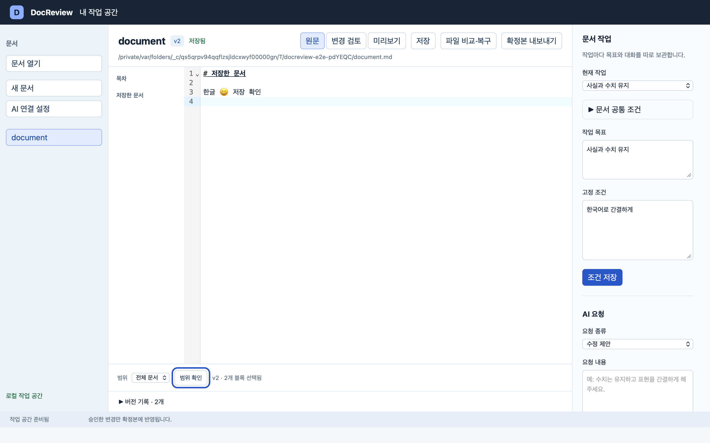
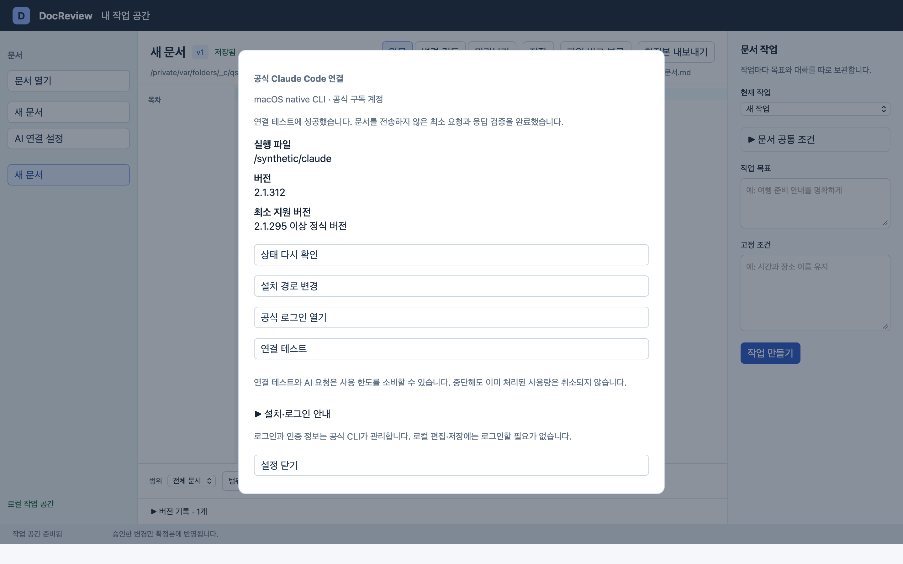
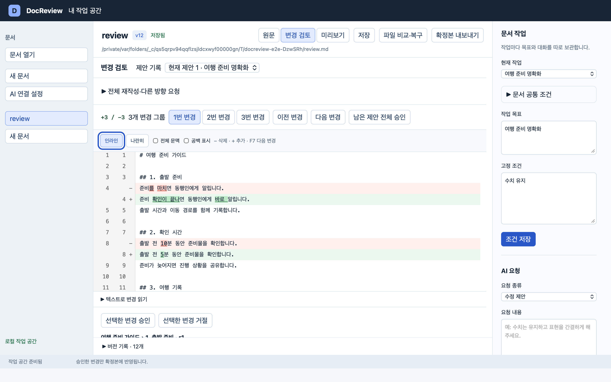
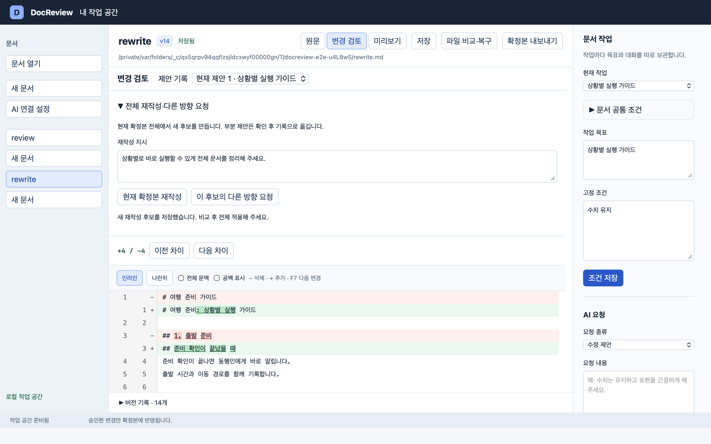
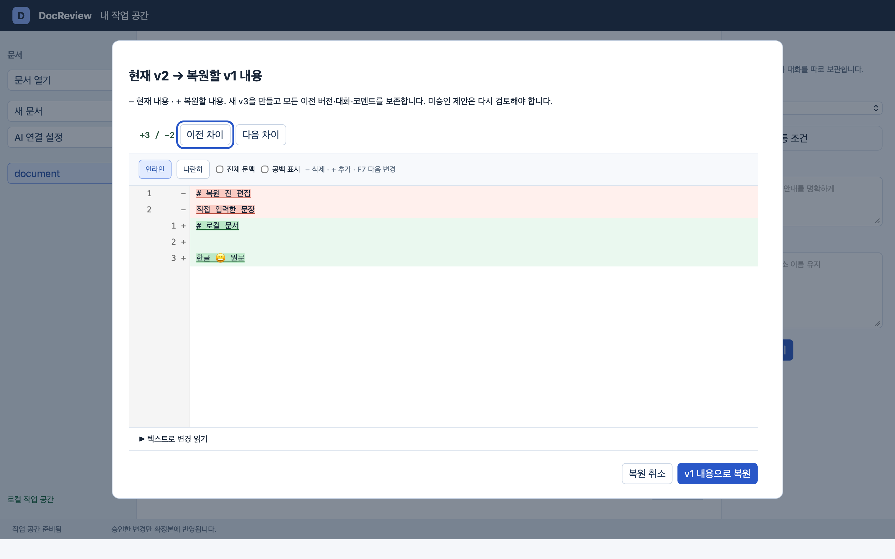
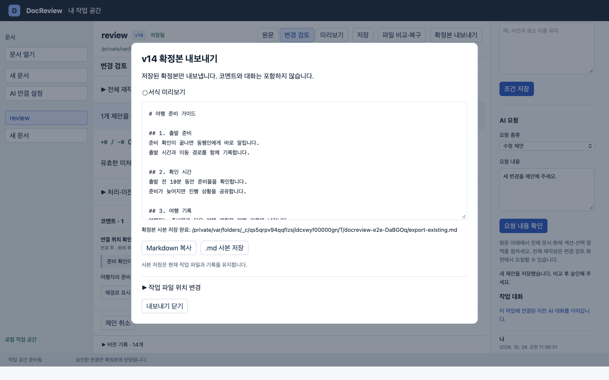

# DocReview

AI가 제안한 Markdown 수정을 실제 diff로 확인하고, 원하는 변경만 승인하며, 코멘트로 수정 방향을 조정하는 macOS용 로컬 설치형 앱이다.

문서 편집·AI 제안 검토·부분 승인·코멘트 재제안·전체 재작성·버전 복원·확정본 내보내기를 제공한다. [설치와 데이터 보존](docs/installation.md), [개발 환경](apps/desktop/README.md), [테스트와 검증 범위](docs/development/testing.md)를 참고한다.

[앱 사용법](#앱-사용법) · [AI 연결](#2-ai-연결-설정) · [변경 승인](#5-변경-검토와-승인) · [문제 해결](#9-실패-복구와-다음-작업-재개) · [설계·개발 자료](#설계개발-자료)

## 설치와 개발

소스 저장소 이름은 `diffraft`이며 앱 이름은 **DocReview**다. macOS 14 이상·Apple Silicon을 목표로 한다.

현재 GitHub에는 소스를 제공하며 설치 파일은 아직 게시하지 않았다. 향후 설치 파일은 [GitHub Releases](https://github.com/soob-forest/diffraft/releases)에서 별도로 제공한다. 로컬 도구·빌드 결과물·테스트 로그·사용자 데이터는 저장소에 포함하지 않는다.

직접 빌드하려면 [개발 환경과 실행 방법](apps/desktop/README.md#준비)을 따라 Node·Rust·Xcode Command Line Tools를 준비한다. 앱·DMG 생성은 [설치 파일 만들기](docs/installation.md#설치-파일-만들기)를 참고한다.

## 앱 사용법

DocReview **0.1.0** 사용법이다. 기존 이미지는 2026-10-28 화면이며 모델 선택 설명은 2026-10-29 구현을 반영한다. 아래 이미지는 실제 macOS 앱의 자동 검사에서 테스트 문서·가짜 CLI 응답으로 촬영한 화면이다. 문서 내용·버전 번호·경로는 예시이며 연결 화면의 `/synthetic/claude`도 테스트 경로다. 이미지를 클릭하면 원본 크기로 볼 수 있다.

**직접 편집한 원문은 자동 저장된다. AI의 수정 제안은 승인해야 원문 파일에 반영된다.**

처음 사용하는 순서는 **문서 열기 → AI 연결 → 작업 만들기 → 범위 선택·AI 요청 → 변경 검토·승인 → 확정본 내보내기**다. 로컬 문서 편집·저장에는 AI 로그인이 필요하지 않다.

### 1. 화면 구성과 문서 편집

[](docs/usage/images/workspace.png)

| 위치 | 기능 |
| --- | --- |
| 왼쪽 | `문서 열기`, `새 문서`, `AI 연결 설정`, 문서 목록 |
| 중앙 상단 | 문서명·버전·저장 상태, `원문`·`변경 검토`·`미리보기`, 저장·복구·내보내기 |
| 중앙 본문 | 원문 편집, 목차 이동, AI 변경 비교 |
| 원문 아래 | 요청 범위 선택·확인, `버전 기록` |
| 오른쪽 | 현재 작업·목표·조건, `AI 요청`, `작업 대화` |
| 앱 맨 위 | AI 처리 상태와 요청 중 표시되는 `생성 중단` |

1. 왼쪽 `문서 열기`로 Markdown 파일을 선택하거나 `새 문서`를 누른다.
2. 중앙 `원문`에서 내용을 편집한다. 입력은 자동 저장되며 상단 `저장됨`을 확인한다. 즉시 저장하려면 `저장`을 누른다.
3. `미리보기`에서 Markdown 서식을 확인한다. 편집은 `원문`으로 돌아가서 한다.

오른쪽 패널에 필요한 항목이 보이지 않으면 패널 안을 아래로 스크롤한다. 문서의 실제 저장 위치는 중앙 상단 경로에 표시된다.

### 2. AI 연결 설정

[](docs/usage/images/ai-connection.png)

1. 왼쪽 `AI 연결 설정`을 누른 뒤 `상태 다시 확인`을 누른다.
2. 실행 파일·감지 버전·최소 지원 버전·인증 안내를 확인한다. 현재 앱은 공식 native Claude Code **2.1.295 이상 정식 버전**, **개인 구독을 포함한 공식 구독의 firstParty 인증 경로**와 필수 실행 옵션을 확인한다.
3. 로그인이 필요하면 `공식 로그인 열기`를 사용한다. 창이 열리지 않으면 `설치·로그인 안내`에 표시된 `claude auth login`을 터미널에서 실행한 뒤 상태를 다시 확인한다.
4. 실행 파일을 찾지 못하면 `설치 경로 변경`에서 공식 CLI 실행 파일을 선택한다. CLI 설치가 필요하면 `설치·로그인 안내 → 공식 설치 안내 열기`를 사용한다.
5. 연결 준비 상태에서 `연결 테스트`를 누른다. 성공 안내를 확인한 뒤 `설정 닫기`를 누른다.

`기본 모델`에서 `CLI 기본값 / Sonnet / Opus / Haiku`를 선택하고 `모델 설정 저장`을 누른다. CLI 설치·로그인 전에도 저장할 수 있으며 앱을 다시 열어도 유지된다. `CLI 기본값`은 모델 인자를 지정하지 않고 Claude Code의 선택을 따른다. 사용 가능한 모델은 계정·조직 정책에 따라 달라진다.

저장한 값은 새 요청을 확인할 때 고정된다. 확인 화면과 실패 요청 안내의 `요청 모델`을 확인한다. 기존 요청 재시도는 당시 선택을 유지하므로 모델을 바꾸어 호출하려면 새 요청을 작성한다. 미저장 선택에서는 연결 테스트를 실행할 수 없다.

로그인과 인증 정보는 공식 CLI가 관리한다. 연결 테스트와 AI 요청은 사용 한도를 소비할 수 있으며, 중단해도 이미 처리된 사용량은 취소되지 않는다.

### 3. 문서 작업 만들기

오른쪽 `현재 작업 → 새 작업`을 선택하고 아래 조건을 입력한 뒤 `작업 만들기`를 누른다. **작업을 만들거나 기존 작업을 선택해야 아래에 AI 요청이 표시된다.**

| 항목 | 용도 | 예시 |
| --- | --- | --- |
| 작업 목표 | 이번 작업에서 달성할 목적 | 처음 사용하는 사람을 위한 설명 작성 |
| 고정 조건 | 이 작업에서 유지할 사항 | 제품명과 수치는 변경하지 않기 |
| 문서 공통 조건 | 이 문서의 모든 작업에서 사용할 독자·용어·문체 | 비개발자 대상, 존댓말, 용어 통일 |

기존 작업을 수정했다면 `조건 저장`을 누른다. 문서 공통 조건은 펼친 뒤 `공통 조건 저장`을 누른다. 조건은 다음 요청부터 사용되며 작업마다 대화를 따로 보관한다.

### 4. 요청 범위를 정하고 AI 요청하기

1. 중앙 `원문` 아래의 `범위`를 선택한다. `전체 문서`는 전체 원문, `현재 섹션`은 커서가 있는 섹션, `선택 영역`은 드래그한 텍스트를 기준으로 한다.
2. `범위 확인`으로 저장 버전과 선택된 블록 수를 확인한다. 원문이나 선택을 바꿨다면 다시 확인한다.
3. 오른쪽 `AI 요청 → 요청 종류`에서 `수정 제안` 또는 `설명만 받기`를 선택하고 `요청 내용`을 입력한다.
4. `요청 내용 확인`을 누르고 확인창의 `전달할 원문`과 요청 내용을 살펴본 뒤 `확인 후 요청`을 누른다.

| 요청 종류 | 결과 확인 위치 | 원문 반영 |
| --- | --- | --- |
| 수정 제안 | 중앙 `변경 검토` | 변경을 승인하면 반영 |
| 설명만 받기 | 오른쪽 `작업 대화` | 답변을 대화에만 저장 |

빈 문서의 초안을 만들 때도 `수정 제안`을 사용한다. 예를 들어 다음처럼 입력한다.

> 이 도구의 목적, 주요 기능, 처음 사용하는 사람의 사용 순서를 작성해 주세요.

요청에는 선택한 원문 범위와 작업 목표·조건·대화·코멘트·최근 결정 등 작업 맥락이 전달된다. 처리 중에는 앱 맨 위 `생성 중단`을 사용할 수 있다.

### 5. 변경 검토와 승인

[](docs/usage/images/change-review.png)

1. `수정 제안`이 성공하면 중앙이 `변경 검토`로 전환된다. 상단 버튼으로 직접 전환할 수도 있다.
2. `인라인`은 삭제·추가를 한 화면에, `나란히`는 변경 전후를 좌우에 보여준다. `−`는 삭제, `+`는 추가다. 필요하면 `전체 문맥`, `공백 표시`, `텍스트로 변경 읽기`를 사용한다.
3. `1번 변경` 등의 번호 또는 `이전 변경`·`다음 변경`으로 검토할 그룹을 선택한다. 비교 영역에서 F7로 다음 변경으로 이동할 수도 있다.
4. `선택한 변경 승인`은 해당 그룹을 확정본에 반영한다. `선택한 변경 거절`은 해당 변경을 반영하지 않는다.
5. 남은 유효 변경을 함께 반영하려면 `남은 제안 전체 승인`을 누르고 확인창에서 대상 변경을 확인한다.

화면 예시의 `10분 → 5분`처럼 고정 조건에 맞지 않는 수정도 있을 수 있으므로 승인 전에 내용을 확인한다. `제안 기록`으로 이전 묶음을 볼 수 있다. `제안 취소`는 해당 묶음의 미승인 제안을 취소하며, 이미 승인한 내용은 유지한다.

### 6. 후보 직접 수정과 코멘트·재제안

선택한 변경 아래에는 후보·코멘트·재제안 항목이 있다. 보이지 않으면 중앙 검토 영역을 아래로 스크롤한다.

| 원하는 작업 | 조작 순서 |
| --- | --- |
| 직접 후보 고치기 | `후보 직접 수정 → 새 후보 내용` 입력 → `후보 저장` → 비교 후 승인 |
| 의견 남기기 | `코멘트 남기기 → 대상 쪽` 선택 → 코멘트 입력 → `코멘트 저장` |
| AI에게 다시 요청 | `코멘트 반영·다시 제안 → 재제안 지시` 입력 → `재제안 요청` → 요청 모델 확인 → `확인 후 재제안` → 새 후보 비교·승인 |

후보 저장이나 코멘트 저장만으로 확정본이 바뀌지는 않는다. **코멘트 저장만으로 AI 재제안이 시작되지는 않으며 요청 모델을 확인한 뒤 `확인 후 재제안`을 눌러야 한다.**

### 7. 문서 전체 재작성

[](docs/usage/images/whole-rewrite.png)

1. 중앙 `변경 검토 → 전체 재작성·다른 방향 요청`을 펼친다.
2. `재작성 지시`를 입력하고 `현재 확정본 재작성`을 누른다.
3. 확인창에서 전체 문서 전달과 기존 부분 제안의 기록 이동 안내를 확인한 뒤 요청한다.
4. 생성된 전체 후보를 비교한다. 적용하려면 검토 영역 아래의 `이 재작성안 적용 → 확인 후 전체 적용`을 누른다. 전체 재작성은 구간별 승인 없이 문서 전체를 적용한다.

다른 결과를 원하면 해당 후보에서 `이 후보의 다른 방향 요청`을 사용할 수 있다. 이전 재작성안은 `제안 기록`에서 확인하고, 기준본이 유지된 경우 `이전 안 선택`으로 다시 선택할 수 있다. 선택만으로 파일에 적용되지는 않는다.

### 8. 버전 복원과 확정본 내보내기

[](docs/usage/images/version-restore.png)

중앙 하단 `버전 기록`을 펼치고 `v번호 비교·복원`을 누른다. 비교창에서 `− 현재 내용`, `+ 복원할 내용`을 확인한 뒤 `v번호 내용으로 복원`을 누른다. 복원은 이전 내용을 가진 **새 버전**을 만들고 기존 버전·대화·코멘트를 보존한다. 남아 있는 미승인 제안은 다시 검토해야 한다.

[](docs/usage/images/confirmed-export.png)

상단 `확정본 내보내기`를 누르고 내보낼 버전·내용을 확인한다.

| 버튼 | 동작 |
| --- | --- |
| Markdown 복사 | 저장된 확정본을 클립보드에 복사 |
| .md 사본 저장 | 현재 작업 파일과 기록을 유지하며 별도 파일로 저장 |
| 작업 파일 위치 변경 → 다른 이름으로 작업 파일 저장 | 이후 편집의 저장 경로를 새 파일로 변경하고 기존 파일·기록은 보존 |

미승인 제안·코멘트·대화는 내보내기에 포함하지 않는다. `서식 미리보기`로 내보낼 Markdown의 서식을 확인할 수 있다.

### 9. 실패 복구와 다음 작업 재개

| 상황 | 사용할 기능 |
| --- | --- |
| AI 요청 실패·중단 | 오른쪽 `작업 대화 → 마지막 요청 다시 실행`. 문서가 바뀌었다면 새 요청 작성 |
| AI 응답 형식 오류 | 기존 원문·후보를 확인한 뒤 직접 재요청. 재시도는 사용 한도를 추가로 소비할 수 있음 |
| 저장 오류 | 상단 안내를 확인하고 `저장 다시 시도` |
| 외부에서 파일 변경 | `파일 비교·복구`에서 차이를 확인하고 `외부 파일 사용` 또는 `수동으로 통합` |
| 미완료 저장 복구 필요 | `파일 비교·복구 → 저장 복구 실행` |
| 앱 내용을 별도 보존 | `파일 비교·복구 → 앱 내용 사본 저장` |

앱을 다시 열면 마지막 문서와 문서별 선택 작업으로 돌아온다. 왼쪽 문서와 오른쪽 `현재 작업`에서 기존 작업을 선택하면 대화·제안을 이어 확인할 수 있다. CLI 대화가 유실됐다는 안내가 나오면 다음 요청은 저장한 작업 맥락으로 새 대화를 시작한다.

앱 교체 전에는 정상 종료하고 작업 문서와 `~/Library/Application Support/local.diffraft.docreview/`를 함께 백업한다. 설치·교체·데이터 보존 절차는 [설치 안내](docs/installation.md#데이터-보존과-앱-교체)를 참고한다.

## 설계·개발 자료

- [문서 목차](docs/README.md): 제품 사양·설계·예시 안내
- [기능 명세](docs/product/specification.md)와 [인수 기준](docs/product/acceptance-criteria.md): 제품 동작과 경계 사례
- [개발 설계](docs/development/architecture.md)와 [Diff 구현 상세](docs/development/diff-implementation.md): 저장·승인·CLI·비교 구조
- [화면 갤러리](docs/design/gallery.html)와 [사용 시나리오](docs/design/scenarios.md): 정적 설계 화면과 예시 흐름

## 프로젝트 구조

```text
.
├── README.md
├── LICENSE
├── apps/desktop/                 # Tauri·React 앱과 Rust 코어·테스트
└── docs/
    ├── README.md                 # 문서 목차
    ├── installation.md           # 설치·백업·앱 교체
    ├── product/                  # 제품 범위·기능 명세·인수 기준
    ├── development/              # 아키텍처·diff·테스트 안내
    ├── design/                   # 시나리오·디자인 명세·화면 자산
    ├── examples/                 # 원문·후보·확정본 예시
    ├── usage/images/             # 사용법의 실제 앱 캡처
    └── references.md             # 공식 참고 자료
```

제품 동작의 기준은 기능 명세다. `docs/design/`의 정적 설계 화면은 위 사용법의 실제 앱 캡처와 구분한다. 지원 환경과 검증 한계는 [설치 안내](docs/installation.md#지원-환경과-제한)와 [테스트 안내](docs/development/testing.md#검증-범위와-한계)를 따른다.

## 라이선스

프로젝트 소스와 문서는 [MIT License](LICENSE)를 따른다. 사용 중인 외부 라이브러리와 도구에는 각각의 라이선스가 적용된다.
