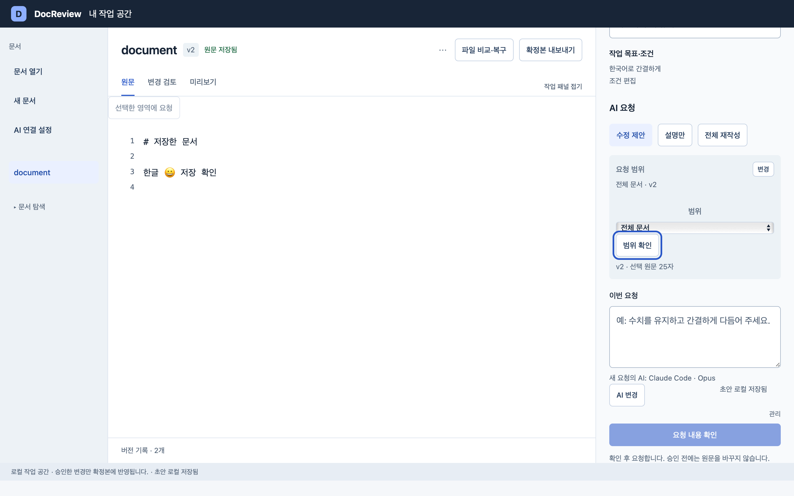
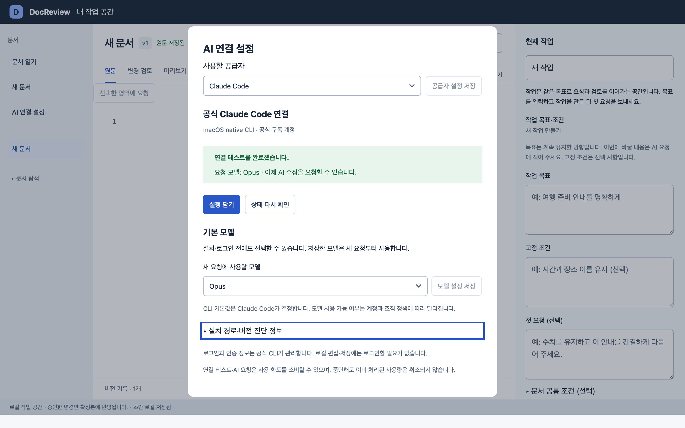
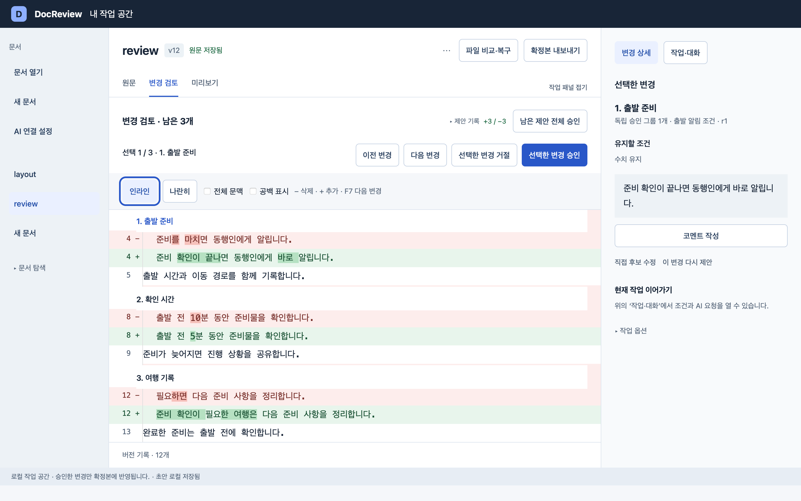
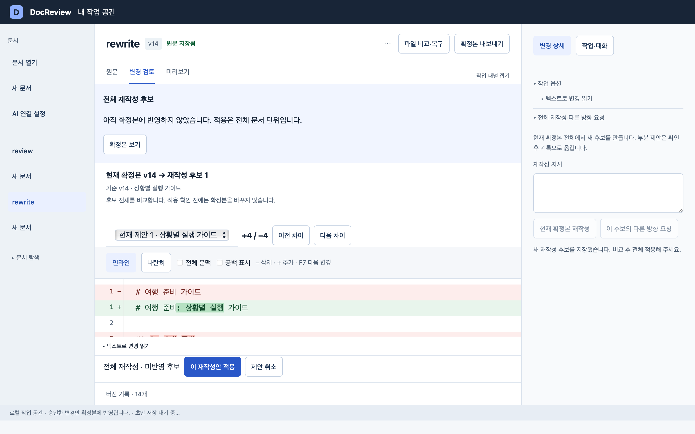
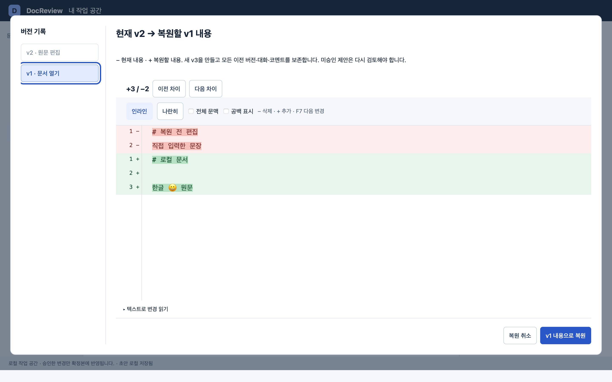
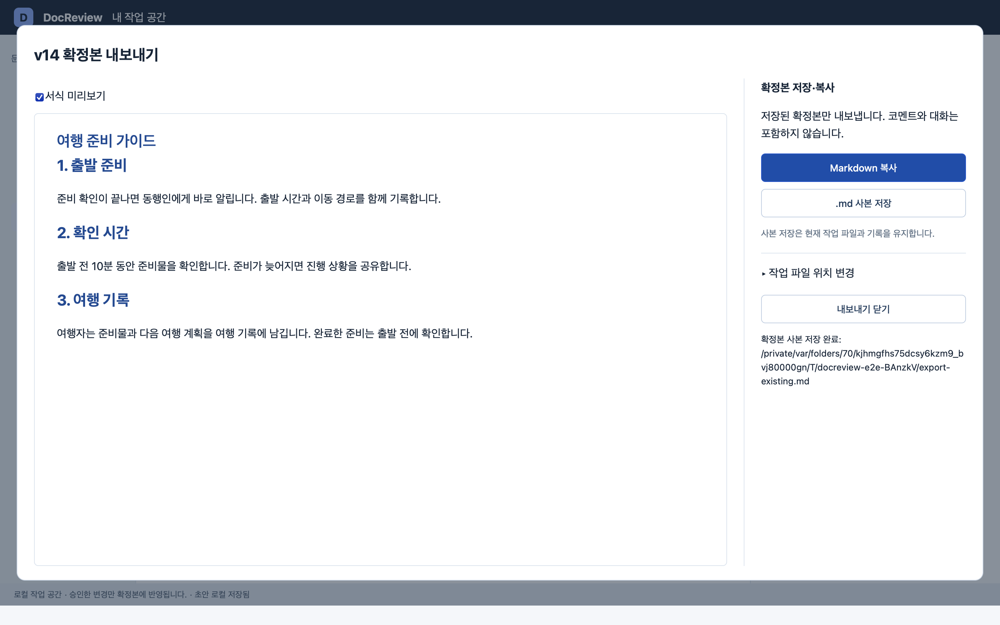

# DocReview

AI가 제안한 Markdown 수정을 실제 diff로 확인하고, 원하는 변경만 승인하며, 코멘트로 수정 방향을 조정하는 macOS용 로컬 설치형 앱이다.

문서 편집·AI 제안 검토·부분 승인·코멘트 재제안·전체 재작성·버전 복원·확정본 내보내기를 제공한다. [설치와 데이터 보존](docs/installation.md), [개발 환경](apps/desktop/README.md), [테스트와 검증 범위](docs/development/testing.md)를 참고한다.

[앱 사용법](#앱-사용법) · [AI 연결](#2-ai-연결-설정) · [변경 승인](#5-변경-검토와-승인) · [문제 해결](#9-실패-복구와-다음-작업-재개) · [설계·개발 자료](#설계개발-자료)

## 설치와 개발

소스 저장소 이름은 `diffraft`이며 앱 이름은 **DocReview**다. macOS 14 이상·Apple Silicon을 목표로 한다.

현재 GitHub에는 소스를 제공하며 설치 파일은 아직 게시하지 않았다. 향후 설치 파일은 [GitHub Releases](https://github.com/soob-forest/diffraft/releases)에서 별도로 제공한다. 로컬 도구·빌드 결과물·테스트 로그·사용자 데이터는 저장소에 포함하지 않는다.

직접 빌드하려면 [개발 환경과 실행 방법](apps/desktop/README.md#준비)을 따라 Node·Rust·Xcode Command Line Tools를 준비한다. 앱·DMG 생성은 [설치 파일 만들기](docs/installation.md#설치-파일-만들기)를 참고한다.

## 앱 사용법

DocReview **0.1.0**의 사용법이다. 문서 정리·설정 위치·패널 조절은 [11월 10일 구현 기록](docs/development/workspace-panels.md)을, 요청·질문·처리 기록은 [11월 5일 실제 앱 캡처와 출처](docs/usage/request-workflow/README.md)를 따른다. 아래 일반 기능 이미지는 11월 1일, [이전 선택 수정 캡처](docs/usage/ux/README.md)는 11월 2일 자료로 현재 설정 위치와 다르다. 현재 조작은 아래 설명과 [화면 계약](docs/design/ux-runtime-contract.md), 검사 결과·남은 인수는 [요청 흐름 실행 기록](docs/development/request-workflow-implementation.md)을 따른다. 이전 기능·설치 앱 상태는 [UX 개선 현재 상태](docs/development/ux-status.md)에 구분했다. 이미지는 합성 문서·가짜 CLI로 촬영했으며 `/synthetic/claude`도 테스트 경로다.

**직접 편집한 원문은 자동 저장된다. AI의 수정 제안은 승인해야 원문 파일에 반영된다.**

처음 사용하는 순서는 **문서 열기 → AI 연결 → 요청 작성·대상 확인 → 변경 검토·승인 → 확정본 내보내기**다. 로컬 문서 편집·저장에는 AI 로그인이 필요하지 않다.

### 1. 화면 구성과 문서 편집

[](docs/usage/images/workspace.png)

| 위치 | 기능 |
| --- | --- |
| 왼쪽 | `문서 열기`, `새 문서`, 일반·완료 문서 목록과 문서별 더보기·우클릭 메뉴 |
| 중앙 상단 | 문서명·버전·저장 상태, `원문`·`변경 검토`·`미리보기` 옆 `문서 탐색`, 저장·복구·내보내기 |
| 중앙 본문 | 원문 편집, 목차 이동, AI 변경 비교 |
| 본문 선택 옆·위·아래 | 선택 팝오버 / 편집 영향 안내 / 하단 `버전 기록` |
| 오른쪽 | `이 변경 / AI 요청·대화`, 요청 목적·대상·지시, 접힌 지속 조건과 작업 관리 |
| 앱 맨 위 | `문서 목록` 열기·닫기, AI 처리 상태와 `생성 중단`, 오른쪽 위 톱니바퀴 `AI 연결 설정` |

1. 왼쪽 `문서 열기`로 Markdown 파일을 선택하거나 `새 문서`를 누른다.
2. 중앙 `원문`에서 내용을 편집한다. 입력은 자동 저장되며 상단 `저장됨`을 확인한다. 즉시 저장하려면 문서 메뉴의 `저장`을 누른다.
3. `미리보기`에서 Markdown 서식을 확인한다. 편집은 `원문`으로 돌아가서 한다.

오른쪽 패널에 필요한 항목이 보이지 않으면 패널 안을 아래로 스크롤한다. 역할 탭과 `본문으로 돌아가기`는 패널 상단에 유지된다. 문서의 실제 저장 위치는 문서 메뉴에서 확인한다.

문서명 옆 더보기 버튼 또는 문서 행의 우클릭 메뉴에서 `완료로 이동`을 선택한다. 원문·조건·초안을 먼저 저장하며, 저장에 실패하면 목록과 현재 문서를 유지한다. 왼쪽 `완료한 문서`를 펼쳐 문서명을 누르거나 메뉴의 `다시 열기`를 선택하면 기존 문서로 돌아온다. 앱에서 만든 내부 문서도 완료 목록에서 바로 복구할 수 있다.

완료 문서의 메뉴에서 `목록에서 완전히 제거…`를 선택하고 확인하면 일반·완료 목록 양쪽에서 사라진다. **파일과 작업 이력은 삭제하지 않는다.** 이후에는 `문서 열기`에서 같은 파일을 선택해야 다시 사용할 수 있다. 목록 상태는 이 Mac의 웹뷰 설정에 보관하며 재실행 후에도 유지한다. 메뉴는 문서 행에 포커스를 둔 Shift+F10, 방향키, Enter, Esc로도 조작한다.

`문서 탐색`은 중앙의 보기 탭 옆에 있다. 원문에서는 목차, 변경 검토에서는 변경 목록을 제공한다. 왼쪽 문서 목록을 닫아도 사용할 수 있다. [문서 관리·탐색 보완 기록](docs/development/document-management-followup.md)에 대안과 저장 방식이 있다.

좌우 패널 경계선을 드래그해 너비를 바꾼다. 경계선에 포커스를 두고 좌우 방향키로도 조절할 수 있으며 Home/End는 최소/최대, 두 번 클릭은 기본 너비다. 왼쪽 `닫기`나 상단 `문서 목록`, 오른쪽 접기·열기 버튼으로 패널을 닫았다 다시 연다. 요청 패널의 너비·열림 상태는 같은 앱 세션의 문서 전환 후에도 유지한다. 중앙 본문은 남은 공간에 맞춰 조절된다. `버전 기록`은 펼친 뒤 아래쪽 조절점을 드래그해 높이를 바꿀 수 있다. 좁은 화면에서는 본문과 요청 패널을 한 영역씩 전환한다. [복구·패널 상태 보완 기록](docs/development/workspace-panels-followup.md)을 참고한다.

### 2. AI 연결 설정

[](docs/usage/images/ai-connection.png)

1. 오른쪽 위 톱니바퀴 `AI 연결 설정`을 열고 `Codex (ChatGPT 계정)` 또는 `Claude Code`를 선택한 뒤 `공급자 설정 저장`을 누른다. 새 데이터는 Codex가 기본이며, 기존 데이터는 Claude 선택을 유지한다.
2. **Codex:** 공식 CLI **0.165.0 이상**을 설치하고 기존 ChatGPT 로그인을 사용한다. `상태·모델 목록 조회`로 설치·인증·이용 가능한 모델을 확인한다. 로그인 필요 시 `ChatGPT 로그인 열기` 또는 터미널의 `codex login`을 사용한다. 실행 파일을 찾지 못하면 `설치 경로·버전 진단 정보`에 절대 경로를 저장한다. Claude 설치·계정이나 API 키는 필요하지 않다.
3. **Claude:** `상태 다시 확인`으로 공식 native Claude Code **2.1.295 이상 정식 버전**과 firstParty 구독 인증을 진단한다. `공식 로그인 열기`, `설치 경로 변경`과 기존 설치 안내를 사용한다. 위 이미지는 이 경로를 가짜 CLI로 검사한 화면이다.
4. `기본 모델`을 선택하고 `모델 설정 저장`을 누른다. Codex는 조회된 모델 또는 `Codex 기본값`, Claude는 `CLI 기본값 / Sonnet / Opus / Haiku`를 제공한다. 설치·로그인 전에도 기본값을 저장할 수 있다. Codex 목록 조회에 실패해도 저장한 선택을 유지한다.
5. `연결 테스트`로 실제 구조화 응답을 확인한 뒤 `설정 닫기`를 누른다. 상태·모델 조회 성공과 실제 생성 성공은 구분한다.

저장한 공급자·모델은 새 요청 확인 전에 고정된다. Codex 기본값도 이때 구체적인 모델 ID와 reasoning 값으로 확정한다. 확인·진행·실패 복구에서 `요청 공급자 / 모델`을 확인한다. 기존 요청 재시도는 당시 선택을 유지하므로 공급자나 모델을 바꾸려면 새 요청을 작성한다. 미저장 선택에서는 연결 테스트를 실행할 수 없다. 공급자별 세션과 Codex의 계정 범위를 분리하며 로컬 대화·후보는 보존한다.

로그인·인증 정보는 공식 CLI가 관리하며 앱은 토큰을 읽거나 복사하지 않는다. API 키·사용자 지정 과금 경로는 지원하지 않는다. 연결 테스트와 AI 요청은 사용 한도를 소비할 수 있으며, 중단해도 이미 처리된 사용량은 취소되지 않는다.

### 3. 요청부터 시작하기

작업이 없어도 오른쪽 `이번 요청`에 원하는 내용을 적는다. `요청 내용 확인`에서 내부 작업을 한 번 준비하며 `확인 후 요청` 전에는 AI를 실행하지 않는다. 확인 취소·재확인에는 같은 작업과 지시를 사용하고, 생성 전 초안도 이 Mac에 보관한다.

`계속 참고할 조건 (선택)`은 기본으로 접혀 있다. `작업 이름`은 표시용이며 AI에 전달할 지속 목표와 다르다. `이 작업에서 계속 참고할 방향`, `이 작업에서 유지할 조건`, 문서의 모든 작업에서 참고하는 `문서 공통 조건`을 필요할 때 입력한다. 첫 요청을 지속 목표로 자동 복사하지 않는다. 조건 변경 후에는 요청을 다시 확인하며 실행 중 요청에 소급하지 않는다.

다른 작업은 `작업 관리`에서 선택하고 새 작업은 `새 작업 시작…`을 고른다. 같은 이름은 목록의 보조 순번으로 구별하며 저장 이름·목표는 바뀌지 않는다. 작업마다 대화·제안·초안을 따로 보관한다.

### 4. 요청 범위를 정하고 AI 요청하기

1. 오른쪽 `AI 요청·대화`에서 `수정 제안 받기 / 질문하기`를 선택한다. 수정은 `기존 문장 다듬기 / 새 전체 초안 만들기`를 별도로 고른다. 각 방식의 지시는 따로 보관된다.
2. 일반 요청은 `요청 대상 → 변경`에서 전체·현재 섹션·선택 영역을 정하고 `범위 확인`으로 저장된 원문의 정확한 인용을 고정한다. 드래그만으로 요청 대상은 바뀌지 않는다.
3. `이번 요청`에 지시를 입력하고 `요청 내용 확인`에서 전달 원문·범위·모델·이전 제안 보관 영향을 확인한다.
4. `확인 후 요청`으로 실행한다. 전체 재작성은 문서 전체를 전달하며 결과에서 변경별 검토를 시작할 수 있다. 설명은 대화에만 저장된다.

일반 수정 생성은 성공 시 기존 활성 묶음을 기록으로 옮긴다. **기존 제안을 유지하며 원문의 일부만 요청하려면 원문 드래그 → 선택 옆 `이 부분 수정`**을 사용한다. 오른쪽에서 고정 인용·지시를 작성하고 `요청 내용 확인 → 확인 후 요청`으로 새 미승인 부분 제안을 만든다. 미승인 구간과 겹치면 해당 검토로 안내한다. 이후 한 묶음을 승인하면 다른 묶음의 기준이 바뀔 수 있다.

빈 문서에서도 `수정 제안 받기 → 기존 문장 다듬기`로 초안을 요청할 수 있다. 예를 들어 다음처럼 입력한다.

> 이 도구의 목적, 주요 기능, 처음 사용하는 사람의 사용 순서를 작성해 주세요.

요청에는 선택한 원문 범위와 작업 목표·조건·대화·코멘트·최근 결정 등 작업 맥락이 전달된다. 처리 중에는 앱 맨 위 `생성 중단`을 사용할 수 있다.

### 5. 변경 검토와 승인

[](docs/usage/images/change-review.png)

1. `기존 문장 다듬기`가 성공하면 중앙이 `변경 검토`로 전환된다. 상단 버튼으로 직접 전환할 수도 있다.
2. `인라인`은 삭제·추가를 한 화면에, `나란히`는 변경 전후를 좌우에 보여준다. `−`는 삭제, `+`는 추가다. 필요하면 `전체 문맥`, `공백 표시`, `텍스트로 변경 읽기`를 사용한다.
3. `1번 변경` 등의 번호 또는 `이전 변경`·`다음 변경`으로 검토할 그룹을 선택한다. 비교 본문에 포커스가 있을 때 F7은 다음 변경, Shift+F7은 이전 변경으로 이동한다.
4. `선택한 변경 승인`은 해당 그룹을 확정본에 반영한다. `선택한 변경 거절`은 해당 변경을 반영하지 않는다.
5. 남은 유효 변경을 함께 반영하려면 `남은 제안 전체 승인`을 누르고 확인창에서 대상 변경을 확인한다.

같은 요청의 서로 다른 위치도 독립적으로 검토한다. 줄바꿈·목록·표가 포함됐다는 이유만으로 요청 전체를 묶지 않으며, 참조·이동·연결된 구조 변경만 이유와 함께 결합한다. `선택 1 / 5`의 분모는 남은 그룹 수라서 하나를 결정하면 4개가 남는다. 기존 제안도 전부 미처리이고 현재 원문과 일치하면 검토를 열 때 AI 재요청 없이 나눈다. 일부 처리된 구형 묶음과 이전 기록은 자동 재분류하지 않는다. 하나의 큰 교체 제안 내부를 문장별로 다시 나누지는 않는다. [구현·검증 기록](docs/development/patch-groups-implementation.md)을 참고한다.

화면 예시의 `10분 → 5분`처럼 고정 조건에 맞지 않는 수정도 있을 수 있으므로 승인 전에 내용을 확인한다. `제안 기록`으로 이전 묶음을 볼 수 있다. `제안 취소`는 해당 묶음의 미승인 제안을 취소하며, 이미 승인한 내용은 유지한다.

### 6. 후보 직접 수정과 코멘트·재제안

변경 상세는 오른쪽 패널에서 연다. 제안 쪽의 문장·문단을 선택하면 가까운 곳에 `이 부분 수정 / 코멘트` 팝오버가 뜬다. `이 부분 수정`으로 지시를 한 번 작성한다. `더보기 → 이 문장 선택 / 이 문단 선택`은 범위를 먼저 보여주며, 모호한 Markdown은 드래그로 지정한다. 키보드는 선택 후 Cmd+Shift+Enter, 선택 행동은 Shift+F10으로 열고 Enter로 진입하며 Esc로 편집기에 복귀한다.

`요청 내용 확인`에서 인용·참고 문맥·저장 코멘트·모델을 확인한 뒤 `확인 후 요청`으로 실행한다. 선택 밖 문구와 다른 제안은 유지되며 새 후보도 미승인이다. `이 부분 직접 고치기`는 AI 없이 해당 후보 부분만 저장한다. 확정 본문의 새 부분 제안은 별도 활성 묶음이며, 재작성 후보의 부분 수정은 전체 적용 원칙을 유지한다.

| 원하는 작업 | 조작 순서 |
| --- | --- |
| 직접 후보 고치기 | `직접 후보 수정 → 새 후보 내용` 입력 → `후보 저장` → 비교 후 승인 |
| 의견 남기기 | `코멘트 작성 → 대상 쪽` 선택 → 코멘트 입력 → `코멘트 등록` |
| AI에게 다시 요청 | `더 고치기`로 해당 후보를 열고 지시 작성 → `요청 내용 확인` → `확인 후 요청` → 새 후보 비교·승인 |

후보 저장이나 코멘트 등록만으로 확정본이 바뀌지는 않는다. `더 고치기 → 이번 요청 → 요청 내용 확인 → 확인 후 요청`으로 지시·저장 코멘트와 모델을 확인해 실행한다. 확인 후 조건·모델을 바꾸면 지시는 유지하고 다시 확인한다. 설정을 조회하고 저장 없이 닫는 경우에는 확인을 유지한다.

원문·후보의 `이 부분 수정`을 취소하려면 다른 본문 위치를 한 번 클릭한다. 작성 화면과 선택 고정은 해제하고 지시·정확한 대상은 초안으로 남긴다. `선택 수정 초안 이어쓰기`로 다시 열고 요청 내용을 재확인한다. 새 드래그·스크롤·작성기 조작은 취소 클릭으로 처리하지 않는다. 저장에 실패하면 창을 유지하고 복구 안내를 표시한다.

### 7. 문서 전체 재작성

[](docs/usage/images/whole-rewrite.png)

1. 오른쪽 `AI 요청·대화 → 수정 제안 받기 → 새 전체 초안 만들기`을 선택하고 지시를 입력한다.
2. `요청 내용 확인`을 누른다. 기존 전체 후보를 참고한 다른 방향은 `이 후보를 참고해 다른 방향 만들기`에서 같은 작성기를 연다.
3. 확인창에서 전체 문서 전달과 기존 부분 제안의 기록 이동 안내를 확인한 뒤 요청한다.
4. 생성된 전체 후보를 비교하고 주요 버튼 `변경별 검토 시작`을 누른다. 추가 AI 호출 없이 문단과 연결된 구조 변경을 승인 단위로 나눈다. 시작 전에는 보조 버튼 `이 재작성안 적용 → 확인 후 전체 적용`도 사용할 수 있다.
5. `미처리 / 처리됨 / 전체`에서 읽을 범위를 고르고 목록이나 `변경 선택`, `이전 / 다음`으로 이동한다. 시각 비교 본문에 포커스를 둔 F7/Shift+F7도 같은 필터 안에서 이동한다. 번호는 승인·거절 후에도 유지된다. 필터 결과가 비면 선택과 단위 행동이 비활성화된다.
6. `변경 N 승인`은 그 단위의 모든 관련 변경을 즉시 원문에 저장한다. `변경 N 거절`은 원문을 유지한다. 성공 후 다음 미처리 단위의 제목으로 이동하며 마지막 단위 뒤에는 완료를 알린다. `남은 N개 승인…`은 진행 상태 옆에서, 좁은 창에서는 `검토 도구`에서 열어 포함 대상을 확인한 뒤 실행한다.

긴 단위 제목과 결합 이유는 `검토 도구`의 변경 정보에서 확인한다. 결합 단위의 `관련 위치 선택`과 옆 `이동`으로 각 범위를 읽는다. 선택 범위에는 같은 번호와 좌측 표식이 표시된다. 본문을 스크롤해도 승인 대상은 바뀌지 않으며, 선택한 변경이 화면 밖이면 이동 안내를 사용한다. 작은 창·확대 화면에서는 핵심 선택·결정 도구를 유지하고 본문이나 작성 패널 안에서 스크롤한다.

변경별 검토의 `코멘트`는 선택한 변경의 제안 전체에 대한 의견이다. 원문/후보나 인용 범위를 고르지 않는다. 버튼 가까이에서 **코멘트 등록 결과**와 **이 입력의 기기 보관 상태**를 따로 확인한다. 초안이 기기에 저장돼도 코멘트가 등록된 것은 아니다. 보관 실패·미확인에는 `초안 보관 재시도`, 등록 실패에는 `코멘트 다시 등록`을 사용한다. 초안 보관 재시도는 의견을 등록하지 않는다. 등록 성공은 제출한 동일 입력만 비우며 새 입력과 다른 단위의 초안은 유지한다. 등록은 AI 요청이나 승인을 실행하지 않는다.

코멘트 입력의 Enter는 줄바꿈이고 Esc는 초안을 유지한 채 진입 버튼으로 돌아간다. 좁은 화면에서 `본문으로 돌아가기`로 복귀해 같은 단위의 검토를 이어간다. 기기에 보관된 초안·선택·보기 설정은 재실행 후 복원된다. 처리된 변경도 목록에서 읽고, 거절한 변경은 `다시 검토`로 같은 번호와 의견을 유지하며 재개한다.

현재 비교는 `현재 확정본 · vN → 제안 반영 예상본 · 미승인 포함`이다. 거절한 내용은 예상본에서 제외된다. `검토 도구 → 원래 전체 후보 보기`는 `당시 기준본 · vN → 원래 전체 후보 · 읽기 전용`을 보여준다. 비교 영역의 `텍스트로 변경 읽기`는 표시 중인 같은 비교의 단위번호·선택·삭제/추가·행 번호를 읽는 방식이다. 펼치면 시각 비교 대신 텍스트를 읽고, 접으면 본문으로 돌아간다. 원래 후보 조회 실패에는 `다시 불러오기`, 현재 비교로 복귀하려면 `현재 검토로 돌아가기`를 사용한다. 버전을 확인할 수 없으면 미상으로 표시한다.

현재/원래 비교를 왕복하면 각각 읽던 위치를 유지한다. 텍스트 읽기에서 단위나 관련 위치를 선택하면 해당 페이지의 변경 행으로 이동한다. 다른 페이지를 수동으로 읽다가 돌아오려면 `선택한 변경 읽기`를 사용한다. 승인 실패·잠김 이유는 작은 창에서도 검토 도구 밖에 표시되며, 줄인 안내의 전문은 검토 도구에서 확인한다.

변경별 검토를 시작한 뒤에는 전체 적용·후보 수정·단위 재제안을 사용할 수 없다. 내용 수정은 `확정본에서 새 요청`으로 이동한 뒤 원문의 정확한 범위를 다시 선택한다. 새 재작성 실패·중단 시 기존 검토를 유지하고 성공 후 이전 검토를 이력으로 옮긴다.

변경별 검토 시작 전에는 해당 후보에서 `이 후보를 참고해 다른 방향 만들기`를 사용할 수 있다. 이전 재작성안은 `제안 기록`에서 확인하고, 기준본이 유지된 경우 `이전 안 선택`으로 다시 선택할 수 있다. 선택만으로 파일에 적용되지는 않는다.

`이유 묻기`는 검토 중인 변경의 전후 내용과 수정안을 고정해 같은 요청 작성기에서 질문한다. 변경별 검토는 해당 단위 전체가 대상이다. 답변의 `질문한 제안 보기`로 원래 대상에 돌아가며, 답변만으로 문서·제안·승인 상태를 바꾸지 않는다. AI가 설명한 이유는 검토 참고 정보다. PATCH와 WHOLE 후보의 `더 고치기`는 그 후보를 대상으로 열고, CHANGES는 확정 원문을 다시 선택한다.

처리 기록은 `승인됨/거절됨 · 대상 제목 · 변경 요약`으로 읽는다. 첫 수정안의 r1은 기본 화면에서 숨기며 이후 차수는 실제 revision에 맞춰 `수정안 N`으로 표시한다. 일반 검토를 마치면 확정본 보기와 추가 요청을 먼저 제공하고, 당시 비교는 `이번 검토 기록 · 비교와 표시 설정`에서 펼친다. 실행 범위와 수동 인수 대기는 [구현 기록](docs/development/request-workflow-implementation.md)과 [보완 기록](docs/development/request-workflow-followup.md)을 따른다. 과거 캡처는 현재 화면의 완료 근거와 구분한다.

### 8. 버전 복원과 확정본 내보내기

[](docs/usage/images/version-restore.png)

중앙 하단 `버전 기록`을 펼치고 `v번호 비교·복원`을 누른다. 비교창에서 `− 현재 내용`, `+ 복원할 내용`을 확인한 뒤 `v번호 내용으로 복원`을 누른다. 복원은 이전 내용을 가진 **새 버전**을 만들고 기존 버전·대화·코멘트를 보존한다. 남아 있는 미승인 제안은 다시 검토해야 한다.

[](docs/usage/images/confirmed-export.png)

상단 `확정본 내보내기`를 누르고 내보낼 버전·내용을 확인한다.

| 버튼 | 동작 |
| --- | --- |
| Markdown 복사 | 저장된 확정본을 클립보드에 복사 |
| .md 사본 저장 | 현재 작업 파일과 기록을 유지하며 별도 파일로 저장 |
| 작업 파일 위치 변경 → 다른 이름으로 작업 파일 저장 | 이후 편집의 저장 경로를 새 파일로 변경하고 기존 파일·기록은 보존 |

미승인 제안·코멘트·대화는 내보내기에 포함하지 않는다. `서식 미리보기`로 내보낼 Markdown의 서식을 확인할 수 있다.

### 9. 실패 복구와 다음 작업 재개

| 상황 | 사용할 기능 |
| --- | --- |
| AI 요청 실패·중단 | 오른쪽 `작업 대화 → 마지막 요청 다시 실행`. 문서가 바뀌었다면 새 요청 작성 |
| AI 응답 형식 오류 | 기존 원문·후보를 확인한 뒤 직접 재요청. 재시도는 사용 한도를 추가로 소비할 수 있음 |
| 저장 오류 | 상단 안내를 확인하고 `저장 다시 시도` |
| 외부에서 파일 변경 | `파일 비교·복구`에서 차이를 확인하고 `외부 파일 사용` 또는 `수동으로 통합` |
| 미완료 저장 복구 필요 | `파일 비교·복구 → 저장 복구 실행` |
| 앱 내용을 별도 보존 | `파일 비교·복구 → 앱 내용 사본 저장` |

요청·선택 수정·코멘트·후보 수정 초안은 SQLite에 보관하고 실제 저장 상태와 재시도를 표시한다. 저장된 초안은 앱 재실행 후 복원되며 자동 전송하지 않는다. 오래된 대상은 다시 선택·확인해야 한다. 강제 종료 직전 아직 저장하지 않은 입력까지 보장하지는 않는다.

원문과 변경 검토는 마지막 작성 대상을 각각 기억한다. 원문 요청 중 보기를 바꿔도 실행 상태를 유지한다. 다른 작업으로 이동하면 작성창은 닫히고 초안은 보관되며, 이전 작업의 요청이 완료돼도 현재 작업을 바꾸지 않는다.

작업 대화의 `이 요청의 변경 보기`는 해당 묶음·revision을 연다. 이전 후보·처리 기록은 중앙에서 당시 기준으로 비교한다. 앱을 다시 열면 마지막 문서와 문서별 선택 작업으로 돌아온다. 왼쪽 문서와 오른쪽 `작업 관리`에서 기존 작업을 선택하면 대화·제안을 이어 확인할 수 있다. CLI 대화가 유실됐다는 안내가 나오면 다음 요청은 저장한 작업 맥락으로 새 대화를 시작한다.

앱 교체 전에는 정상 종료하고 작업 문서와 `~/Library/Application Support/local.diffraft.docreview/`를 함께 백업한다. 설치·교체·데이터 보존 절차는 [설치 안내](docs/installation.md#데이터-보존과-앱-교체)를 참고한다.

## 설계·개발 자료

- [문서 목차](docs/README.md): 제품 사양·설계·예시 안내
- [기능 명세](docs/product/specification.md)와 [인수 기준](docs/product/acceptance-criteria.md): 제품 동작과 경계 사례
- [개발 설계](docs/development/architecture.md)와 [Diff 구현 상세](docs/development/diff-implementation.md): 저장·승인·CLI·비교 구조
- [화면 갤러리](docs/design/gallery.html)와 [사용 시나리오](docs/design/scenarios.md): 정적 설계 화면과 예시 흐름

## 프로젝트 구조

```text
.
├── README.md
├── LICENSE
├── apps/desktop/                 # Tauri·React 앱과 Rust 코어·테스트
└── docs/
    ├── README.md                 # 문서 목차
    ├── installation.md           # 설치·백업·앱 교체
    ├── product/                  # 제품 범위·기능 명세·인수 기준
    ├── development/              # 아키텍처·diff·테스트 안내
    ├── design/                   # 시나리오·디자인 명세·화면 자산
    ├── examples/                 # 원문·후보·확정본 예시
    ├── usage/images/             # 사용법의 실제 앱 캡처
    ├── usage/ux/                 # 선택 수정·전환의 실제 화면과 출처
    └── references.md             # 공식 참고 자료
```

제품 동작의 기준은 기능 명세다. `docs/design/`의 정적 설계 화면은 위 사용법의 실제 앱 캡처와 구분한다. 지원 환경과 검증 한계는 [설치 안내](docs/installation.md#지원-환경과-제한)와 [테스트 안내](docs/development/testing.md#검증-범위와-한계)를 따른다.

## 라이선스

프로젝트 소스와 문서는 [MIT License](LICENSE)를 따른다. 사용 중인 외부 라이브러리와 도구에는 각각의 라이선스가 적용된다.
