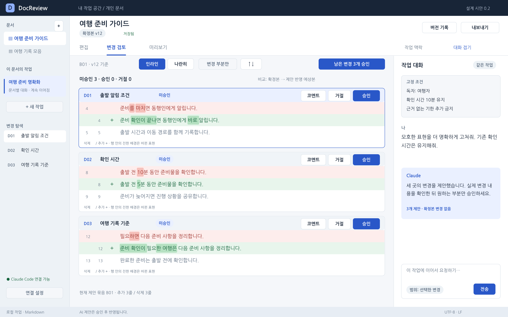

# 프로젝트 문서

DocReview의 사용·설치·제품 동작·개발 구조를 설명한다. 실제 앱 사용은 [화면별 사용법](../README.md#앱-사용법), 소스 실행은 [개발 환경](../apps/desktop/README.md)을 참고한다.

## 문서 안내

| 문서 | 내용 |
| --- | --- |
| [설치와 데이터 보존](installation.md) | 지원 환경·앱/DMG 생성·백업·앱 교체 |
| [제품 범위](product/prd.md) | 대상 사용자·기능 범위·검토 원칙 |
| [기능 명세](product/specification.md) | 화면 동작·승인·범위·저장·오류 계약 |
| [인수 기준](product/acceptance-criteria.md) | 정상·실패·경계 사례의 기대 결과 |
| [개발 설계](development/architecture.md) | 기술 선택·CLI·세션·데이터 모델·복구·IPC |
| [Diff 구현 상세](development/diff-implementation.md) | projection·승인 그룹·코멘트 앵커·비교 표시 |
| [테스트 안내](development/testing.md) | 검사 명령·가짜 CLI·네이티브 E2E·검증 한계 |
| [사용 시나리오](design/scenarios.md) | 예시 문서와 화면별 시작 조건·조작·결과 |
| [디자인 명세](design/design-guide.md) | 화면 구조·컴포넌트·색·타이포그래피·접근성 |
| [화면 갤러리](design/gallery.html) | 설계 화면 11개의 독립 HTML 갤러리 |
| [예시 문서](examples/) | 원문·후보·확정본·전체 재작성 fixture |
| [사용법 이미지](usage/images/README.md) | 실제 앱 캡처의 출처와 갱신 방법 |
| [공식 참고 자료](references.md) | 설계에 참고한 공식 문서 |

## 설계 화면과 예시

`design/assets/screens/`에는 편집 가능한 SVG와 3200×2000 PNG가 있다. `design/assets/screen-manifest.json`은 화면 ID·설명·상대 경로, `design/assets/design-tokens.json`은 색·글꼴·간격 기준을 담는다. 갤러리는 PNG를 내장해 HTML 하나만으로 볼 수 있다.

설계 화면의 버튼은 정적 시안이며 실제 앱의 화면은 [사용법](../README.md#앱-사용법)에 있다. 예시의 관계·행 번호·버전별 분기는 [시나리오의 예시 안내](design/scenarios.md#2-예시-문서와-버전)를 따른다.

제품 동작은 기능 명세를 기준으로 하고, 인수 기준은 그 동작의 확인 조건이다. 요구사항 `FR`·`INV`·`AT`, 화면 `S`, 시나리오 `SC`, 예시 `D`·`B`·`W` 식별자와 파일 간 상대 위치를 유지한다.
