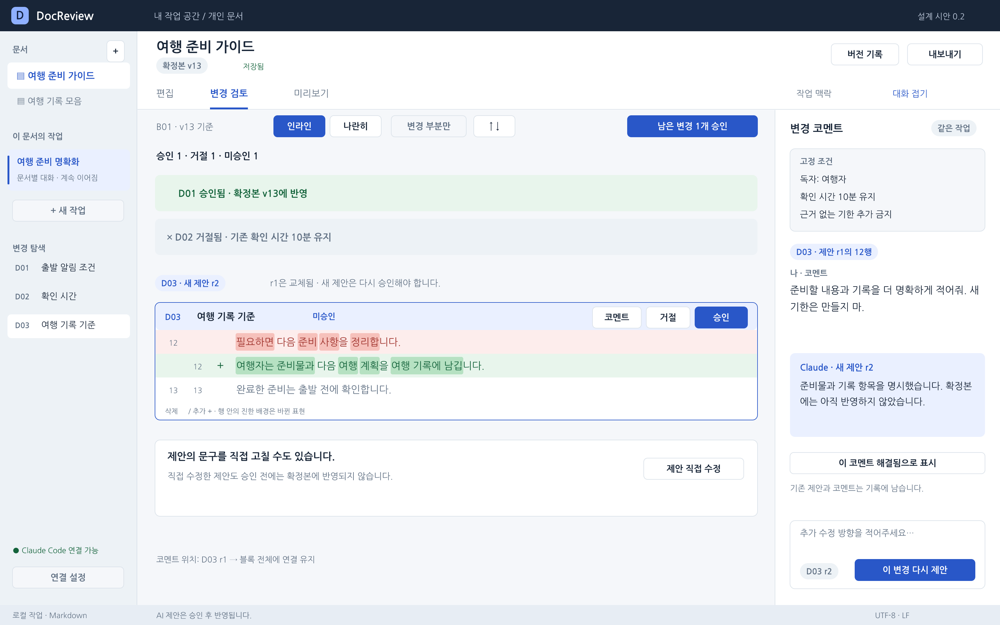
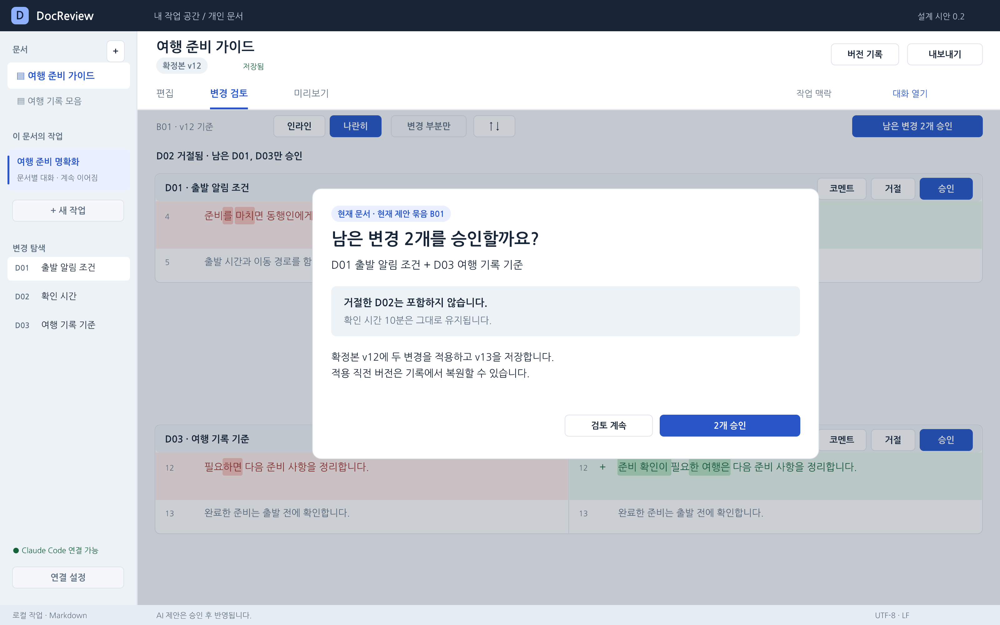
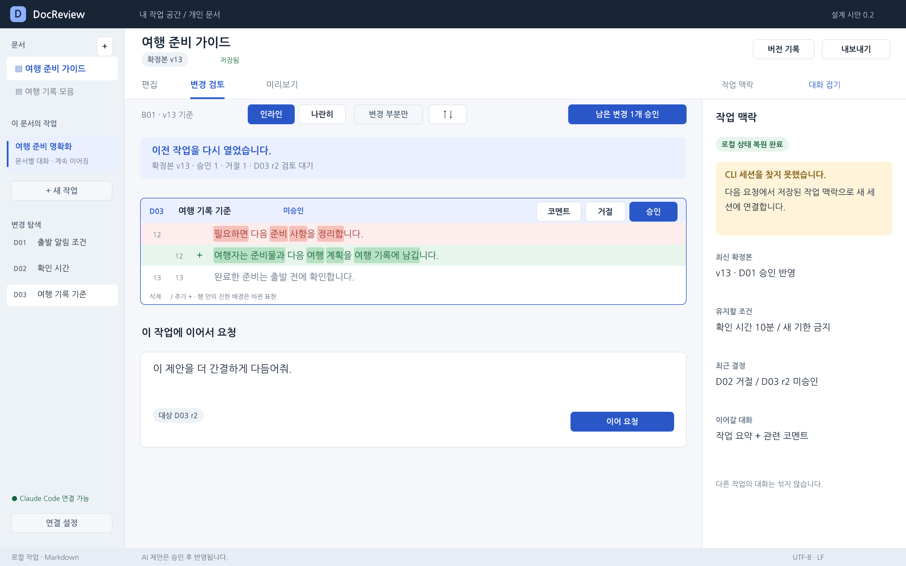
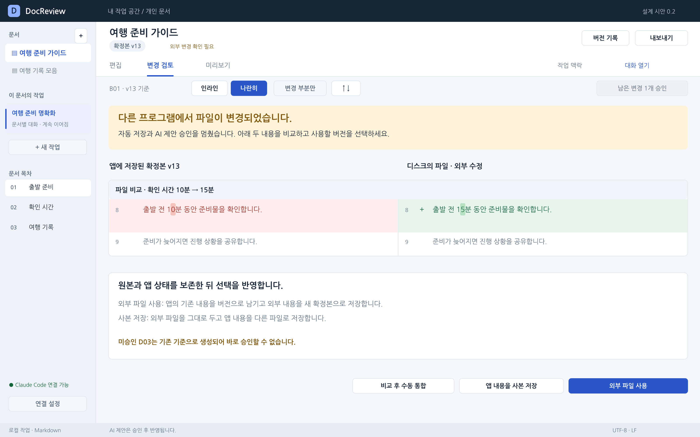

# 시나리오별 화면 설계

버전 0.2 · 2026-10-26 · 대상: 기획·디자인 검토 및 개발 인수

**먼저 [화면 갤러리](gallery.html)를 열면 시나리오를 선택하며 11개 화면을 볼 수 있다.** 이 문서는 같은 화면을 시작 조건 → 행동 → 결과 순서로 설명한다. PNG는 글꼴 설치 없이 보는 용도이고 SVG는 수정 가능한 디자인 원본이다. 모든 화면은 설계 시안이며 실제 AI 연결·저장·승인을 실행하는 프로그램이 아니다.

## 1 시나리오 지도

| 시나리오 | 화면 | 확인할 핵심 행동 | 연결 기능 |
| --- | --- | --- | --- |
| SC00 처음 실행 | S00 | 공식 CLI 연결 상태와 테스트 | FR01 |
| SC01 문서 수정 요청 | S01 | 확정본 편집, 범위와 고정 조건 확인 | FR02~05 |
| SC02 변경 확인과 부분 승인 | S02, S03 | 실제 diff 확인, 보기 전환, 한 변경 승인 | FR06~08 |
| SC03 코멘트로 방향 수정 | S04 | 특정 제안에 코멘트, 새 revision 재검토 | FR09 |
| SC04 남은 변경 전체 승인 | S05 | 거절 항목을 제외한 승인 대상 확인 | FR08 |
| SC05 전체 재작성 | S06 | 다른 방향의 후보를 diff로 비교, 전체 적용 | FR10 |
| SC06 적용 후 복원 | S07 | 현재→복원할 내용 비교, 새 버전으로 복원 | FR11~12 |
| SC07 다음 날 작업 재개 | S08 | 문서·결정·코멘트·맥락 복원 | FR14 |
| SC08 외부 파일 수정 | S09 | 앱/파일 diff 확인, 쓰기 충돌 해결 | FR17~18 |
| SC09 확정본 내보내기 | S10 | 미승인 제안 없이 복사·저장 | FR13 |

주 경로는 **SC02 → SC03 → SC05 → SC06**이다. SC04는 전체 승인 기능을 보기 위한 별도 분기다. SC07~09는 각 절의 시작 버전에서 출발하는 독립 시나리오다. 화면 번호가 시간 순서의 버전 번호를 의미하지 않는다.

## 2 예시 문서와 버전

예시: `여행 준비 가이드.md`. 요청은 “모호한 표현을 더 명확하게 고쳐줘. 기존 확인 시간은 유지해줘.”다. 고정 조건은 독자=여행자, 확인 시간 10분 유지, 근거 없는 기한 추가 금지다.

| 변경 | 위치 | 원문 | 최초 제안 | 대표 사용자 결정 |
| --- | --- | --- | --- | --- |
| D01 | 4행 | 준비를 마치면 동행인에게 알립니다. | 준비 확인이 끝나면 동행인에게 바로 알립니다. | 승인 |
| D02 | 8행 | 출발 전 10분 동안 준비물을 확인합니다. | 출발 전 5분 동안 준비물을 확인합니다. | 조건 위반을 발견하고 거절 |
| D03 | 12행 | 필요하면 다음 준비 사항을 정리합니다. | 준비 확인이 필요한 여행은 다음 준비 사항을 정리합니다. | 코멘트 후 재제안 |

D02는 **모델이 지시를 잘못 따르는 경우를 검토하는 의도적인 예시**다. 고정 조건 입력만으로 오류가 차단된다고 가정하지 않는다. 수치 변경 자동 경고는 제공하지 않으며 사용자가 실제 diff에서 발견하고 거절한다.

| 주 경로 버전 | 내용 |
| --- | --- |
| v12 | 가져온 원본. D01~03 모두 미반영 |
| v13 | D01 승인. D02 거절. D03 r2는 미승인 |
| v14 | D03 r2 승인. 10분 기준 유지 |
| v15 | v14를 바탕으로 전체 재작성안 W02 적용 |
| v16 | v14 내용을 복원한 새 버전. v15도 보존 |

원문 파일: [v12](../examples/base_v12.md), [B01 최초 예상본](../examples/proposal_B01.md), [v14 확정본](../examples/confirmed_v14.md), [재작성안 W02](../examples/rewrite_W02.md). 최초 B01은 +3/-3, W02는 v14와 비교하여 +4/-4다.

[proposals.json](../examples/proposals.json)은 B01의 D01~D03과 D03 r2의 행·원문·제안·문맥을 담는다. 예시 Markdown은 각각 13행이며 화면과 [인수 기준](../product/acceptance-criteria.md)에 연결된 설계 데이터다.

- 파일의 행 번호와 정확한 문구를 유지한다. 추가 설명은 이 문서에 작성하고 샘플 본문에는 넣지 않는다.
- v14 확정본은 D01과 D03 r2를 승인한 주 경로의 결과다. SC04의 전체 승인은 D03 r1을 적용하는 별도 분기이므로 결과가 다르다.
- 실제 테스트 fixture를 만들 때는 시작 상태·기대 결과·버전·분기를 명시한다. 현재 예시가 자동화 테스트를 통과했다는 의미는 아니다.

## SC00 처음 실행

[SVG 원본](assets/screens/S00_connection.svg)

**시작 조건:** 공식 Claude Code CLI를 별도로 설치했고 본인 계정으로 공식 로그인 흐름을 완료했다. 화면의 연결 성공 표시는 예시이며 실제 사용자 계정을 시험했다는 의미가 아니다.

1. 앱은 CLI 위치·버전·인증 정보를 확인한다. 비밀번호나 토큰을 앱에 입력하지 않는다.
2. 사용자는 `연결 테스트`를 누른다. 버튼 주변에서 구독 한도를 사용할 수 있음을 확인한다.
3. 성공하면 문서를 열어 작업한다. 실패하면 확인된 원인과 재시도 행동을 보여준다.

**결과:** API credits 설정 화면으로 유도하지 않고 본인의 공식 CLI 이용 경로를 사용한다. 로컬 편집은 연결 실패 중에도 가능하다. CLI 미설치·로그인 필요·정책 제한은 각각 다른 메시지로 표시한다. 실제 이용 가능 여부와 정책 호환성은 설치된 CLI와 본인 계정의 연결 진단으로 확인한다.

## SC01 문서 편집과 범위 지정

[SVG 원본](assets/screens/S01_editor.svg)

**시작 조건:** v12 원본을 열고 `여행 준비 명확화` 작업을 만들었다.

1. 가운데에서 4–5행을 선택한다. 오른쪽 입력창의 범위가 `선택 영역 4–5행`으로 표시된다.
2. `수정 요청`을 누르면 선택 영역과 필요한 문맥만 보내며 범위 밖 수정은 허용하지 않는다.
3. 문서 전체 검토를 원하면 범위를 `문서 전체`로 명시적으로 바꾼 후 요청한다. SC02의 세 변경은 이 전체 범위 요청의 결과다.

**결과:** 요청 전에 직접 입력을 저장하고 기준 버전을 고정한다. 생성 중에는 진행 상태와 중단을 표시하며 확정본은 바뀌지 않는다. `설명만 요청`은 대화 답변만 만들고 변경 제안을 생성하지 않는다.

## SC02 변경 확인과 부분 승인

[SVG 원본](assets/screens/S02_inline_diff.svg)

**시작 조건:** v12를 기준으로 문서 전체 수정 요청 B01이 완료됐다. 미승인 3개, 실제 추가 3줄/삭제 3줄이다.

1. D01의 빨간 삭제 줄과 초록 추가 줄을 읽는다. 진한 배경으로 바뀐 표현을 찾고 아래의 변하지 않은 문맥도 읽는다.
2. D02에서 `10분 → 5분`을 발견한다. `거절`을 누르면 10분 원문이 유지되며 거절 이유를 선택적으로 남긴다.
3. D01의 `승인`을 누르면 해당 변경만 확정본 v13에 반영된다. 다른 미승인 변경은 적용되지 않는다.
4. D03은 그대로 두고 코멘트로 수정 방향을 전달한다.

**결과:** D01 승인 1개, D02 거절 1개, D03 미승인 1개. 승인 이후 예상본은 최신 확정본 v13 위에 D03만 가상 반영하여 구성한다. 승인한 D01을 다시 추가하지 않는다.

### 같은 변경을 나란히 보기

[SVG 원본](assets/screens/S03_split_diff.svg)

위 S03은 결정을 내리기 전 S02와 같은 v12/B01 상태를 다른 보기로 표현한 화면이다. `나란히`를 누르면 왼쪽 확정본/오른쪽 예상본으로 전환하고 대화를 접어 비교 폭을 확보한다. 두 열은 스크롤을 동기화한다. 보기 전환 자체는 승인·거절·코멘트를 바꾸지 않는다.

`변경 부분만`은 변하지 않은 구간을 접는다. 문맥 더 보기 또는 문서 전체 보기를 통해 앞뒤를 확인할 수 있어야 한다. `↑/↓`는 독립 승인 단위로 이동한다. 자동 줄바꿈으로 여러 화면 줄이 되어도 원문의 행 번호와 추가/삭제 통계는 바뀌지 않는다.

## SC03 코멘트로 방향 수정

[SVG 원본](assets/screens/S04_comment_revision.svg)

**시작 조건:** v13, D01 승인·D02 거절·D03 r1 미승인. 사용자가 D03의 추가 줄을 선택하여 코멘트를 작성했다.

1. `준비할 내용과 기록을 더 명확하게 적어줘. 새 기한은 만들지 마.`를 남기고 `이 변경 다시 제안`을 실행한다.
2. 생성 중에는 r1을 유지한다. 성공한 경우에만 r1을 교체됨으로 바꾸고 r2를 미승인으로 등록한다.
3. S04에서 새 문구 `여행자는 준비물과 다음 여행 계획을 여행 기록에 남깁니다.`의 실제 diff를 확인한다.
4. `승인`을 누르면 v14가 된다. 필요하면 `제안 직접 수정` 후 다시 검토하고 승인할 수 있다.

**결과:** 코멘트를 작성하거나 재제안받는 것만으로 확정본은 바뀌지 않는다. 코멘트의 해결 여부는 사용자가 결정한다. 기존 r1과 코멘트는 기록에 남는다. 앵커가 모호해지면 연결 위치 확인 필요로 표시한다.

## SC04 남은 변경 전체 승인

[SVG 원본](assets/screens/S05_bulk_approve.svg)

**별도 분기:** v12/B01에서 D02만 먼저 거절했다. D01과 D03 r1은 미승인이다. SC03의 v13 상태에서 이어지는 화면이 아니다.

1. `남은 변경 2개 승인`을 누른다.
2. 확인창에서 D01/D03만 포함되고 D02는 제외된 것을 확인한다. 10분 유지 안내가 보인다.
3. `2개 승인`을 누르면 두 변경을 한 번의 저장으로 반영하고 이 분기의 v13을 만든다. `검토 계속`은 아무것도 반영하지 않는다.

**결과:** 거절 항목은 전체 승인에 섞이지 않는다. 기준 버전이나 파일이 바뀌었으면 두 건 모두 적용하지 않는다. 이 확인창은 모든 문서의 제안을 승인하는 창이 아니며 현재 문서·현재 B01만 다룬다.

## SC05 다른 방향의 전체 재작성

[SVG 원본](assets/screens/S06_full_rewrite.svg)

**시작 조건:** 주 경로의 확정본 v14. 이전 재작성안 W01을 보고 “다른 방향도 보여줘. 상황별로 바로 실행할 수 있게 정리해줘.”라고 요청하여 W02가 생성됐다. W01과 W02 모두 아직 미반영이다.

1. 현재 확정본 v14와 W02의 실제 소스 diff를 본다. 화면에는 네 제목 변경 중 세 개가 보이고 나머지는 스크롤로 확인한다.
2. `이전 안 W01 보기`는 이전 후보를 읽는다. `다른 방향 요청`은 보고 있는 후보 ID와 원래 기준본을 함께 대상으로 한다.
3. `이 재작성안 적용`은 문서 전체를 v15로 저장한다. 개별 diff 구간 승인 버튼은 제공하지 않는다.
4. `제안 취소`는 확정본 v14를 유지한다. 취소한 후보는 작업 기록에 남는다.

**결과:** 복잡한 브랜치 화면 없이 후보 비교·전체 적용·버전 복원으로 실험할 수 있다. 이전 부분 제안이 남아 있으면 먼저 “이전 제안을 기록으로 옮기고 확정본에서 재작성” 행동을 제시한다. 범위를 조용히 전체로 확대하지 않는다.

## SC06 적용 후 복원

[SVG 원본](assets/screens/S07_restore.svg)

**시작 조건:** W02를 적용한 v15. 사용자는 이전 문서 흐름이 더 적합하다고 판단했다.

1. `버전 기록`을 열고 v14를 선택한다.
2. 비교 방향은 `현재 v15 → 복원할 v14 내용`이다. 삭제 색은 현재 문서에서 사라질 내용, 추가 색은 복원하면서 들어올 내용이다.
3. `v14 내용으로 복원`을 누르면 v16을 만든다. v15는 기록에 남아 다시 선택할 수 있다.

**결과:** 문서가 돌아가도 대화 기록은 삭제되거나 과거로 되감기지 않는다. 다음 AI 요청에 현재 v16과 복원 사실을 전달한다. Ctrl/Cmd+Z는 현재 직접 편집 구간에만 사용하며 AI 적용을 되돌릴 때는 버전 복원을 사용한다.

## SC07 다음 날 작업 재개

[SVG 원본](assets/screens/S08_resume.svg)

**독립 시작 조건:** SC03에서 D03 r2를 아직 승인하지 않은 v13 상태로 앱을 종료했다. 재시작 시 CLI의 이전 세션 기록은 찾을 수 없다고 가정한다.

1. 같은 문서·같은 작업을 연다. v13, 승인/거절 결정, D03 r2와 관련 코멘트를 복원한다.
2. `작업 맥락`에서 현재 확정본, 10분 유지 조건, 거절 결정과 미승인 상태를 확인한다.
3. `이 제안을 더 간결하게 다듬어줘.`를 요청하면 저장된 맥락으로 새 CLI 세션에 연결한다.

**결과:** CLI 세션이 없어도 로컬 작업 상태를 잃지 않는다. 새 세션으로 연결한다는 사실을 표시한다. 긴 대화는 요약될 수 있지만 고정 조건과 최신 확정본·결정은 요약만으로 대체하지 않는다. claude.ai의 다른 대화를 자동으로 가져오지 않는다.

## SC08 다른 편집기에서 파일 수정

[SVG 원본](assets/screens/S09_conflict.svg)

**독립 시작 조건:** 앱은 v13을 보유하고 D03가 미승인이다. 다른 편집기에서 파일의 확인 시간을 10분에서 15분으로 바꿨다.

1. 앱은 자동 저장·AI 요청·승인을 멈추고 충돌 배너를 표시한다.
2. 왼쪽 앱 버전과 오른쪽 디스크 파일의 실제 차이를 비교한다. 이 화면은 AI 제안 검토가 아니라 파일 충돌 비교다.
3. `외부 파일 사용`, `앱 내용을 사본 저장`, `비교 후 수동 통합` 중 하나로 진행한다.

**결과:** 외부 파일을 자동 덮어쓰지 않는다. 외부 파일을 쓰기로 하면 앱 상태를 먼저 보존하고 새 버전을 만든다. D03는 기준이 바뀌어 다시 제안받아야 한다. 사용자가 외부 변경을 선택하는 것은 새로운 사용자 결정이므로 기존 고정 조건과 충돌할 수 있음을 검토할 수 있어야 한다.

## SC09 확정본 복사와 저장

[SVG 원본](assets/screens/S10_export.svg)

**시작 조건:** 주 경로 v14, D01과 D03 r2 승인 완료. D02는 거절되어 10분이 유지된다.

1. 미리보기에서 제목·문단을 읽고 실제 확정본을 확인한다.
2. `Markdown 복사` 또는 `.md 파일로 저장`을 실행한다.
3. 사용자가 외부 문서 편집기에서 직접 붙여넣고 내용을 확인한다.

**결과:** 미승인 제안·코멘트·대화·검토용 −/+ 표시가 내보내기에 섞이지 않는다. 미승인 항목이 남은 경우에도 제외 건수를 알리고 확정본만 내보낼 수 있다. 외부 문서 서비스 게시 실행과 게시 이력은 앱 범위에서 제외한다.

## 3 예외 상태의 화면 문구

| 상황 | 표시할 문구 | 가능한 다음 행동 |
| --- | --- | --- |
| 생성 중 | 변경 제안을 만들고 있습니다. 확정본은 유지됩니다. | 중단 |
| 생성 실패 | 제안을 만들지 못했습니다. 기존 문서와 제안은 그대로입니다. | 원인 확인, 재시도 |
| 요청 취소 | 생성을 중단했습니다. 미완성 결과는 반영하지 않았습니다. | 다시 요청 |
| 문서 기준 변경 | 문서가 바뀌어 이 제안을 바로 승인할 수 없습니다. | 최신 문서에서 다시 제안 |
| 연결 위치 불명 | 코멘트가 연결된 위치를 확인해 주세요. | 원래 인용문 확인, 다시 연결 |
| 한도/정책 제한 | 확인된 제한 사유를 표시하고 추가 사용 가능 시점은 확인된 경우만 안내 | 로컬 편집 계속, 공식 계정 상태 확인 |
| 저장 실패 | 저장을 완료하지 못했습니다. 입력을 보존하고 있습니다. | 재시도, 별도 위치 저장 |
| 검토 완료 | 남은 미승인 변경이 없습니다. | 확정본 보기, 복사 |

이 예외 화면은 추가 정적 시안 없이 기존 화면의 배너·버튼 상태로 정의했다. 실제 구현에서 발생 조건과 포커스 이동을 SPEC의 인수 조건으로 검증한다.
