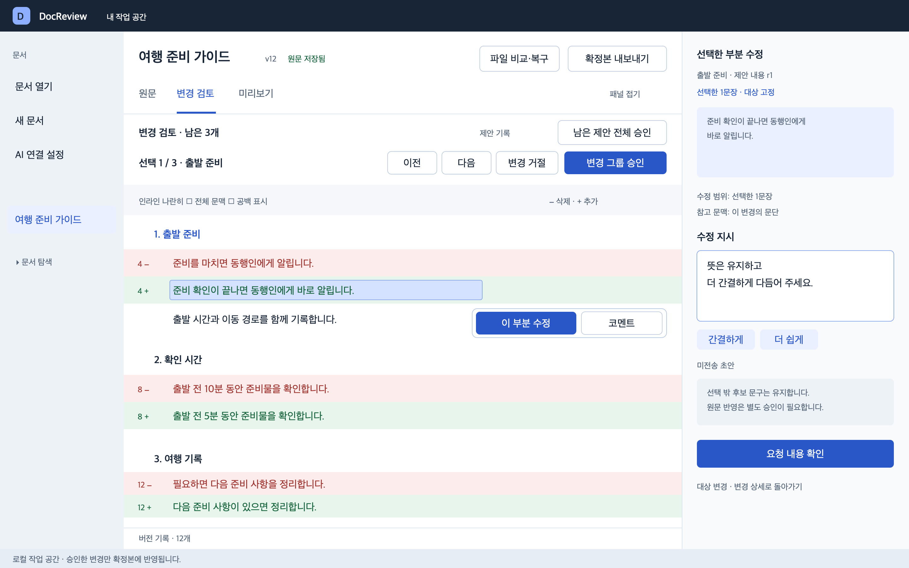
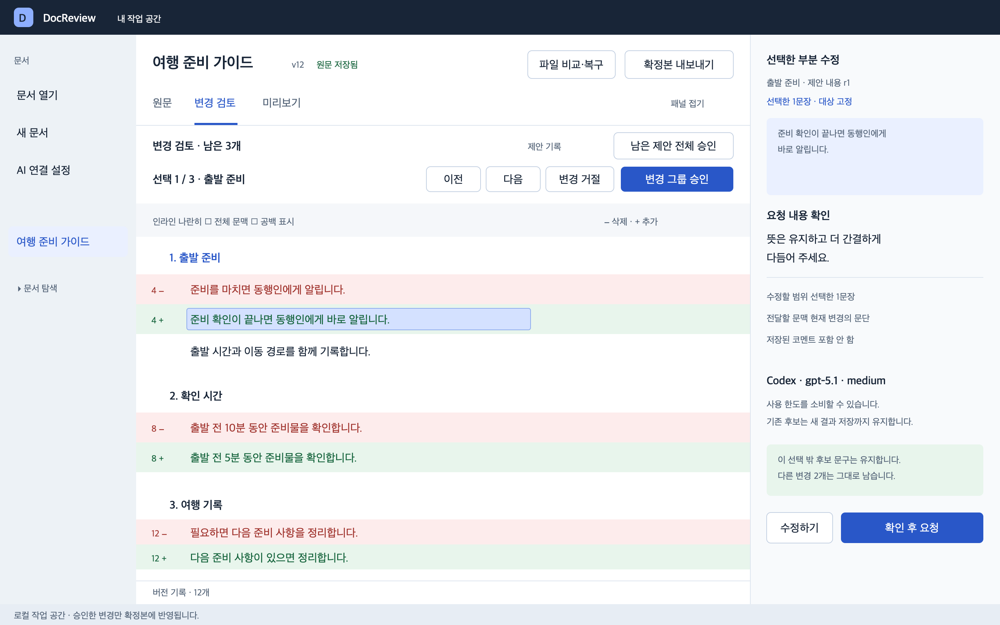
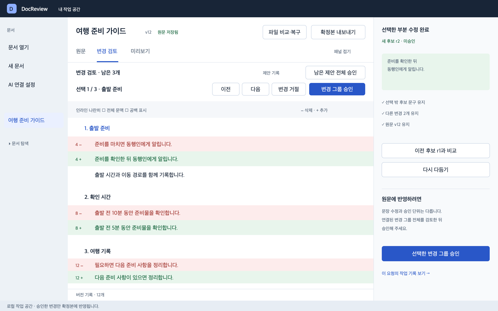
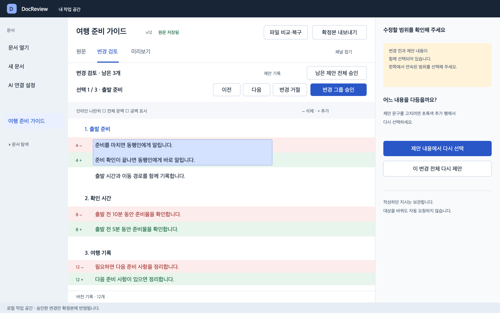
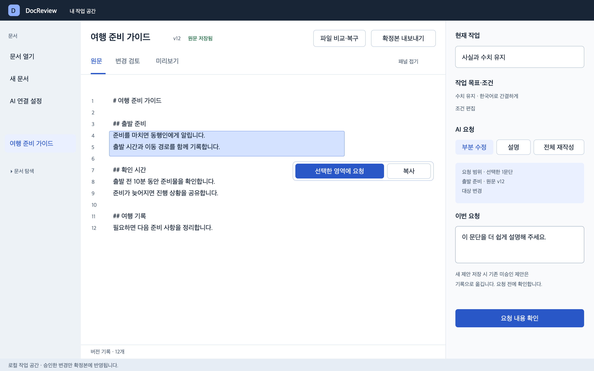
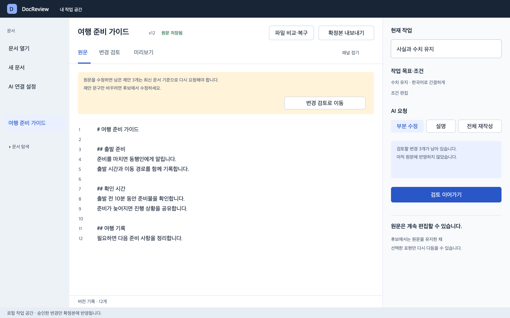
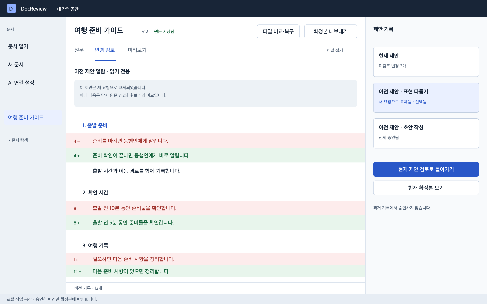
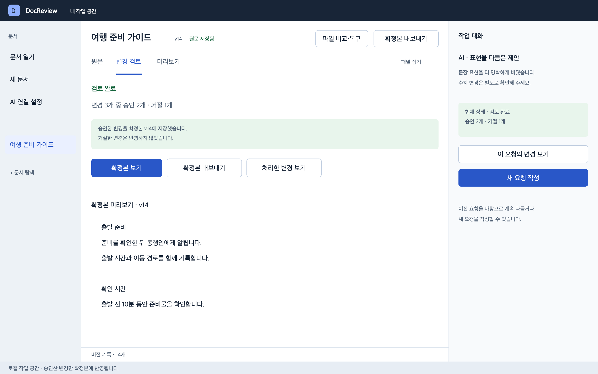
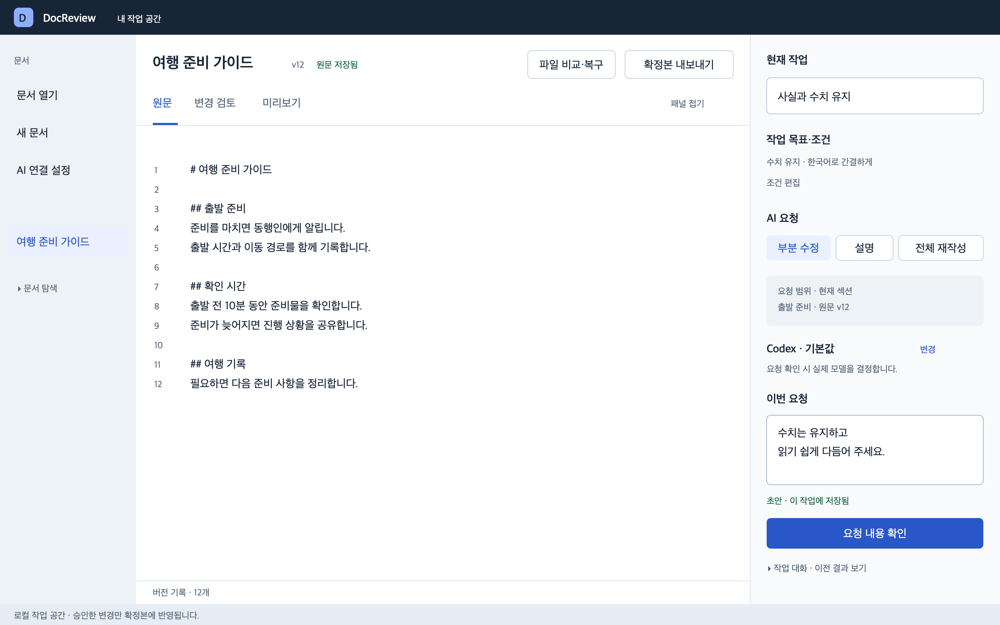

# DocReview 사용자 경험 개선 제안

작성일: 2026-11-01 · 상태: 제품 개선 제안 · 대상: 제품 기획, 디자인, 개발 담당자

DocReview의 개선 목표는 읽고 있는 문장과 수정 요청, 새 후보 검토를 한 흐름으로 연결하는 것이다. 현재의 원문·제안 분리, 부분 승인, 버전 검증을 유지하면서 선택 대상의 의미와 다음 행동을 명확하게 만든다. 우선 권고는 **선택한 부분에서 수정 요청 시작**, **원문 편집 영향 사전 안내**, **제안 상태와 결과 이동 개선**이다.

[개선 화면안 갤러리 열기](ux-proposal/index.html) · [문서 안에서 화면 보기](#9-개선-화면안) · [구현된 실제 앱 화면 1~9](../usage/ux/README.md)

아래 분석은 구현 전 관찰과 설계 결정을 보존한 제안서다. 현재 구현 동작은 [화면 계약](ux-runtime-contract.md), 자동 검증 결과와 남은 실제 입력기·VoiceOver·사용자 평가는 [UX 개선 현재 상태](../development/ux-status.md)를 따른다.

2026-11-02 보완 설계: 원문도 [선택 옆 팝오버 화면안](ux-proposal/source-selection-popover.html)에서 ‘이 부분 수정’으로 시작한다. 기존 제안을 보존하는 확정본 선택 요청을 사용한다. 3절과 화면 5의 고정 버튼·일반 요청 연결은 최초 제안의 이력이며, 최신 실행 계획은 [선택 팝오버 계획](../development/selection-popover-plan.md)을 따른다.

## 1 문제 정의

| 구분 | 내용 |
| --- | --- |
| 배경 | 사용자는 Markdown을 읽으며 AI가 바꾼 내용을 판단하고, 특정 표현만 다시 다듬고 싶어 한다. |
| 문제 | 선택한 텍스트, 코멘트 대상, 재제안 범위가 서로 다르다. 원문 편집으로 남은 제안이 무효화되는 영향과 제안의 현재 상태도 이해하기 어렵다. |
| 목표 | 대상 선택부터 요청·새 후보 비교까지 맥락을 보존하고, 의도한 범위 밖 수정과 작성 내용 손실을 줄인다. |
| 비목표 | 전면 테마 교체, 자동 승인, 자동 의미 병합, 실시간 공동 편집, 외부 문서 서비스 게시. |
| 제약 | 승인 전 확정본 불변, 기준 버전·revision·파일 검증, 단일 생성, 명시적 AI 실행, 기존 승인 그룹과 복원 규칙을 유지한다. |

판단 기준은 현재 설치 앱에서 관찰한 원문·검토·이력·재작성·연결 화면과 현재 소스다. README의 화면 구성 설명과 과거 캡처는 현재 UI의 근거에서 제외한다. 활성 제안의 드래그·재제안 세부 동작은 아래 소스와 기존 테스트를 기준으로 분석했다. 사용자가 느끼는 혼란과 개선 효과는 사용성 평가로 확인할 가설이다.

가정: 한 사람이 문서 작성과 검토를 반복하며, 기존 작업의 미승인 제안을 유지한 채 일부 표현을 수정하려는 수요가 있다. 문장 선택의 편리함이 승인 단위의 자동 분할을 의미하지는 않는다. 이 제안은 기존 기능 명세를 즉시 대체하지 않으며, 구현 단계에서 해당 명세와 인수 기준을 함께 갱신한다.

## 2 현재 버전의 개선 우선순위

| ID | 우선순위 | 보완할 경험 | 판단 근거 | 권고 |
| --- | --- | --- | --- | --- |
| UX01 | P1 | diff에서 문장·문단을 지정해 수정 요청 | 선택은 코멘트에 전달되지만 재제안 계약은 제안 전체 대상 | 선택 행동과 공통 요청 폼 연결, 정확한 수정 범위 검증 |
| UX02 | P1 | 원문 편집의 영향 이해 | 직접 편집 저장 시 남은 제안이 STALE로 전환 | 영향 사전 안내와 후보 수정 경로 제공 |
| UX03 | P1 | 원문 선택과 요청 범위 일치 | 선택과 범위 종류가 별개이며 초기 범위는 전체 문서 | 명시적인 선택 영역 요청 행동 |
| UX04 | P1 | 남은 변경 0개의 의미 이해 | 이전 제안과 0개 안내가 함께 표시됨 | 완료·이력 열람·기준 변경 상태별 안내와 다음 행동 |
| UX05 | P2 | 이전 제안 읽기 | 좁은 상세 패널에 변경 전·후 전문 연속 표시 | 중앙의 읽기 전용 과거 diff로 연결 |
| UX06 | P1 | 대화에서 생성 결과 찾기 | 응답 본문과 현재 제안 상태·이동 행동의 연결이 약함 | 결과 링크와 현재 상태 배지 |
| UX07 | P2 | 전체 재작성 요청 시작 | 요청 화면에서 검토 화면의 작업 옵션으로 이동 | 요청 종류 선택에 재작성 통합 |
| UX08 | P2 | 사용할 AI와 다음 설정 행동 이해 | 요청 폼에 공급자·모델 요약 없음, 연결 행동의 위계 약함 | 짧은 모델 요약과 상태별 다음 행동 |
| UX09 | P1 | 초안·코멘트 보존과 전달 대상 이해 | 초안은 세션 내 보관, 미저장 코멘트와 재제안 진입이 분리 | 초안 영속 저장, 저장·전달 대상 확인 |

P1은 대상 오해·작업 손실·주요 과업 단절에 우선 대응하는 항목이며, P2는 탐색과 반복 사용 효율을 높이는 항목이다. 현재 적용된 조건 접기, 요청 범위의 오른쪽 통합, 작업·변경 상세 전환은 유지한다.

## 3 원문 선택과 요청 범위 연결

원문을 드래그해도 범위 종류는 자동으로 바뀌지 않는다. 현재의 범위 표시는 유용하지만, 선택했다는 행동이 부분 수정 요청으로 이어지지는 않는다. [범위 상태 처리](../../apps/desktop/src/editor/request-scope.ts)

| 대안 | 장점 | 단점과 위험 | 선택 |
| --- | --- | --- | --- |
| A 선택 후 선택한 영역에 요청 버튼 제공 | 의도가 명시적이고 기존 범위 설정을 존중 | 행동 진입점을 추가해야 함 | 권고 |
| B 드래그할 때마다 범위를 선택 영역으로 전환 | 조작 수가 적음 | 복사용 선택도 요청 범위를 바꾸며 사용자의 전체 문서 설정을 덮을 수 있음 | 보류 |

버튼을 누르면 선택을 보존하고 기존 요청 폼을 연다. 요청 준비 시 원문·조건 저장을 완료한 뒤 버전, 정확한 인용과 좌표를 검증해 고정한다. 저장 실패 시 요청을 시작하지 않는다. 기존 요청 초안이 있으면 유지하거나 바꿀지 선택하게 한다. 포커스를 요청 입력으로 옮겨도 대상을 유지하고 원문에 강조를 남긴다. 대상이 바뀌면 재확인을 요구하며 전체 문서로 확대하지 않는다. 확인에는 섹션명·원문 일부·글자 수를 먼저 표시한다.

이 행동은 현재의 새 수정 요청 경로를 사용할 수 있지만, 활성 제안이 있으면 새 결과로 이전 제안을 보관하는 영향을 확인 단계에 명시해야 한다. 다른 미승인 제안을 보존하며 후보 일부를 다듬는 UX01과 구분한다.

## 4 원문 직접 편집의 영향 안내

직접 편집, 다른 작업 승인, 외부 변경, 복원으로 기준이 바뀌면 남은 제안의 승인을 막는 규칙은 유지한다. 입력 전에 결과를 이해하도록 보완한다. [저장 시 제안 유효성 변경](../../apps/desktop/src-tauri/src/storage/review_effects.rs)

| 대안 | 장점 | 단점과 위험 | 선택 |
| --- | --- | --- | --- |
| A 원문 화면에 영향과 후보 수정 행동 안내 | 기존 정확성 규칙을 유지하며 변경이 작음 | 안내만 읽고 넘길 수 있어 후속 복구 행동도 필요 | 권고 |
| B 직접 편집의 영향을 분석해 일부 제안을 유지 | 재요청을 줄일 수 있음 | 겹침·반복 문장·구조 변경에서 잘못된 적용 위험과 검증 부담이 큼 | 후속 연구 |

유효한 미검토 제안이 있을 때만 원문 화면에 영향 개수를 표시한다. 다음은 안내 문구의 예시다.

> 원문을 수정하면 남은 제안 3개는 최신 문서 기준으로 다시 요청해야 합니다.
> 제안 문구만 바꾸려면 후보에서 수정하세요. [변경 검토로 이동]

새 확인창을 매번 띄우거나 입력을 막지 않는다. 여러 작업에 남은 제안이 있다면 영향 개수를 문서 기준으로 집계하고 작업별 내역을 펼칠 수 있게 한다. 다른 작업 승인·복원도 해당 행동의 확인 영역에 영향을 표시한다.

기준 변경 후에는 “문서가 바뀌어 제안 N개를 승인할 수 없습니다”와 “최신 문서에서 요청 준비”를 제공한다. 기존 지시와 코멘트는 참고로 유지하되 새 범위를 확인한다. 재요청은 자동 실행하지 않는다. 원문 undo만으로 과거 제안이 다시 유효해진다고 약속하지 않는다.

## 5 diff에서 선택한 부분 수정 요청

### 5.1 현재 흐름의 단절

문장이나 문단을 읽는 위치에서 수정 요청을 바로 시작하기 어렵다는 의견에 동의한다. 현재 흐름에는 다음 문제가 있다.

1. 드래그 후 선택 주변에 수정 요청 행동이 나타나지 않는다. 변경 상세에서 코멘트 또는 재제안 진입을 찾아야 한다.
2. 코멘트를 거치는 경우 저장, 재제안 화면 이동, 별도 지시 입력, 모델 확인을 거친다. 수정 의도와 같은 내용을 반복 작성할 수 있다.
3. 선택 구간은 코멘트 인용에 사용할 수 있지만, 재제안 요청에는 선택 좌표가 없다. 백엔드는 해당 제안의 원문 범위 전체에 대한 새 후보를 받는다.
4. 인라인에서 삭제·추가를 섞어 드래그하거나 접힌 행을 포함하면 유효한 논리 선택을 얻지 못할 수 있다. 코멘트 대상은 선택이 매핑되지 않으면 제안 전문으로 돌아간다.
5. 변경 없는 문맥이나 여러 제안에 걸친 선택은 단일 변경 그룹으로 정해지지 않는다. 화면 선택과 실제 수정 대상을 분명하게 구별해야 한다.

근거: [선택 이벤트](../../apps/desktop/src/review/DiffPane.tsx), [좌표 변환](../../apps/desktop/src/review/coordinates.ts), [코멘트 대상의 전체 범위 대체](../../apps/desktop/src/review/comment-target.ts), [그룹 매핑](../../apps/desktop/src/review/group-selection.ts), [재제안 요청 계약](../../apps/desktop/src-tauri/src/domain/regeneration.rs), [AI에 전달하는 재제안 범위](../../apps/desktop/src-tauri/src/storage/regeneration_context.rs).

### 5.2 대안 비교

| 대안 | 동작 | 장점 | 단점과 위험 |
| --- | --- | --- | --- |
| A 코멘트 저장과 재제안 준비 연결 | 현재 코멘트 폼에서 저장 후 기존 재제안으로 이동 | 구현 범위가 가장 작고 기존 계약 재사용 | 제안 전체가 수정 가능하므로 선택한 부분만 바뀐다는 보장 없음 |
| B 선택 주변 행동과 공통 요청 폼 연결 | 선택 → 이 부분 수정 → 오른쪽에 고정 인용과 지시 → 요청 확인 | 읽는 위치 유지, 지시 1회 입력, 기존 패널 활용 | 정확한 부분 수정 계약과 선택 고정·복귀 구현 필요 |
| C 본문 안에 지시 입력 상자 삽입 | 선택한 문장 아래에서 지시와 결과를 처리 | 대상과 조작 거리가 가장 짧음 | diff 배치·스크롤·선택·IME·확대·키보드 포커스 처리가 복잡 |

**B를 권고한다.** 부분 수정 요구를 충족하는 가장 작은 구조로 기존 오른쪽 패널을 활용한다. A는 단기 동선 개선으로 사용할 수 있지만 버튼을 “이 변경 다시 제안”으로 표시해야 한다. 선택 범위만 수정한다고 표현하려면 B의 범위 검증까지 구현한다. C는 읽기 공간과 상호작용 비용을 측정한 뒤 검토한다.

### 5.3 권장 사용자 흐름

1. 제안 내용에서 문장·여러 문장·문단 일부를 드래그한다. 커서가 있는 문장 또는 문단을 대상으로 하는 메뉴도 같은 진입점을 사용한다.
2. 선택 근처의 작은 행동 영역에서 “이 부분 수정”을 누른다. 선택만으로 포커스를 옮기거나 AI를 실행하지 않는다.
3. 오른쪽 패널이 “선택한 부분 수정”으로 바뀌고 대상 쪽, 인용, 해당 변경의 제목을 표시한다. 본문의 대상 강조를 유지하고 지시 입력에 포커스를 둔다.
4. “수치를 유지하고 더 간결하게”처럼 지시를 한 번 입력한다. “간결하게”, “더 쉽게”는 지시를 채우는 보조 행동이며 자동 전송하지 않는다.
5. “요청 내용 확인”에서 대상, 참고로 전달할 문맥, 기존 코멘트 포함 여부, 모델과 사용량 안내를 확인한 뒤 “확인 후 요청”으로 실행한다.
6. 생성 중에는 기존 후보와 지시를 유지하고 상태·중단 행동을 제공한다. 작업이나 보기가 바뀌어도 요청 대상을 바꾸지 않는다.
7. 성공하면 같은 변경 위치에서 새 미승인 후보를 보여준다. 이전 후보와 비교하거나 기록을 열 수 있게 하며, 확정본 반영은 별도 승인으로 수행한다.

구체적인 배치는 [선택 요청 화면](#화면-1-선택한-부분에서-바로-수정-요청), [요청 확인](#화면-2-수정-범위와-전달-문맥-확인), [새 후보 검토](#화면-3-같은-위치에서-새-후보-검토)에서 확인한다.

직접 수정도 같은 선택 대상을 활용하되 “직접 고치기 → 후보 저장”으로 구분한다. 새 후보를 저장해도 확정본은 바뀌지 않는다. “코멘트”는 의견을 남기는 독립 행동으로 유지하고, AI 수정 요청의 필수 단계로 만들지 않는다.

### 5.4 대상별 처리와 제공 단계

| 선택 대상 | 권장 동작 | 제공 단계 |
| --- | --- | --- |
| 유효한 단일 미승인 제안의 제안 내용 안 | 선택한 문자열만 교체한 새 revision 생성 | 첫 기능 범위 |
| 같은 제안 안의 문장·문단 | 드래그 또는 문장·문단 메뉴로 범위를 표시한 뒤 같은 부분 수정 사용 | 첫 기능 범위, 문장 자동 경계 판정은 별도 검증 |
| 변경 전 또는 삭제된 문장 | 참고 인용으로 구분하고 제안 쪽에서 수정 대상을 지정하거나 변경 전체 재제안을 명시적으로 선택 | 첫 기능 범위의 안내 경로 |
| 삭제·추가 혼합, 접힌 구간, 여러 제안에 걸친 선택 | 이유를 표시하고 한쪽의 연속 범위를 다시 선택하도록 안내 | 첫 기능 범위의 실패 처리 |
| 변경 없는 문맥, 이미 승인된 본문 | 현재 확정본에 대한 새 부분 제안 생성 | 후속 범위, 기존 미승인 제안을 보존하는 저장 계약 필요 |
| 전체 재작성 후보의 일부 | 새 전체 후보 안에서 선택 부분만 수정하고 전체 적용 원칙 유지 | 후속 범위, 재작성 후보 계약 확장 필요 |
| 취소·교체된 이전 제안 | 읽기 전용 유지, 최신 버전에서 새 요청을 준비하는 명시적 행동 | 후속 범위 |

“이 문장”과 “이 문단”은 수정 범위를 펼쳐 선택하는 보조 기능이다. 자동으로 확대한 범위를 먼저 보여주고, 표·목록·코드·문장 부호에서 모호하면 드래그로 지정하게 한다. 전체 문서나 임의의 변경으로 대체하지 않는다.

**수정 요청 단위와 승인 단위는 다르다.** 한 문장만 수정해도 기존 결합 그룹의 승인 단위는 유지한다. 패널에 “이 문장만 다시 다듬습니다. 적용은 연결된 변경 그룹 단위입니다”를 표시한다. 문장별 승인은 독립성 검증을 별도로 설계한 후 제공한다.

### 5.5 범위 보존과 데이터 처리

- 요청 준비 시 문서·작업·묶음·제안 ID, 기준 head, revision, 대상 쪽, 정확한 인용, 원문 기준 좌표를 고정한다. 인용 문자열은 문서를 포함하므로 진단 로그에 남기지 않는다.
- diff의 표시 행·추가/삭제 기호·접힘 문구를 원문 좌표로 사용하지 않는다. UTF-16과 UTF-8 변환을 검증하고 한글·이모지·CRLF·반복 문장으로 확인한다.
- 후보 안의 범위는 해당 revision의 후보 문자열 기준으로 고정한다. 다른 제안의 추가·삭제로 바뀌는 전체 예상본 좌표를 그대로 저장하지 않는다.
- 주변 문맥을 AI에 전달하는 범위와 실제 수정 허용 범위를 구별해 표시한다. “문장만 수정”이 “문장만 외부 전송”이라는 의미가 되지 않게 한다.
- Rust 코어는 선택 부분의 교체 문자열을 받아 기존 후보의 앞·뒤 문자열과 결합한다. 범위 밖 문구를 모델이 다시 작성한 결과로 대체하지 않는다.
- 기존 재제안 계약에는 선택 대상 필드와 부분 교체 응답 검증이 없으므로, UI 변경과 함께 Rust 계약·생성 타입·응답 처리도 확장한다. 기존 전체 제안 재생성의 프롬프트에 인용만 추가해서 범위 보존을 보장하지 않는다.
- 결과 저장 전 head·revision·파일 상태를 다시 확인한다. 기준이 달라지면 적용하지 않고 지시와 이전 후보를 보존한다. 임의의 문자열 재검색으로 새 대상에 붙이지 않는다.
- 새 revision은 미승인으로 저장한다. 다른 제안의 내용·결정·코멘트를 유지하고, 대상이 바뀐 코멘트는 연결 위치 확인 상태로 남긴다.
- Markdown 경계를 깨는 교체와 크기 초과를 검증한다. 문법 유지를 위해 범위를 넓혀야 하면 사용자가 확대된 범위를 확인한 뒤 다시 요청한다.

### 5.6 실패와 이동

| 상황 | 화면과 보존 규칙 |
| --- | --- |
| 유효하지 않은 드래그 | “변경 전과 제안 내용이 섞여 있습니다. 한쪽에서 다시 선택해 주세요.” 등 실제 이유 표시. 기존 선택 대상 재사용 금지 |
| 생성 실패 또는 중단 | 인용·지시·기존 후보 유지. 수동 재시도 제공, 자동 승인·재실행 금지 |
| 요청 중 원문 또는 후보 변경 | 이전 응답 채택 중지. 새 기준에서 대상 재확인, 지시 보존 |
| 다른 변경 선택 또는 패널 전환 | 작성 중인 대상은 고정하고 이동 후에도 초안으로 복귀 가능. 새 대상을 쓰려면 명시적으로 변경 |
| 800×600 또는 확대 | 기존 보조 패널 정책 활용. 한 영역만 보일 때 돌아가기로 원래 선택·스크롤·포커스 복원 |
| 키보드 사용 | Shift와 방향키로 선택한 뒤 동일한 수정 행동에 접근. Esc로 닫으면 diff 선택 위치로 복귀. Enter는 포커스된 행동만 실행 |

선택 주변 행동에는 우클릭 메뉴와 키보드 진입도 제공한다. 두 버튼만 있다면 일반 버튼 그룹으로 구현하고, 3개 이상을 toolbar 역할로 묶을 때는 방향키·포커스 이동을 함께 구현한다. [W3C Toolbar Pattern](https://www.w3.org/WAI/ARIA/apg/patterns/toolbar/)

## 6 나머지 개선 제안의 대안과 결정

| 항목 | 대안 A와 장단점 | 대안 B와 장단점 | 권고 |
| --- | --- | --- | --- |
| UX04 제안 상태 | 상태별 문구·다음 행동: 변경 작음 / 상태 판정 보완 필요 | 작업 타임라인: 경위 명확 / 데이터·화면 범위 큼 | A. 이전 기록 열람·검토 완료·재검토 필요·변경 없음 구분 |
| UX05 이전 제안 | 중앙의 과거 diff: 기존 비교 활용 / 현재 기준과 당시 기준 구분 필요 | 별도 비교창: 공간 확보 / 왕복과 창 관리 증가 | A. 오른쪽은 제목·실제 상태·요약, 중앙은 당시 전후 비교 |
| UX06 대화와 결과 | 응답에 결과 링크·상태 배지: 작고 명확 / 결과 ID 연결 필요 | 모든 대화를 작업 카드로 개편: 통합성 / 재설계 큼 | A. 생성 당시 문장과 현재 상태를 분리 |
| UX07 전체 재작성 | 요청 종류에 통합: 진입 일관 / 모드 전환 시 초안 처리 필요 | 별도 요청창: 수정 작음 / 진입점 분리 유지 | A. 부분 수정·설명·전체 재작성, 범위와 적용 방식 명시 |
| UX08 AI 설정 | 요청 폼 요약·상태별 다음 행동: 밀도 낮음 / 상태 최신성 표시 필요 | 요청마다 모델 선택: 직접 통제 / 폼과 실수 증가 | A. 미확정 기본값은 그대로 표시하고 확인 시 실제 모델 확정 |
| UX09 초안 보존 | 수동 초안 저장: 작음 / 저장을 기억해야 함 | 로컬 자동 저장·복원: 손실 감소 / 버전·앵커 재검증 필요 | B. 기존 세션 보관 정책을 영속 보관으로 변경 |
| UX09 코멘트 전달 | 미저장 상태에서 재제안 진입 차단: 작음 / 단계 수 유지 | 저장 후 재제안 준비 통합: 입력 반복 감소 / 저장 실패·중복 처리 필요 | 우선 A, UX01은 코멘트 없이 지시를 직접 전달하는 별도 경로 |
| 첫 요청 | 작업 생성과 요청을 한 폼으로 연결: 기존 모델 유지 / 폼 위계 필요 | 시작 마법사: 설명 명확 / 반복 이동 증가 | 한 폼과 작업 만들고 요청 확인, 조건은 선택 입력 |
| 접근성 | 탭·메뉴의 표준 키보드 동작 구현: 의미 일치 / 검증 필요 | 일반 전환 버튼으로 축소: 단순 / 탭 탐색 경험 감소 | 탭 동작·패널 관계·복귀 포커스 구현, VoiceOver 평가 |

상태는 실제 저장값에서 결정한다. 생성 당시 AI가 쓴 “아직 승인되지 않았습니다”를 현재 상태 배지로 사용하지 않는다. 취소·교체 사유를 확인할 수 없다면 추정하지 않는다. 이력은 기본 읽기 전용이며 새 요청이나 과거 안 선택으로 자동 승인하지 않는다.

## 7 실행 순서와 영향 범위

| 단계 | 작업 | 경계와 검토 기준 |
| --- | --- | --- |
| 1 작은 흐름 보완 | UX02·UX03·UX04·UX06, 코멘트 미저장 가드 | 기존 요청·승인·원문 저장 계약 유지. 원문 선택 요청의 이전 제안 보관 영향 표시 |
| 2 선택한 후보 부분 수정 | UX01의 단일 유효 제안 내용 대상, 공통 요청 폼, 정확한 부분 교체 계약 | 대상 스냅샷 → 확인 → AI → 범위 검증 → 새 revision을 함께 검토. 프런트 버튼만 추가해 완료 판정하지 않음 |
| 3 확장과 편의 | 변경 없는 문맥·전체 재작성 후보, 초안 영속 저장, UX05·UX07·UX08 | 기존 제안을 보존하는 저장 계약과 복원 정책을 각각 설계. 범위 밖 수정·자동 보관 금지 |

UX01의 영향은 DiffPane 선택·그룹 매핑·상세 패널, 재제안 요청 계약, AI 응답 검증·revision 저장에 걸친다. 읽기 전용 diff와 기존 승인·파일 저장 경로는 유지하며, 새 후보 저장까지의 경로를 확장한다. 문장 선택과 문장 승인 기능을 한 변경으로 묶지 않는다.

초안 영속 저장은 세션 보관을 명시한 제품 명세의 정책 변경이다. 구현 시 문서·작업·제안·대상별 키, 보관 기간과 명시적 삭제, 오래된 인용 재확인, 로그 비노출을 함께 결정한다. 본 제안서는 앱 코드와 기존 동작 계약을 변경하지 않는다.

## 8 인수 조건과 사용성 평가

아래는 구현 후 추가할 조건이다. 선택·응답은 가짜 AI와 고정 fixture로 검사하고, 실제 계정의 응답 품질을 범위 검증의 대체로 삼지 않는다.

| 시나리오 | 기대 결과 |
| --- | --- |
| 원문 선택 후 요청 폼으로 이동 | 같은 인용과 범위 유지, 전체 문서로 확대하지 않음, 기존 초안 덮어쓰기 전 선택 |
| 미검토 제안이 있는 원문 편집 | 편집 전 영향 안내, 편집 후 실제 재검토 상태·최신 기준 요청 행동 표시 |
| 제안 문장 선택 후 부분 수정 성공 | 지시 1회 작성, 대상·모델 확인, 선택 밖 후보 문자열 일치, 확정본 불변, 새 revision 미승인 |
| 문단·한글·이모지·CRLF·같은 문장 반복 | 정확한 위치만 수정, 표시 좌표와 저장 좌표 혼동 없음 |
| 삭제·추가 혼합 또는 여러 그룹 선택 | 이유와 재선택 행동 제공, 이전 선택 또는 제안 전체로 조용히 대체하지 않음 |
| 응답 형식 오류·크기 초과·중단 | 기존 후보·인용·지시 유지, 새 유효 후보 미등록, 수동 재시도 |
| 생성 중 원문·revision 변경 또는 외부 파일 충돌 | 늦은 응답 채택 차단, 원문 덮어쓰기 없음, 대상 재확인 제공 |
| 더블클릭·지연 응답·재시도 | 중복 작업·revision 없음, 명시적 재시도는 별도 attempt로 기록 |
| 복수의 미승인 제안 중 하나만 수정 | 다른 제안·결정·코멘트 유지, 수정한 후보만 새 revision, 기존 결합 승인 단위 유지 |
| 일반 요청과 전체 재작성 종류 왕복 | 각 지시 초안 보존, 범위·기존 제안 처리·적용 방식 확인 후 실행 |
| 0개 상태·이전 기록·대화 결과 이동 | 현재 상태를 설명할 수 있고 올바른 확정본·기록·새 요청으로 이동 |
| 800×600·150%·200%·키보드·VoiceOver | 대상·입력·확인·오류·복귀 행동 접근 가능, 선택·스크롤 보존 |
| 저장 실패·앱 재실행 | 저장 성공으로 오표시하지 않음, 영속 저장 도입 후 초안 복원과 오래된 대상 재확인 |

사용성 평가는 문서 작성자에게 “수치는 유지하고 선택한 문장만 간결하게 요청한 뒤 새 후보를 검토”하도록 한다. 현재 흐름과 제안 흐름에서 요청 준비 시간, 화면·패널 전환 수, 지시 재입력 횟수, 실제 대상 설명의 정확도, 잘못된 수치 변경 발견 여부를 비교한다. 개선 목표는 코멘트를 필수로 저장하지 않고 지시를 한 번 작성하는 것이다. 범위 밖 수정·오적용은 허용하지 않는다. 시간 개선율은 기준 측정 후 정한다.

## 9 개선 화면안

[전체 화면을 크게 보는 갤러리](ux-proposal/index.html). 아래는 기존 앱의 색·시스템 서체·196px 탐색·360px 보조 패널을 따른 **구현 전의 정적 시안**이다. 실제 앱 캡처가 아니며 문서·모델·버전·건수는 합성 예시다. [실제 구현 화면](../usage/ux/README.md)과 구분한다. 이미지 클릭 시 원본을 연다. SVG 원본과 재생성 방법은 갤러리에 있다.

### 화면 1 선택한 부분에서 바로 수정 요청

UX01. 드래그한 제안 문장 옆에서 수정 요청을 시작하고 오른쪽에 인용·지시를 고정한다. 코멘트 저장은 필수가 아니다.

### 화면 2 수정 범위와 전달 문맥 확인

UX01. 실제 수정할 범위와 AI에 전달할 문맥, 코멘트 포함 여부, 모델을 구분한다. 최종 확인 후에만 실행한다.

### 화면 3 같은 위치에서 새 후보 검토

UX01. 선택 밖 문구·다른 제안·원문 보존을 표시하고 새 후보 r2를 검토한다. 최종 승인은 기존 변경 그룹 단위다.

### 화면 4 삭제와 추가를 섞어 선택한 경우

UX01. 범위를 제안 전체로 바꾸지 않고 한쪽에서 다시 선택하도록 안내한다. 변경 전체 재제안은 별도 선택이다.

### 화면 5 원문 선택과 요청 범위 연결

UX03. 선택한 영역에 요청을 눌러 대상을 고정한다. 새 요청이 기존 제안을 기록으로 옮기는 영향도 확인한다.

### 화면 6 원문 편집 영향 사전 안내

UX02. 유효한 미검토 제안이 있을 때만 영향과 후보 수정 경로를 표시한다. 직접 입력은 계속 허용한다.

### 화면 7 이전 제안의 읽기 전용 비교

UX04·UX05. 오른쪽 목록에는 실제 상태를, 중앙에는 당시 원문과 후보의 diff를 표시한다. 과거 기록에서 승인하지 않는다.

### 화면 8 검토 완료와 대화 결과 연결

UX04·UX06. 완료 내역과 확정본 v14를 보여주고 대화에서도 해당 요청의 변경을 연다. 취소·기준 변경과 구분한다.

### 화면 9 요청 종류와 사용할 AI 요약

UX07·UX08·UX09. 부분 수정·설명·전체 재작성 진입을 통합한다. 초안 저장 표시는 영속 저장 도입과 저장 성공 확인을 전제로 한다.

## 10 참고 자료

- [제품 기능 명세](../product/specification.md): 승인·범위·STALE·복원 규칙과 초안 보관 정책.
- [현재 디자인 계약](design-guide.md#13-현재-to-be-계약): 기존 패널·본문·반응형 기준. 이 제안의 선택 행동과 영속 초안은 후속 변경 대상이다.
- [ProposalDetails](../../apps/desktop/src/review/ProposalDetails.tsx), [useCommentForm](../../apps/desktop/src/review/useCommentForm.ts), [useRegeneration](../../apps/desktop/src/review/useRegeneration.ts): 코멘트·후보·재제안의 현재 연결.
- [regeneration_result](../../apps/desktop/src-tauri/src/storage/regeneration_result.rs), [revisions](../../apps/desktop/src-tauri/src/document/revisions.rs): 제안 전체 응답 검증과 revision 저장.
- [group-selection 테스트](../../apps/desktop/tests/group-selection.test.ts), [재제안 E2E](../../apps/desktop/tests/regeneration.e2e.mjs): 그룹 밖 선택·인용 유지·지연 응답의 기존 검사.
- [GroupBar](../../apps/desktop/src/review/GroupBar.tsx), [ReviewContent](../../apps/desktop/src/review/ReviewContent.tsx): 0개 안내와 이전 제안 전문 표시.
- [Conversation](../../apps/desktop/src/generation/Conversation.tsx), [GenerationPanel](../../apps/desktop/src/generation/GenerationPanel.tsx), [CodexSettings](../../apps/desktop/src/connection/CodexSettings.tsx): 대화 결과 표시, 전체 재작성 진입, 연결 설정 행동.
- [초안 저장소](../../apps/desktop/src/drafts/store.ts), [CommentForm](../../apps/desktop/src/review/CommentForm.tsx): 메모리 보관과 재제안 다음 단계 조건.
- [Apple Context menus](https://developer.apple.com/design/human-interface-guidelines/context-menus): 대상과 관련된 행동을 맥락 가까이 제공하는 원칙. B안의 구체적인 배치는 DocReview에 대한 설계 판단이다.
- [W3C Toolbar Pattern](https://www.w3.org/WAI/ARIA/apg/patterns/toolbar/): toolbar를 사용할 때의 키보드·포커스 동작.
