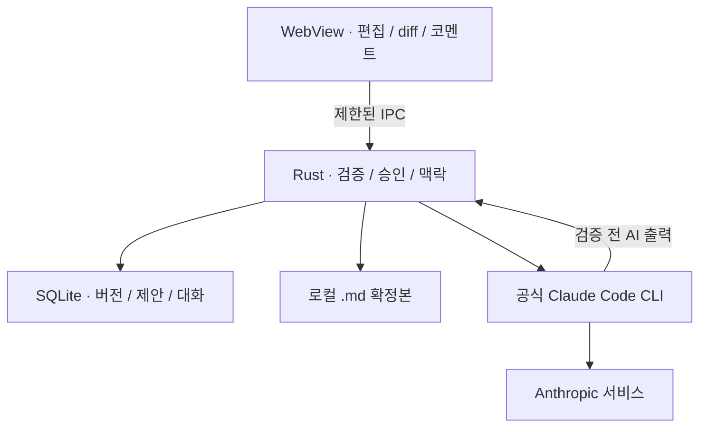

# AI 문서 검토 도우미 개발 설계서

문서 식별자 DEV  |  버전 0.2  |  작성 기준일 2026년 10월 26일

> 0.2 개정: 실제 텍스트 diff를 중심으로 화면을 재설계했다. [시나리오별 화면](../design/scenarios.md), [디자인 명세](../design/design-guide.md), [별도 디자인 갤러리](../design/gallery.html)를 함께 읽는다. 화면은 설계 시안이며 실제 제품의 실행 화면이 아니다.


이 문서는 [기능 명세](../product/specification.md)의 계층 구조, 데이터 계약과 저장 복구를 설명한다. 예시 타입과 의사코드는 설계 계약이며 정확한 IPC 타입과 스키마는 제품의 Rust 정의 및 생성물을 따른다.

## 1 권장 기술 구성과 대안

**권장안은 Tauri 2, Rust 코어, React와 TypeScript UI다.** Markdown 편집과 변경 비교는 CodeMirror 6 기반으로 구현하고, 파일·DB·프로세스·승인 검증은 Rust에서 처리한다. Rust만으로 UI까지 구현해야 한다는 제약은 두지 않는다.

| 대안 | 이 제품에서의 장점 | 검토 비용과 결정 |
| --- | --- | --- |
| Tauri와 웹 UI | 웹 편집기 활용, Rust에서 로컬 기능 통제 | WebView별 입력과 클립보드 검증 필요. 기본안 |
| Iced 기반 Rust UI | Rust 중심의 일관된 코드 구성 | 문서 편집, 비교, IME 품질 검증 비용을 감수할 때 대안 |
| egui 기반 Rust UI | 개발 도구 성격의 빠른 UI 구성에 활용 가능 | 장문 편집과 접근성 경험을 별도 확인해야 함 |
| Slint 기반 UI | 선언적 UI와 Rust 비즈니스 로직 결합 | 편집기 구현 범위와 배포 라이선스 조건 확인 필요 |
| Tauri와 TypeScript SDK 프로세스 | SDK 이벤트와 인터페이스를 활용할 선택지 | Node 런타임과 프로세스가 추가되므로 CLI 한계가 확인될 때 검토 |

위 비교의 적합성 평가는 이 제품에 대한 설계 판단이다. 대안 자체가 장문 편집에 사용할 수 없다는 의미는 아니다. 프레임워크의 기본 설명은 공식 자료를 참고했다. [D4, D7, D8, D9]

**직접 Claude API 호출은 기본안에서 제외한다.** 별도의 API 결제 설정이나 API key 준비를 요구하지 않기 위해, 공식 CLI의 사용자 인증 경로를 우선 검증한다. 특정 SDK를 쓰는 것만으로 API 과금이 구독 과금으로 전환되는 것은 아니다.

## 2 설계 원칙

문서와 상태는 로컬에 저장한다. 수정은 AI 응답이 아닌 Rust의 검증된 승인 명령으로 수행하고 작업 맥락은 CLI 세션과 독립 보관한다. 파일과 DB의 저장에는 복구 저널을 둔다. 외부 서비스 게시와 게시 이력은 지원하지 않는다. Diff는 검토용 표시이며 승인 권한은 도메인 계층에서 검증한다.

## 3 전체 실행 구조



Tauri는 Rust 코어와 WebView의 UI가 통신하는 구조를 제공한다. 이 설계에서는 문서 작업에 필요한 명령만 IPC로 공개한다. 화면에서 임의 파일 경로나 셸 명령을 실행할 수 없게 한다. [D4, D5]

**별도 서버가 필요하지 않은 이유:** 단일 사용자의 파일, 버전, 코멘트와 대화는 PC 안에서 관리할 수 있다. 공식 CLI도 같은 PC에서 실행한다. UI와 코어 사이에는 Tauri IPC를 사용하므로 localhost HTTP 서버도 필수가 아니다. AI 처리 자체는 Anthropic의 원격 서비스에 의존한다.

서버는 다중 사용자 공동 편집, 중앙 문서 저장, 다중 사용자 권한, 중앙 실행 큐 같은 요구가 생길 때 다시 검토한다. 이는 현재 MVP의 요구가 아니다. 설치 파일 배포와 업데이트를 위한 정적 배포 위치가 필요할 수 있으나 문서 처리용 서버와는 별개다.

**신뢰 경계:** UI 입력과 AI 응답은 검증 대상이다. Rust 도메인 계층이 문서 ID, 버전, 범위와 권한을 확인한다. CLI는 제안 생성만 담당한다. 모델에 “파일을 수정하지 말라”고 지시하는 것만으로 파일 변경을 통제했다고 간주하지 않는다.

## 4 공식 CLI 연동과 인증

현재 공식 안내는 플랜 로그인 기반 프로그램 호출의 구독 한도 사용을 허용한다고 설명한다. 제품 통합 시에는 변경하지 않은 공식 바이너리와 사용자 자신의 인증 흐름을 사용해야 하며, 앱이 Claude 자격증명을 수집하거나 중계하지 않는다. 배포 전 최신 조건을 다시 확인한다. [D1, D2]

**연결 진단 순서:** 실행 파일 탐색 → 버전 및 옵션 확인 → 공식 인증 상태 확인 → 최소 구조화 응답 → 같은 세션 재개 → 도구와 사용자 설정 제한 → 중단과 오류 검증. 인증 성공만으로 구독 경로 사용이 증명됐다고 판단하지 않는다. 사용자 계정의 실제 사용 경로도 확인한다.

실행은 Rust의 프로세스 API로 바이너리 경로와 인자 배열을 전달한다. 사용자 문서와 요청은 stdin으로 보낸다. 셸 문자열 결합, shell=true, 문서 내용을 명령 인자에 넣는 방식은 사용하지 않는다. Windows에서는 공식 실행 파일을 우선 사용하고 임의 .cmd 래퍼 자동 실행은 피한다.

| 항목 | 연동 규칙 |
| --- | --- |
| 실행 형태 | claude -p를 기본 진입점으로 사용. 출력은 JSON 계약으로 제한 |
| 구조화 응답 | --output-format json과 --json-schema, structured_output 존재 여부 검사 |
| 기존 대화 | --resume에 작업에 연결된 명시적 세션 ID 전달 |
| 인증 확인 | 공식 auth status 사용. 원문 전체와 비밀 환경변수는 로그에서 제외 |
| 피할 옵션 | 구독 경로에서 --bare 사용하지 않음. 대화 유지 작업에서 세션 저장 비활성화하지 않음 |
| 호환성 | 버전 번호만 믿지 않고 필요한 옵션과 JSON 응답을 실제 검증 |

위 옵션은 현재 공식 문서에 근거한다. --bare는 현재 구독 로그인 자격증명을 읽지 않으므로 이 설계와 맞지 않는다. CLI의 향후 기본 동작 변경도 호환성 검사의 대상이다. [D3, D6]

**도구 제한 프로필:** 사용자 작업 파일이 없는 앱 전용 cwd에서 실행한다. --safe-mode, 빈 tools와 strict 빈 MCP 설정으로 실행을 제한한다. safe mode에서도 일부 관리 정책과 훅이 남을 수 있다. 계정에 적용되는 필수 정책을 우회하지 않으며, 불필요한 실행이 없는 프로필을 확인하지 못하면 AI 기능 연결을 보류한다. cwd 분리는 OS 샌드박스가 아니다. [D6]

stdout와 stderr는 동시에 소비하고 크기를 제한한다. stdin 기록을 끝낸 후 EOF를 전달한다. 중단 시 자신이 만든 프로세스 그룹만 종료하고 종료를 확인한다. 프로세스 핸들을 버리는 것만으로 취소가 완료됐다고 간주하지 않는다. [D10]

## 5 AI 입력과 응답 계약

**입력 계약 PromptEnvelope v1**은 요청 ID, 작업 ID, 기준 버전과 해시, 의도, 범위, 문서 블록, 고정 조건, 최근 결정, 작업 요약과 코멘트로 구성한다. 모델에 문서를 명령이 아닌 편집 대상 데이터로 구분해서 제공한다. 변경 범위를 벗어난 요청은 응답 검증에서 차단한다.

문서는 앱이 파싱한 블록 ID와 원문으로 보낸다. 모델이 바이트 오프셋을 계산하도록 하지 않는다. AI가 제시한 설명이나 해시는 신뢰하지 않고 요청 스냅샷과 대조한다.

```json
{
  "schema_version": 1,
  "mode": "PATCH",
  "summary": "판단 기준을 명확히 함",
  "changes": [{
    "block_id": "b17",
    "before": "필요하면 공유합니다.",
    "after": "준비 확인이 있으면 공유합니다.",
    "reason": "조건을 분명히 표현"
  }]
}
```

위 JSON은 축약된 예시다. 실제 스키마는 additionalProperties=false, 문자열과 배열 크기, 필수 필드, mode별 상호 배타 조건을 선언한다. PATCH에는 changes, REWRITE에는 candidate_markdown, EXPLAIN에는 answer만 허용한다. Rust 코어가 생성한 job_id와 base_version_id를 결과에 결합하며 모델에게 식별자 발급을 맡기지 않는다.

**검증 파이프라인:** 프로세스 종료 확인 → 응답 크기 제한 → 외부 결과 객체 해석 → structured_output 존재 검사 → 앱 스키마 검증 → 기준 버전과 범위 검사 → 실제 diff 계산 → 제안 저장. 형식이 맞아도 의미 검증이 실패하면 OUTPUT_INVALID다. [D3]

MVP는 전체 JSON 응답 후 검토 화면을 만든다. 생성 중에는 단계와 경과 시간, 중단 버튼을 표시하며 근거 없는 진행률은 표시하지 않는다. 스트리밍 미리보기와 미완성 텍스트의 승인 버튼은 제공하지 않는다.

응답이 없거나 유효하지 않으면 기존 제안을 유지한다. 구조화 응답의 CLI 내부 형식 시도는 최대 3회이며 소진하면 OUTPUT_INVALID로 안내한다. 앱이 실패한 전체 요청을 자동으로 재실행하지 않는다.

## 6 작업 맥락과 세션 처리

**기본 매핑:** document_id → 여러 task_id → 작업별 session_binding. 같은 작업의 CLI 세션은 한 번에 한 프로세스만 접근한다. MVP는 앱 전체 생성 한 건으로 제한해 계정 한도와 재개 충돌을 단순화한다.

요청을 만들 때 고정 조건, 최신 문서 및 최근 결정은 항상 최신 상태로 조립한다. 이전 요약을 그대로 재사용하더라도 summary_version과 summary_event_seq를 검사하고 이후의 승인, 거절, 복원 이벤트를 추가한다.

| 우선순위 | 입력 구성 |
| --- | --- |
| 1 필수 | 현재 요청, 고정 조건, 기준 버전과 해시, 변경 허용 범위 |
| 2 필수 | 대상 원문과 필요한 주변 문맥, 관련 코멘트 |
| 3 필수 | 최근 승인·거절·복원 결정과 현재 미승인 상태 |
| 4 선택 | 오래된 대화 요약과 관련 이전 응답 |

문서 전체 요청의 본문은 숨겨서 잘라내지 않는다. 입력 상한을 넘으면 범위를 나누도록 안내한다. 부분 수정에서는 대상 구간과 주변 문맥, 제목 구조를 제공하고 제공하지 않은 부분의 수정은 금지한다. 토큰 예산은 모델과 CLI 환경에 따라 달라지므로 바이트 상한만으로 적합하다고 보장하지 않는다.

CLI가 반환한 세션 ID를 저장하되 자체 대화 원문 파일을 앱 DB로 간주하지 않는다. CLI가 유지하는 실제 기록이 사라지면 세션 ID만으로 재개되지 않을 수 있다. 앱의 목적, 결정, 본문과 요약으로 새 세션을 만들고 연결 이력을 기록한다.

**복원 예시:** 문서가 v14에서 v12 내용으로 복원되어 v15가 됐다면 다음 요청은 “현재 기준은 v15이며 이전 제안의 일부는 적용되지 않았다”라는 상태 이벤트와 v15 본문을 포함한다. 대화에 남은 v14 내용을 현재 상태로 재사용하지 않는다.

작업 전용 cwd는 경로가 안정적인 앱 데이터 디렉터리에 둔다. 문서가 이동해도 task_id와 cwd는 유지한다. CLI 설정, 인증 위치 또는 세션 형식이 변경되면 연결을 재검증한다. claude.ai 웹 대화의 자동 가져오기는 구현하지 않는다.

## 7 로컬 데이터 모델

SQLite는 도메인 메타데이터, 불변 버전, 제안, 코멘트, 대화와 저장 저널을 보관한다. .md 파일은 현재 확정본의 작업 파일이다. 둘의 불일치는 저널과 해시로 복구하며 “항상 파일만 정답” 또는 “항상 DB로 덮어쓰기”로 처리하지 않는다.

| 테이블 | 핵심 필드와 제약 |
| --- | --- |
| documents | id, canonical_path, head_version_id, disk_hash, encoding, newline, bom, common_rules |
| versions | id, document_id, parent_id, content_utf8, content_hash, reason, operation_id |
| tasks | id, document_id, goal, pinned_rules, summary, summary_version, summary_event_seq |
| session_bindings | id, task_id, cli_session_id, cwd, cli_version, status |
| jobs | id, task_id, attempt_id, base_version_id, scope_json, status, error_code |
| proposal_batches | id, job_id, mode, base_version_id, apply_head_id, status |
| proposals | id, batch_id, revision, group_id, block_anchor, before, after, decision, validity |
| comments | id, task_id, target_id, target_revision, anchor_json, text, status |
| messages | id, task_id, seq, role, content, created_at |
| decision_events | id, document_id, task_id, seq, kind, payload, version_id |
| save_operations | id, document_id, old_hash, new_hash, temp_path, phase, recovery_payload |

식별자는 UUID를 사용한다. 실제 파일 경로는 UI가 임의로 지정한 문자열 대신 documents에서 조회한다. 경로 변경은 별도 명령에서 검증한다. content_hash는 정확한 UTF-8 바이트의 SHA-256으로 정의한다. 같은 내용이어도 복원 이벤트와 버전 ID는 구분한다.

versions는 처음에는 전체 본문 스냅샷으로 저장한다. 구현 복잡도가 낮고 1 MiB 문서 범위에서는 복구 검증이 쉽다는 설계 판단이다. 용량 증가를 측정한 뒤 압축과 보존 정책을 별도로 추가한다. 자동 정리로 사용자가 기대한 버전을 지우지 않는다.

작업 DB에 인증 토큰, API key, 결제 정보 또는 외부 문서 서비스 게시 이력은 저장하지 않는다. 로그는 작업 ID, 코드, 소요 시간과 바이트 수 등 제한된 운영 정보만 기본 기록한다. DB와 CLI 자체 기록은 서로 다른 삭제 범위를 가진다는 안내를 제공한다.

## 8 승인과 파일 저장의 복구 저널

SQLite 트랜잭션은 .md 파일 교체까지 원자적으로 묶어 주지 않는다. 다음 절차를 기본으로 하고, 실제 대상 파일 시스템에서 중단 실험으로 검증한다. 앱 내부 document mutex와 단일 작성자 잠금은 외부 편집기의 쓰기를 막는 보장이 아니다.

1. 문서 잠금 획득 후 head 버전과 실제 파일 해시를 읽는다. expected_version과 다르거나 외부 수정이 있으면 종료한다.
2. 승인할 변경 전체를 검증하고 메모리에서 새 내용을 계산한다. 부분 실패이면 아무것도 적용하지 않는다.
3. 같은 볼륨에 임시 파일을 생성하고 새 내용을 기록한 뒤 가능한 내구성 동기화를 수행한다.
4. DB 트랜잭션으로 PREPARED 저널을 저장한다. 이전·신규 내용, 해시, 승인할 제안 revision과 이벤트 등 복구에 필요한 정보를 포함한다. head와 승인 결정은 아직 바꾸지 않는다.
5. 실제 파일 해시를 재검사한 뒤 OS별 교체 API로 작업 파일을 교체한다. 같은 파일 시스템을 사용하고 파일 권한을 보존한다.
6. DB 트랜잭션으로 새 버전, head, 승인 상태와 결정 이벤트를 반영하고 저널을 COMMITTED로 만든다.
7. 필요한 내구성 확인 후 저장 완료 이벤트를 UI에 보낸다. 임시 파일은 정리한다.

| 재시작 시 상태 | 복구 동작 |
| --- | --- |
| PREPARED이며 파일이 old_hash | 저장 전 상태 유지, 임시 결과와 저널을 취소 처리 |
| PREPARED이며 파일이 new_hash | recovery_payload로 DB 반영 완료, 동일 operation_id 중복 반영 방지 |
| COMMITTED이며 파일이 new_hash | 정상 상태, 남은 임시 파일만 정리 |
| 파일이 두 해시와 모두 다름 | 외부 변경 가능성으로 양쪽 보존 후 충돌 표시 |
| 파일이 없거나 접근 불가 | 자동 덮어쓰기 없이 복구 안내와 별도 저장 제공 |

파일 교체 후 DB 반영에 실패하면 성공 또는 단순 취소로 표시하지 않고 복구 확인 상태로 전환한다. 저널을 복구하기 전에는 해당 문서의 추가 쓰기를 차단한다.

OS별 파일 교체의 내구성, 디렉터리 동기화 가능 여부와 Windows 파일 잠금 차이는 구현에서 분리한다. 네트워크 드라이브는 MVP 저장 보장 대상에서 제외하고 로컬 디스크 경로를 안내한다.

외부 편집기와의 경쟁 쓰기를 완전히 막는 공통 파일 시스템 CAS는 전제하지 않는다. 교체 직전 해시 재검사와 교체 후 파일 감시, 이전 내용 백업으로 위험을 낮춘다. 충돌이 감지되면 자동 저장을 중지한다. 이 제한은 파일 공유 경로를 지원하기 전에 다시 검토한다.

## 9 변경 적용과 Unicode 처리

diff 결과는 UI 표현이며 권한 검증 자체가 아니다. 서버가 없는 이 앱에서는 Rust 도메인 계층이 적용 가능한 변경을 결정한다. UI가 전달한 수정 문자열이나 offset을 그대로 파일에 쓰지 않는다.

**범위 모델:** 요청 시 parser가 정확한 소스 범위를 가진 블록 목록을 만든다. 제목 경로, 원문 해시, 앞뒤 문맥과 블록 ID를 함께 저장한다. AI가 반환한 block_id 및 before가 요청 스냅샷과 일치할 때만 변경 후보로 만든다.

**검증 순서:** revision과 결정 상태 확인 → 기준 버전 확인 → 원문 정확 일치 → 허용 범위 포함 → 중복과 겹침 검사 → 의존 그룹 검사 → 적용 후 결과 재검사. 여러 교체는 원본 기준 뒤쪽부터 적용하거나 검증된 편집 연산으로 한 번에 구성한다.

한 묶음에서 A를 먼저 승인하면 immutable base와 적용 연산 목록으로 B의 위치를 다시 계산한다. app이 승인한 같은 묶음의 변화만 이 방식으로 허용한다. 사용자의 직접 수정이나 외부 변경이 끼어들면 남은 항목은 STALE이다. 공백 유사도나 문장 유사도로 자동 승인 위치를 찾지 않는다.

| 위험 | 처리 방식 |
| --- | --- |
| Rust UTF-8 바이트와 JS UTF-16 위치 차이 | 경계 변환 함수를 한곳에 두고 유효한 문자 경계만 허용 |
| 한국어 IME 조합 중 저장 | composition 완료와 편집 상태를 구분, 부분 조합으로 범위 요청 금지 |
| 이모지와 결합 문자 | 화면 선택은 grapheme 인지, 실제 패치는 원문 바이트 기준 검증 |
| 반복 문장과 동일 제목 | 블록 ID와 주변 문맥까지 검사, 모호하면 적용 차단 |
| CRLF와 BOM | 입출력 메타데이터 보존, 기존 비변경 영역 바이트 유지 |
| 코드 블록 안의 제목 문자 | Markdown parser의 소스 범위로 구분 |
| 표와 중첩 목록 | 구조 단위 diff와 소스 편집 병행, 무관한 영역 재직렬화 금지 |

원문 전체를 AST에서 다시 출력하면 공백과 목록 형식이 의도치 않게 달라질 수 있다. 부분 변경은 원문 소스에 최소 패치로 적용한다. 전체 재작성만 전체 후보 본문으로 교체한다.

의미적 독립성을 완벽히 자동 판정한다고 가정하지 않는다. 제목 구조를 바꾸거나 서로 전제하는 변경은 그룹 또는 재작성안으로 제시하고 적용 후 전체 미리보기를 제공한다.

거절된 변경이 재생성에서 다시 나타나는 것은 모델이 같은 제안을 만들 수 있는 경우다. 이를 숨겨 반영하지 않고 이전 거절 맥락과 함께 다시 미승인으로 표시한다. 반복 제안 감소는 품질 개선 과제로 측정한다.

## 10 UI와 Rust 사이의 명령 계약

Tauri의 capability와 command 권한은 필요한 범위만 허용한다. 렌더러에 범용 셸, 범용 SQL, 임의 파일 쓰기를 열지 않는다. UI가 제안한 승인 목록은 Rust가 다시 조회하고 검증한다. [D5]

| 명령 | 주요 입력 | 결과와 검증 |
| --- | --- | --- |
| open_document | 사용자 파일 선택 핸들 | 문서 ID, head, 초기 상태. 경로 검증 |
| save_editor_buffer | document_id, expected_version, text | 저장된 새 버전. 길이와 외부 파일 확인 |
| start_generation | task_id, intent, scope, expected_version | job_id. 저장 완료와 동시 실행 확인 |
| cancel_generation | job_id | CANCELLING. 자신의 작업만 중단 |
| accept_proposals | batch_id, proposal revisions, expected_version, operation_id | 적용 버전 또는 오류. 전체 검증 후 한 번 저장 |
| reject_proposal | proposal_id, revision, optional reason | 결정 이벤트. 확정본 불변 |
| regenerate_proposal | proposal_id, revision, comment_ids | 새 job. 성공 후 기존 제안 교체 |
| restore_version | document_id, target_version, expected_version, operation_id | 새 버전. 기존 버전 보존 |
| export_confirmed | document_id, expected_version, format | 고정된 버전의 결과. 리뷰 데이터 제외 |

```typescript
type AppEvent = {
  schemaVersion: 1;
  documentId: string;
  taskId?: string;
  jobId?: string;
  sequence: number;
  kind: string;
  payload: unknown;
};
```

이벤트 kind는 save_started, document_saved, job_started, job_progress, proposal_ready, job_failed, job_cancelled, conflict_detected로 제한한다. 실제 구현은 kind별 판별 유니온을 만들고 Rust 타입에서 TypeScript 계약을 생성하거나 양쪽 스키마 일치 테스트를 둔다.

UI는 오래된 sequence와 종료된 job_id의 진행 이벤트를 무시한다. IPC 연결이 끊겼다가 복구되면 이벤트만 재생해 상태를 추측하지 않고 Rust의 현재 스냅샷을 다시 조회한다. operation_id에 유일 제약을 두어 승인과 복원의 중복 실행을 막는다.

## 11 화면 구현과 안전한 미리보기

CodeMirror는 원문 편집과 변경 표시의 기반으로 사용한다. 변경 단위와 승인 상태는 편집기 라이브러리 내부 상태에만 보관하지 않고 도메인 모델에서 공급한다. UI 리렌더링이나 창 종료로 결정이 사라지면 안 된다. CodeMirror 관련 패키지의 실제 API와 라이선스는 선택 버전에서 확인한다. GitHub 저장소는 이전 안내를 제공하는 보관본이며, 개발 중단의 근거로 해석하지 않는다. 현재 저장소는 공식 이전 링크로 확인한다. [D13](diff-implementation.md#16-diff-구현-상세와-화면-계약)

미리보기는 Markdown을 HTML로 변환한 뒤 허용된 요소와 속성만 렌더링한다. script, 이벤트 핸들러, javascript URL, iframe 및 임의 실행은 차단한다. 외부 링크 열기는 OS 브라우저로 명시적으로 전환한다. 외부 이미지 자동 로드는 기본 꺼짐으로 두고 파일 경로 접근은 허용 범위 내에서만 처리한다.

프런트엔드는 외부 CDN 없이 앱에 포함한다. CSP는 인라인 실행과 외부 스크립트를 제한한다. 경로는 canonicalization과 허용 루트 검사, symlink 재검증을 거쳐 처리한다. 문서 내용이나 코멘트에 들어 있는 지시가 도구 권한을 넓히지 못하도록 한다.

클립보드는 저장된 head 버전을 고정해 작성한다. 현재 내보내기는 plain text Markdown을 사용하며 서식 포함 HTML 복사는 제공하지 않는다. 외부 편집기의 전용 매크로나 첨부 파일은 변환하지 않는다.

## 12 디렉터리와 책임 분리

| 경로 | 책임 |
| --- | --- |
| apps/desktop/src | React 화면·편집기·diff 표시·IPC 클라이언트 |
| apps/desktop/src/generated | Rust에서 생성된 IPC 타입·응답 스키마 |
| apps/desktop/src-tauri/src/domain | 승인·상태 전이·범위 검증 |
| apps/desktop/src-tauri/src/storage | SQLite·버전·저장 저널·복구 |
| apps/desktop/src-tauri/src/claude_adapter | 인증·프로세스·출력 계약·호환성·중단 |
| apps/desktop/src-tauri/src/document | Markdown 범위·diff·Unicode 변환 |
| apps/desktop/src-tauri/src/commands | 비동기 IPC 경계와 Store 연결 |
| apps/desktop/tests/fixtures | 가짜 CLI·프로세스·한글·표·비정상 출력 사례 |

Rust 코어는 같은 패키지의 책임별 모듈로 구성한다. I/O는 저장·프로세스 경계에 두고 UI 이벤트 루프를 막지 않는다.

## 13 검증과 설치 패키지

단위·계약·네이티브 검사의 명령과 한계는 [테스트 안내](testing.md)를 따른다. 제품 패키지는 E2E·장애 주입·개발용 계약 생성 기능을 제외한다. 지원 환경·빌드·서명·마이그레이션 백업은 [설치 안내](../installation.md)에 있다.

## 15 참고 자료

확인일 2026년 10월 26일. 정책과 동작 설명만 외부 자료에 근거하며, 데이터 모델과 저장 절차는 이 제품의 설계 제안이다. 짧은 URL 대신 자료 제목을 눌러 공식 문서를 열 수 있다.

- [D1 Claude 플랜과 Agent SDK 사용](https://support.claude.com/en/articles/15036540-use-the-claude-agent-sdk-with-your-claude-plan)
- [D2 Claude Code 통합과 인증 조건](https://code.claude.com/docs/en/legal-and-compliance)
- [D3 CLI 프로그램 실행과 구조화 출력](https://code.claude.com/docs/en/headless)
- [D4 Tauri 프로세스 모델](https://v2.tauri.app/concept/process-model/)
- [D5 Tauri capability와 명령 권한](https://v2.tauri.app/security/capabilities/)
- [D6 Claude Code CLI 참조](https://code.claude.com/docs/en/cli-reference)
- [D7 Iced 공식 안내](https://iced.rs/)
- [D8 egui 공식 프로젝트](https://github.com/emilk/egui)
- [D9 Slint 공식 안내](https://slint.dev/)
- [D10 Tokio 프로세스 처리](https://docs.rs/tokio/latest/tokio/process/index.html)
- [D11 CodeMirror 공식 프로젝트](https://github.com/codemirror/dev)
- [D12 Claude Code 문맥 관리](https://code.claude.com/docs/en/context-window)

구현 시작 시 Rust, Tauri, 편집기 및 저장 라이브러리의 호환 버전과 라이선스를 기록한다. 이 문서는 최신 버전을 무조건 채택하도록 요구하지 않으며, 검증한 조합을 고정해서 배포하는 것을 원칙으로 한다.

## 16 Diff 구현 상세와 화면 계약

[Diff 구현 상세](diff-implementation.md)에서 projection, 승인 그룹, 코멘트 앵커, 추가 명령과 D13~D14 참고 자료를 확인한다.
