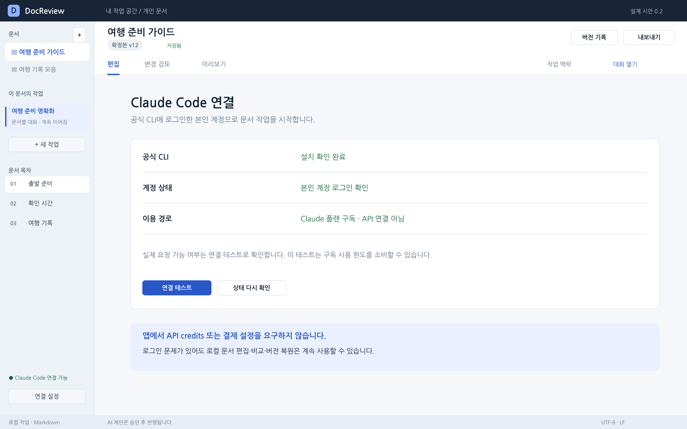
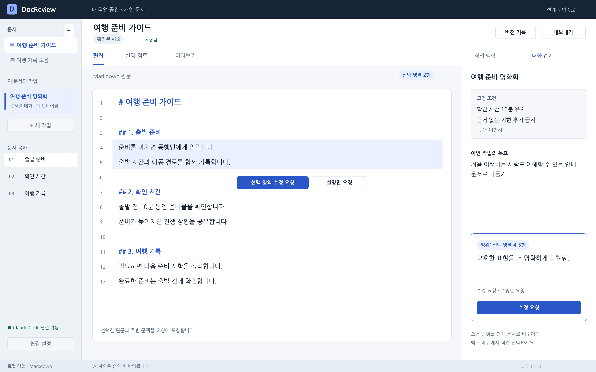
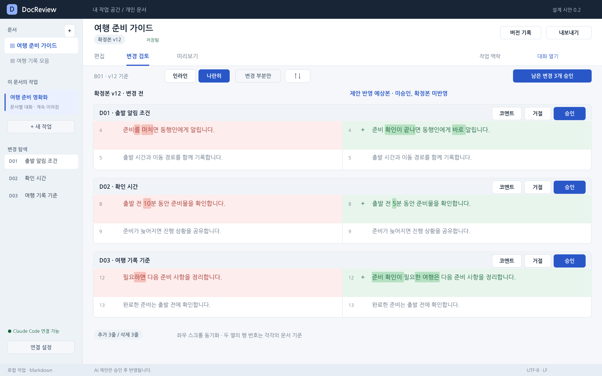
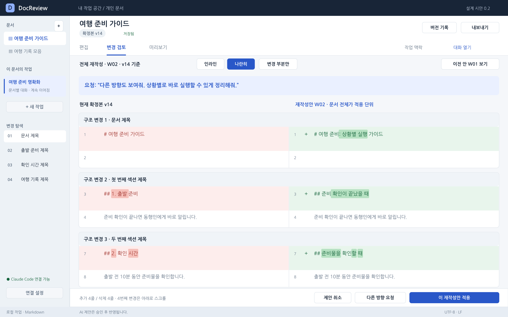
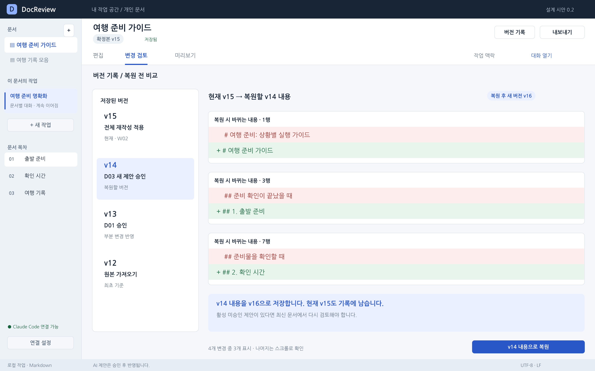
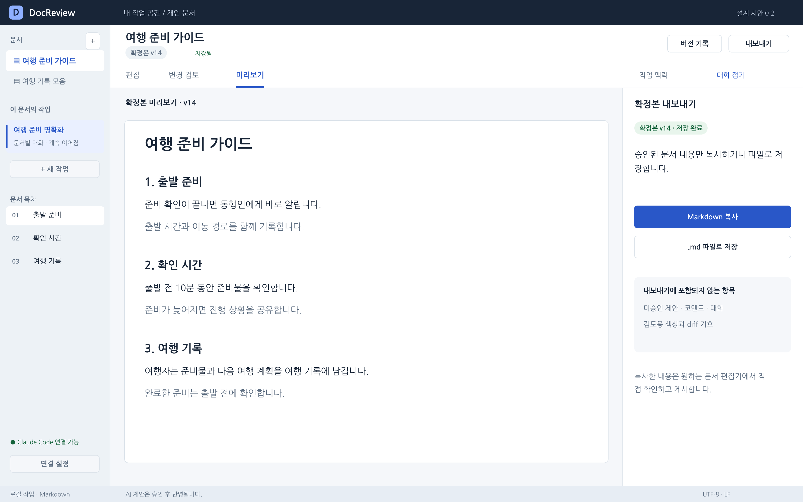

# AI 문서 검토 도우미 기능 명세서

문서 식별자 SPEC  |  버전 0.2  |  작성 기준일 2026년 10월 26일

> 0.2 개정: 실제 텍스트 diff를 중심으로 화면을 재설계했다. [시나리오별 화면](../design/scenarios.md), [디자인 명세](../design/design-guide.md), [별도 디자인 갤러리](../design/gallery.html)를 함께 읽는다. 화면은 설계 시안이며 실제 제품의 실행 화면이 아니다.

이 문서는 PRD의 MVP를 화면 동작, 상태 전이, 오류 처리 및 인수 조건으로 구체화한다. 개발자, 디자이너, 테스트 담당자가 같은 동작을 구현하고 판단하는 기준이다. 아래의 수치와 기술 세부값은 초기 설계값이며 실측 결과가 아니다.

## 1 반드시 유지할 제품 규칙

| ID | 규칙 |
| --- | --- |
| INV01 | AI 출력은 제안이다. 사용자 승인 명령 없이 확정본을 수정할 수 없다. |
| INV02 | 승인과 복원은 기준 버전 및 파일 상태를 검증한 후 하나의 작업으로 적용한다. |
| INV03 | 확정본은 사용자 직접 편집 또는 유효한 승인과 복원으로만 바뀐다. |
| INV04 | 미승인 제안, 코멘트, 대화는 복사와 .md 내보내기에 포함하지 않는다. |
| INV05 | 실패하거나 중단된 생성 결과를 자동 반영하지 않는다. |
| INV06 | 현재 버전은 로컬 저장 상태에서 결정한다. AI가 기억한 문서보다 우선한다. |
| INV07 | 복원은 새 버전을 만든다. 이미 저장된 버전은 덮어쓰지 않는다. |
| INV08 | 로그인과 인증 정보 관리는 공식 CLI가 담당한다. 앱은 토큰을 수집하지 않는다. |

## 2 용어와 상태의 기준

**확정본**은 사용자가 직접 편집하거나 승인한 현재 문서다. **제안 묶음**은 한 요청으로 생성한 검토 대상이고, **변경 단위**는 독립 승인 가능한 문장·문단 또는 결합된 변경 그룹이다. **작업**은 한 문서에서 하나의 목표를 이어가는 대화 단위다.

**문서 버전**은 저장된 내용과 해시를 가진 불변 기록이다. **편집 버퍼**는 아직 저장이 완료되지 않은 직접 입력이다. **기준 버전**은 AI 요청과 비교가 출발한 확정본 버전이다. **전체 재작성안**은 부분 적용을 제공하지 않는 문서 전체 후보다.

| 화면 상태 | 의미와 가능한 행동 |
| --- | --- |
| 편집 중 | 확정본 직접 편집, 요청 시작, 이전 작업 열기 |
| 생성 중 | 진행 상태와 중단 제공, 직접 편집은 허용하되 결과 유효성 재검사 |
| 검토 중 | 승인, 거절, 코멘트, 재제안, 제안 취소 |
| 검토 완료 | 남은 미승인 변경 없음. 확정본 확인과 내보내기 |
| 충돌 해결 필요 | 저장 또는 승인 차단. 두 내용을 비교하여 사용자 선택 |

로그인 실패가 로컬 편집을 차단하지 않는다.

## 3 S00 초기 설정과 연결

**FR01 연결 진단.** 공식 CLI의 위치, 버전, 지원 옵션, 인증 상태를 확인한다. 실행 파일이 없으면 공식 설치 안내를 제공한다. 앱에서 자격증명을 입력받는 로그인 폼은 만들지 않는다.

| 행동 | 동작과 완료 조건 |
| --- | --- |
| 공식 로그인 열기 | 공식 CLI의 인증 흐름을 사용자가 진행. 완료 후 상태 재확인 |
| 상태 다시 확인 | 실행 경로와 인증 정보를 다시 읽음. 토큰과 전체 환경변수는 표시하지 않음 |
| 연결 테스트 | 사용자가 누르면 최소 요청 실행. 사용 한도를 소비할 수 있음을 표시 |
| 설치 경로 변경 | 사용자가 고른 실행 파일의 출처와 버전 확인 후 사용 |

현재 앱은 본인 계정으로 로그인한 공식 CLI의 구독 인증을 사용한다. 개인 구독을 포함하며 별도의 API 결제 설정을 요구하지 않는다. 공식 안내와 실제 계정의 이용 가능 여부는 구분한다. [S1]

상태는 “CLI 없음”, “지원 기능 확인 필요”, “로그인 필요”, “연결 가능”, “네트워크 오류”, “한도 또는 계정 이용 정책 제한”으로 구분한다. 정확한 사유가 없는 실패에 “한도 초과”를 임의 표시하지 않는다. Console/API 인증이 감지되면 구독 경로와 다름을 알리고 공식 CLI에서 계정을 확인하도록 안내한다. 앱이 과금 경로를 자동 변경하지 않는다.

## 4 S01 문서와 작업

**FR02 문서 관리.** 새 문서는 앱의 로컬 작업 공간에 만든다. 기존 .md 열기는 원래 파일을 작업 파일로 사용하며 최초 내용 스냅샷을 생성한다. 저장 위치와 파일을 바꾸는 행동은 사용자에게 표시한다. UTF-8이 아닌 파일은 자동 변환하지 않고 변환 안내 또는 별도 사본 열기를 제공한다.

**FR03 직접 편집.** Markdown 원문 편집과 미리보기 탭을 제공한다. 직접 편집은 사용자 결정이므로 별도 AI 승인이 필요 없다. 저장 완료 표시 전에는 미저장 상태를 표시한다. AI 생성 도중 편집할 수 있지만 그 결과는 새로운 문서 기준으로 재검토한다.

**FR04 요청.** 작업 목표와 요청 본문을 입력하고 선택 영역, 현재 섹션, 문서 전체 중 범위를 정한다. 현재 섹션은 선택한 제목부터 다음 같거나 상위 수준 제목 직전까지다. 범위 선택은 요청 순간의 버전에 고정된다. 선택이 사라졌다면 전체 문서로 자동 변경하지 않는다.

**FR05 대화와 고정 조건.** 설명 요청은 대화 답변만 만든다. 수정 요청은 제안 묶음을 만든다. 고정 조건 변경은 이후 요청부터 적용한다. 앱 재시작 후에도 문서와 작업을 구분해 복원한다. 한 문서에 여러 작업을 만들 수 있으나 활성 생성은 한 건으로 제한한다.

요청 전 직접 편집 버퍼를 저장하고 기준 버전을 확정한다. 저장 실패 시 AI 요청을 시작하지 않는다. 다른 문서와 작업의 대화는 명시적으로 제공하지 않는 한 입력에 포함하지 않는다.

**사용성 보완(2026-10-28).** 조건 요약을 요청 위에서 확인하고, 조건 편집은 접어 둔다. 오른쪽은 작업명 → 조건 요약 → 범위·종류 → 지시·확인 → 대화 순서다. 요청 초안은 문서·작업별, 코멘트 초안은 문서·작업·제안·대상 쪽별로 세션 안에서 보관한다. 코멘트 작성 당시 revision과 인용이 달라지면 내용을 유지하고 명시적 대상 재확인을 요구한다. 앱 종료 후 미등록 초안 복원은 지원하지 않는다. 원문 저장과 초안 보관은 별도 표시한다.

원문 화면에서 유효한 남은 검토로 이동하고, 실패한 요청의 지시만 현재 초안에 가져와 새 기준으로 확인할 수 있다. 기존 초안 덮어쓰기는 사용자가 선택한다. 선택 승인과 전체 승인의 대상 수를 구분하고, 적용 완료 후 해당 적용 전 버전 비교로 연결한다. 좁은 폭에서 보조 패널을 접어 핵심 행동에 접근한다. 상세 구현·검증 범위는 [재구현 실행 기록](../development/design-reimplementation.md), 디자인 목표·실제 전후는 [3종 비교](../design/design-reimplementation.html)를 따른다.

## 5 S02 부분 변경 검토

**FR06 실제 변경 표시.** 기준 확정본과 검증된 후보의 실제 텍스트를 로컬에서 비교한다. AI가 작성한 변경 요약은 diff를 대신하지 않는다. 소스 Markdown이 정확한 비교 기준이다. 글자 장식이 적용된 미리보기는 보조 화면이다.

| 세부 ID | 동작 규칙 |
| --- | --- |
| FR06.1 | 인라인은 삭제 줄 다음에 추가 줄을 표시한다. 나란히는 왼쪽 확정본, 오른쪽 제안 반영 예상본을 표시한다. 보기 전환은 결정 상태와 코멘트를 바꾸지 않는다. |
| FR06.2 | 변경 줄에 −/+ 기호와 배경색을 함께 표시하고, 줄 안의 변경 표현은 더 진하게 표시한다. 실제 삭제·추가 없이 요약 카드만 표시하는 구현은 불가하다. |
| FR06.3 | 행 번호는 각 원문의 논리 행 기준이다. 자동 줄바꿈은 새 행으로 세지 않는다. 인라인은 이전/이후 두 행 번호 열을 가지며 해당하지 않는 셀은 비운다. |
| FR06.4 | 기본 문맥은 변경 전후 최대 3행이다. 문맥이 겹치면 겹친 행을 중복 출력하지 않고 연결해 보여줄 수 있으나 승인 경계는 유지한다. 변경 부분만/문서 전체 토글, 문맥 더 보기, 이전/다음 변경을 제공한다. |
| FR06.5 | 추가·삭제 줄 수는 실제 논리 행 diff에서 계산한다. 수정 한 줄은 삭제 1줄과 추가 1줄이다. 미승인 N개는 독립 승인 그룹 수이며 줄 수·코멘트 수와 다르다. |
| FR06.6 | 인라인/나란히 두 모드 모두 수정 불가능한 비교 화면을 기본으로 한다. “제안 직접 수정”만 후보 편집 상태를 열며 확정본 편집과 구분한다. |
| FR06.7 | 제목 이동은 MVP에서 삭제+추가로 표시한다. 같은 내용의 이동을 확정적으로 식별하거나 이동 전용 시각화를 제공한다고 약속하지 않는다. 연결된 변경은 하나의 그룹으로 승인한다. |
| FR06.8 | 공백과 줄바꿈 변경도 보존한다. Markdown에서는 공백이 의미를 가질 수 있으므로 공백 무시로 변경을 숨기는 기능은 MVP에서 제공하지 않는다. 필요 시 공백 문자 보기를 켤 수 있다. |
| FR06.9 | 차이가 없는 응답은 “변경 없음”이다. 승인 버튼과 건수에 포함하지 않는다. 파싱 실패·범위 초과 응답은 검토 가능한 변경으로 등록하지 않는다. |
| FR06.10 | 최신 확정본과 활성 묶음의 유효한 미승인 변경만으로 예상본을 구성한다. 승인한 변경은 확정본에 이미 포함되고, 거절·교체·취소된 제안은 예상본에서 제외한다. |

화면 S02/S03은 전체 13행 문서 중 세 변경을 추려 보여주는 시안이다. 구현에서는 생략한 구간에 “문맥 더 보기”를 제공해야 한다. 행 번호는 `../examples/base_v12.md`와 일치한다. [시나리오 SC02](../design/scenarios.md#sc02-변경-확인과-부분-승인)에서 전후 원문을 확인할 수 있다.

재구현 UI는 왼쪽 변경 탐색·중앙 실제 diff·오른쪽 변경 상세를 사용한다. 묶음/보기와 선택/결정을 두 도구 행으로 묶고, 본문 16px/1.8과 그룹 제목·선택 강조를 유지한다. 원문·미리보기 왕복에도 선택·보기·스크롤을 보존한다. 나란히 비교는 실제 각 열이 540px 미만일 때 인라인 전환을 안내한다.

**FR07 부분 승인.** 한 변경의 기준 문구, 범위, 연결된 제안 버전과 현재 파일 상태를 확인한다. 유효하면 해당 변경만 적용하고 새 문서 버전 및 승인 이벤트를 저장한다. 결합된 변경은 그룹 전체를 적용한다. 중복 클릭은 최초 결과를 반환한다.

**FR08 거절과 전체 승인.** 거절은 해당 제안을 REJECTED로 기록하며 확정본은 유지한다. “남은 변경 N개 승인”의 N은 현재 묶음에서 PENDING인 독립 승인 그룹 수다. 버튼을 누르면 현재 문서, 묶음, 포함 그룹과 제외된 거절 항목을 보여주는 짧은 확인창을 연다. 확인창의 최종 “N개 승인”이 적용 명령이다. 유효하지 않은 항목이 하나라도 있으면 버튼을 비활성화하고 원인을 표시한다. 확인창을 띄운 뒤 상태가 바뀌면 대상 수를 조용히 갱신하지 않고 확인창을 닫아 다시 검토하게 한다. 최종 실행 직전 다시 검사하며, 실패 시 어떤 항목도 적용하지 않는다.

**FR09 코멘트와 재제안.** 코멘트는 문서 버전과 대상 구간 또는 proposal_id 및 revision에 연결한다. 삭제 줄(변경 전)과 추가 줄(제안) 중 어느 쪽에 남겼는지, 정확한 인용 구간과 행 번호를 함께 저장한다. 줄 번호만으로 연결하지 않는다. 인라인/나란히 전환 후에도 같은 코멘트를 같은 논리 구간에 표시한다. 재제안 성공 시 이전 대상은 SUPERSEDED가 되고 새 제안은 PENDING으로 시작한다. 생성 실패 시 기존 제안을 유지한다. 제안 직접 수정도 새 revision이며 승인 결정은 승계하지 않는다.

코멘트는 열린 상태, 해결됨, 연결 위치 확인 필요로 표시한다. 제안이 대폭 바뀌어 위치 연결이 불가능하면 임의로 다른 문단에 붙이지 않는다. 해당 코멘트는 작업 목록에서 계속 볼 수 있다.

## 6 S06 전체 재작성과 이전 제안

**FR10 전체 재작성.** 사용자가 전체 재작성을 선택했거나 독립적인 부분 적용이 어려운 구조 변경인 경우 mode=REWRITE로 만든다. 부분 수정 요청이 재작성으로 확대되어야 하면 즉시 실행하지 않고 “문서 전체 재작성으로 요청” 행동을 제시한다.

전체 재작성도 인라인·나란히 실제 diff와 변경 간 이동을 제공한다. 구조 요약만 보여주고 적용하게 하지 않는다. 단, 개별 diff 구간에는 승인·거절 버튼을 제공하지 않는다.

현재 안을 보며 “다른 방향”을 요청하면 그 후보 ID와 원래 확정본 버전을 입력에 함께 전달한다. 기존 안은 새 결과가 완성될 때까지 유지한다. 새 안 생성 후에는 이전 안 목록으로 이동한다. 활성 후보는 하나지만 이전 후보는 읽거나 다시 선택할 수 있다.

**적용 조건:** 현재 확정본 버전이 후보의 기준과 일치하고 파일 충돌이 없어야 한다. 전체 내용과 적용 전 스냅샷을 하나의 작업으로 저장한다. 적용 후에는 새 버전과 “전체 재작성 적용” 이유를 표시한다. 부분 선택 체크박스는 제공하지 않는다.

미승인 부분 제안이 있을 때는 “이전 제안을 기록으로 옮기고 확정본에서 재작성” 버튼으로 전환한다. 전환 후 이전 묶음은 활성 검토 대상에서 빠지며 이미 승인된 내용은 확정본에 남는다. 전환 취소 시 원래 검토 상태를 유지한다.

**제안 취소:** 아직 적용하지 않은 후보만 DISCARDED로 바꾼다. 이미 반영한 변경까지 되돌리려면 버전 복원을 사용한다. 취소한 후보는 읽기용 작업 기록에 남으며 바로 재승인할 수 없다. 다시 사용하려면 최신 확정본에 대한 새 후보로 만들어 검증한다.

## 7 S07 편집 취소와 버전 복원

**FR11 세 가지 되돌리기.** Ctrl 또는 Cmd+Z는 현재 직접 편집 구간만 되돌린다. AI 승인, 전체 재작성 적용, 버전 복원 및 외부 변경 반영은 편집 기록의 경계다. 경계가 생기면 기존 편집 undo와 redo 스택을 종료하여 과거 승인이나 다른 내용을 조용히 덮지 않게 한다. 이전 상태는 버전 기록에서 복원한다.

**FR12 버전 복원.** 현재 버전과 선택 버전을 비교한 후 “이 버전으로 복원”을 실행한다. 미저장 입력을 먼저 저장한다. 저장 실패나 외부 충돌이 있으면 복원하지 않는다. 복원 전 상태를 보관하고 선택 버전의 내용을 새 head 버전으로 저장한다.

예를 들어 v14에서 v12를 선택하면 v12의 내용을 가진 v15가 생성된다. v14는 그대로 남는다. 다른 파일명으로 저장하는 행동과 버전 복원을 혼동하지 않도록 한다.

복원 후 모든 활성 미승인 제안은 STALE로 표시한다. 과거 버전에 연결된 코멘트와 대화는 보존한다. AI 세션 자체를 과거로 되감지 않으며 다음 요청에 복원 이벤트와 현재 확정본을 전달한다.

버전은 직접 편집 저장, 승인, 전체 적용, 외부 변경 수용, 복원 시 생성한다. 짧은 자동 저장은 목록에서 하나의 편집 구간으로 묶어 표시할 수 있으나 내부 저장 순서와 복구 가능성을 잃지 않는다. MVP에서는 저장된 버전을 자동 삭제하지 않는다.

## 8 S10 확정본 복사와 내보내기

**FR13 결과 내보내기.** 저장이 끝난 확정본 버전을 고정하여 미리보기, Markdown 복사, .md 파일 저장을 수행한다. 내보내기 직전 편집 버퍼를 저장한다. 미승인 변경이 남아 있으면 “미승인 N건은 제외하고 확정본만 내보냅니다”라고 표시한다. 해당 사실을 알린 뒤 내보내기를 허용한다.

기존 파일을 덮어쓰는 저장은 OS의 덮어쓰기 확인 흐름을 따른다. 새 경로의 사본 내보내기는 현재 문서의 작업 ID와 파일 연결을 바꾸지 않는다. 작업 파일의 경로 변경은 별도 “다른 이름으로 작업 파일 저장” 동작으로 구분한다.

| Markdown 요소 | MVP 처리 |
| --- | --- |
| 제목, 문단, 강조, 인용, 목록 | 원문 편집과 미리보기 지원 |
| 링크, 코드 블록, 기본 표 | 원문 보존 및 미리보기. 복사 후 대상 편집기에서 확인 |
| 이미지 참조 | 링크 원문 보존. 첨부 업로드와 이미지 이전은 하지 않음 |
| 원시 HTML, 매크로, 임베드 | 원문 보존. 미리보기에서는 실행하지 않음 |

현재 서식 포함 HTML 복사는 지원하지 않는다. Markdown 복사가 모든 외부 문서 서비스 편집기에서 자동으로 서식을 보존한다고 보장하지 않는다. 앱에는 외부 문서 서비스 게시 버튼, 게시 상태, 게시 이력 테이블을 만들지 않는다.

## 9 작업 맥락과 세션 연속성

**FR14 맥락 보존.** 문서 ID와 작업 ID는 별개다. 같은 작업을 재개하면 저장된 목표, 고정 조건, 사용자 결정, 코멘트, 대화와 활성 제안을 불러온다. CLI 세션 ID는 이 작업에 연결된 외부 실행 정보로 취급하며 앱 상태의 유일한 근거로 사용하지 않는다.

| 맥락 층 | 내용 | 갱신과 적용 규칙 |
| --- | --- | --- |
| 문서 공통 | 용어, 독자, 문체, 공통 금지 조건 | 사용자가 변경하면 이후 요청에 적용 |
| 작업 목표 | 이번 작업의 목적과 요청 범위 | 작업별 독립 보관 |
| 확정본 | 현재 버전, 본문, 해시, 제목 구조 | 요청 직전 저장된 상태로 교체 |
| 사용자 결정 | 승인, 거절, 거절 이유, 복원, 직접 수정 | 순서가 있는 이벤트로 누적 |
| 대화 | 사용자 요청과 AI의 공개 응답 | 앱의 작업 로그로 보관 |
| 요약 | 오래된 작업 경과의 압축 | 고정 조건과 명시적 결정을 덮어쓰지 않음 |

매 요청에는 현재 기준 버전, 필요한 본문, 고정 조건, 대상 범위, 최근 결정과 코멘트를 전달한다. 이전 AI 제안이 승인됐다고 가정하지 않는다. 범위 밖 내용은 참고 문맥일 뿐 수정 허가가 아니다.

기존 CLI 세션이 유효하면 명시적 ID로 재개한다. 세션 기록이 없거나 재개할 수 없으면 로컬 맥락으로 새 세션을 만들며 화면에 구분해 표시한다. 범용 “가장 최근 대화 이어가기” 방식으로 다른 작업의 대화가 섞이지 않게 한다. [S2]

대화가 길어지면 이전 대화를 요약할 수 있지만 고정 조건, 최신 확정본 및 최근 사용자 결정은 요약만으로 대체하지 않는다. 모델의 문맥 크기를 넘으면 관련 부분만 선택하거나 범위를 줄이도록 알린다. 사용자 요청을 숨겨서 잘라내지 않는다. [S3]

**새 작업 만들기**는 동일 문서에서 새로운 목표를 시작한다. 문서 공통 조건은 이어받고 이전 작업 대화와 임시 지시는 기본 입력에서 제외한다. 다른 작업의 요약을 선택해 가져오는 기능은 제공하지 않는다.

## 10 생성과 제안의 상태 전이

**FR15 생성 관리.** job_id로 요청을 식별한다. 작업당 생성 한 건, 문서당 활성 생성 한 건을 허용하며 MVP는 앱 전체에서도 한 건씩 실행한다. 실행 중 추가 요청은 자동 대기열에 넣지 않고 “진행 중인 요청을 중단한 뒤 다시 요청” 행동을 제시한다.

| 대상 | 상태 전이 | 적용 규칙 |
| --- | --- | --- |
| 생성 작업 | CREATED → RUNNING → SUCCEEDED | 출력 검증과 결과 저장까지 끝나야 성공 |
| 생성 작업 | RUNNING → CANCELLING → CANCELLED | 늦게 도착한 결과는 승인 가능한 제안으로 만들지 않음 |
| 생성 작업 | CREATED 또는 RUNNING → FAILED | 사유를 보관하고 확정본 유지 |
| 제안 결정 | PENDING → ACCEPTED 또는 REJECTED | 한 revision에 대한 결정은 불변 |
| 제안 교체 | PENDING → SUPERSEDED | 재제안 성공 후 새 revision 생성 |
| 제안 취소 | PENDING → DISCARDED | 확정본 및 이미 승인한 변경 유지 |
| 유효성 | VALID, STALE, CONFLICT | 결정 상태와 별도 필드로 관리 |

STALE은 기준 버전이 달라 재검토가 필요한 상태다. CONFLICT는 대상 원문 또는 범위가 맞지 않는 상태다. 둘 다 승인할 수 없다. 일반 사용자에게 보류 상태는 제공하지 않는다. 미결정 제안은 PENDING으로 남는다.

한 묶음에서 일부를 승인하면 기준 원본은 보관하고 승인 적용 기록을 이용해 남은 변경 위치를 계산한다. 이 앱이 적용한 같은 묶음의 변경만 순차 반영할 수 있다. 직접 편집, 다른 작업 승인, 외부 변경 또는 복원으로 head가 바뀌면 남은 제안은 모두 STALE로 전환한다. 자동 의미 병합은 하지 않는다.

재시도는 새 attempt_id를 가지며 이전 attempt와 연결한다. 응답 수신 여부를 알 수 없는 네트워크 오류는 사용자가 재시도한다. 같은 요청이 서버에서 다시 실행되어 한도를 소비할 수 있음을 설명한다. 앱 내부에는 attempt별 결과를 한 번만 등록한다.

중단은 로컬에서 결과 채택을 멈추는 보장이다. 이미 서버에서 처리된 요청의 사용량이 취소되거나 환불된다는 의미는 아니다.

## 11 저장과 충돌 처리

**FR16 자동 저장.** 입력 멈춤 후 500 ms를 기본 저장 지연으로 한다. 이는 목표값이다. 실제 디스크와 DB 기록이 끝난 뒤에만 “저장됨”을 표시한다. 화면 이동, AI 요청, 승인, 복원, 내보내기와 정상 종료 전에는 남은 입력을 먼저 저장한다. 강제 종료로 아직 저장되지 않은 마지막 입력까지 보존한다고 약속하지 않는다.

문서 내용, 제안, 코멘트, 대화는 서로 다른 저장 대상이다. AI 생성 중간 텍스트는 진행 표시일 뿐 확정 결과가 아니다. 종료된 작업의 검증된 응답만 영속 제안으로 등록한다. 로컬 대화와 CLI의 자체 세션 기록은 각각 보관되므로 삭제 및 백업 범위 안내가 필요하다.

**FR17 외부 수정.** 작업 파일의 변경을 감지하고 모든 쓰기 직전에 해시를 다시 비교한다. 외부 수정 시 자동 덮어쓰기를 멈추고 앱 버전과 파일 버전을 비교한다.

| 사용자 선택 | 처리 |
| --- | --- |
| 외부 파일을 현재 버전으로 사용 | 앱의 기존 상태를 스냅샷으로 보관한 후 외부 내용으로 새 버전 생성 |
| 앱 내용을 다른 파일로 저장 | 외부 파일은 그대로 두고 새 경로에 사본 또는 새 작업 파일 생성 |
| 비교 후 수동 통합 | 두 내용을 보여주고 사용자가 새 통합 내용을 확정 |

외부 파일을 무조건 덮어쓰는 기본 버튼은 제공하지 않는다. 연결 파일이 삭제되거나 이동되면 새 위치 선택 또는 사본 저장을 제공한다. 같은 경로를 다른 창이나 앱 인스턴스가 동시에 쓰지 않도록 단일 작성자 잠금을 사용한다.

**FR18 장애 복구.** 문서 파일과 DB의 저장 도중 앱이 종료되면 시작 시 저장 저널을 확인한다. 저장 전 또는 저장 후의 일관된 상태로 복구한다. 중간에 외부 수정된 내용은 별도 보관하고 충돌로 전환한다. 복구가 끝나기 전에는 해당 문서의 쓰기와 AI 요청을 막는다.

## 12 제안 적용 전 검증

기준 버전, 정확한 원문, 대상 범위, 제안 revision, 중복 여부, 변경 간 겹침, 인코딩과 출력 크기를 검증한다. 위치만 맞거나 비슷한 문장이 있다는 이유로 적용하지 않는다. 동일한 문장이 반복되면 문맥과 블록 식별자를 함께 확인한다. 검증 실패 시 새 기준으로 다시 제안받게 한다.

## 13 오류와 비기능 요구사항

| 코드 | 상황 | 사용자에게 제공할 행동 |
| --- | --- | --- |
| AUTH_REQUIRED | 공식 CLI 로그인 필요 | 공식 로그인 열기, 상태 재확인 |
| CLI_UNSUPPORTED | 필요한 옵션 또는 출력 형식 불일치 | 지원 버전 안내, 진단 정보 복사 |
| NETWORK_ERROR | 연결 실패 또는 응답 상태 불명 | 작업 유지, 수동 재시도 |
| RATE_OR_POLICY | 확인된 한도 또는 계정 이용 정책 제한 | 제공된 원인 표시, 이후 재시도 |
| OUTPUT_INVALID | 스키마, 누락 필드 또는 의미 검증 실패 | 확정본 유지, 재요청 |
| STALE_BASE | 요청 뒤 확정본 변경 | 최신 문서로 다시 요청 |
| FILE_CONFLICT | 외부 수정 또는 파일 교체 | 비교, 외부 버전 수용, 별도 저장 |
| SAVE_FAILED | 디스크 부족, 권한, 잠금 오류 | 입력 유지, 다른 위치 저장, 재시도 |
| SESSION_MISSING | 원래 CLI 대화 재개 불가 | 로컬 맥락으로 새 세션 생성 |
| CONTEXT_TOO_LARGE | 입력 또는 응답 상한 초과 | 범위 축소 또는 작업 분리 |

기술 오류 원문에 인증 정보나 문서 내용이 들어갈 수 있으므로 진단 복사는 필터링된 메타데이터만 포함한다. 의미 있는 원인이 없으면 UNKNOWN_ERROR를 사용한다.

| ID | 초기 검증 목표 |
| --- | --- |
| NFR01 | 1 MiB 이하 UTF-8 .md 열기와 기본 편집 지원. 8 GB 메모리급 기준 장치에서 열기 2초 이내 목표 |
| NFR02 | 50 KiB 문서의 변경 비교와 승인 UI 반응 300 ms 이내 목표. 실제 저장 완료와 AI 응답 시간은 별도 측정 |
| NFR03 | 입력 맥락 합계 200 KiB, 검증 응답 2 MiB를 초기 상한으로 설정. 모델 한도가 더 작으면 그 한도를 우선 |
| NFR04 | 저장 완료로 표시한 버전과 검토 상태는 재시작 후 복원. 강제 종료 지점별 검증 |
| NFR05 | 키보드 이동과 가시적 포커스 지원, 색상 외 텍스트로 변경 상태 구분 |
| NFR06 | 로컬 편집, 비교, 저장, 복원과 내보내기는 오프라인 지원. AI 생성은 연결 필요 |

외부로 전송되는 입력의 범위는 요청 전 확인 가능해야 한다. 문서 내용이 포함된 진단 수집과 자동 텔레메트리는 MVP에서 기본 비활성화한다. 로컬 저장은 기본적으로 암호화 DB를 의미하지 않으며 OS 계정과 디스크 보호 정책을 따른다.

## 14 핵심 인수 시나리오

[제품 인수 기준](acceptance-criteria.md#14-핵심-인수-시나리오)에서 AT01~AT14와 필수 경계 사례를 확인한다.

## 15 근거와 적용 범위

- [S1 Claude 플랜과 프로그램 호출의 현재 안내](https://support.claude.com/en/articles/15036540-use-the-claude-agent-sdk-with-your-claude-plan)
- [S2 Claude Code CLI 참조](https://code.claude.com/docs/en/cli-reference)
- [S3 Claude Code 문맥 관리](https://code.claude.com/docs/en/context-window)

자료 확인일은 2026년 10월 26일이다. 화면 상태와 수치, 저장·승인 규칙은 이 앱의 설계 제안이다. 지원 OS와 데이터 보존의 제한은 [설치 안내](../installation.md)를 따른다. 외부 편집기에 붙여넣은 결과는 해당 편집기에서 확인한다.

## 16 Diff 화면의 상태와 인수 조건

| 상황 | 화면과 버튼 |
| --- | --- |
| 정상 미승인 | 변경별 승인·거절·코멘트, 남은 변경 전체 승인 가능 |
| 생성 중 | 기존 제안은 읽기 가능. 같은 대상의 재생성 중에는 승인 잠금과 중단 제공 |
| 생성 실패 | 기존 제안과 코멘트 유지, 오류와 재시도 표시. 미완성 diff 없음 |
| 일부 승인 | 승인 항목은 완료 목록으로 접고 최신 확정본으로 남은 항목 비교 재계산 |
| 거절 | 기본 미승인 diff에서 제외. 처리됨 목록에서 당시 차이와 이유 읽기 가능 |
| 코멘트 재제안 | 기존 revision은 교체됨, 새 revision은 미승인. 해결됨 자동 처리 없음 |
| 최신 본문과 기준 불일치 | “최신 문서에서 다시 제안 필요”. 개별·전체 승인 차단 |
| 외부 파일 충돌 | 앱 버전/파일 버전 diff로 전환. 자동 저장 및 AI 요청·승인 차단 |
| 미승인 0개 | 빈 검토 영역에 “검토 완료”와 확정본 미리보기 제공 |
| 생성 결과에 차이 없음 | “요청 범위에서 변경 없음”. 검토 완료와 별도로 결과 기록 |

실패·제한·연결 필요 상태는 본문과 구별되는 배너로 표시한다. 메시지 원인, 보존된 데이터, 다음 행동을 함께 쓴다. 검토 상태가 달라져 버튼을 없앨 때는 키보드 포커스를 다음 변경 또는 완료 메시지로 옮긴다.

[추가 인수 조건](acceptance-criteria.md#16-diff-화면의-추가-인수-조건)에서 AT15~AT24를 확인한다.
