# UX 개선의 실제 앱 화면

2026-11-02 · DocReview 0.1.0 · macOS Tauri/WKWebView.
[제안 화면 1~9](../../design/ux-proposal/index.html)에 대응하는 실제 실행 화면이다. 합성 문서·소유 임시 SQLite·가짜 Claude/Codex를 사용했으며 PNG 원본은 편집하지 않았다. 캡처 빌드·시각·크기·해시는 [manifest.json](manifest.json)에 기록한다.

[구현·검증 현재 상태](../../development/ux-status.md) · [원문 요청 수명 보완](../../development/source-request-lifecycle-fixes.md) · [시안 대조·예외](../../development/selection-popover-audit.md) · [현재 화면 계약](../../design/ux-runtime-contract.md) · [팝오버 작업 계획](../../development/selection-popover-plan.md)

| 화면 | 실제 상태 | 원본 artifact 폴더 | 재현 테스트 |
| --- | --- | --- | --- |
| 1 | diff 팝오버 → 선택 수정 작성 | selection-popover / ux | selection-popover.e2e.mjs / ux.e2e.mjs |
| 2 | 범위·문맥·모델 확인 | ux | ux.e2e.mjs |
| 3 | 새 미승인 후보 | ux | ux.e2e.mjs |
| 4 | 변경 전 인용의 수정 차단 | ux | ux-local.e2e.mjs |
| 5 | 원문 팝오버·확인·성공·실패·겹침 | selection-popover | selection-popover.e2e.mjs |
| 6 | 원문 편집 영향 | ux | ux-local.e2e.mjs |
| 7 | 과거 후보 비교 | ux | ux-local.e2e.mjs |
| 8 | 실제 결정에 따른 완료 | ux | ux-local.e2e.mjs |
| 9 | 요청 종류·첫 지시 보존 | ux | ux-local.e2e.mjs |

원본 경로는 `apps/desktop/.artifacts/` 아래다. 시안의 표본 문장·건수·버전·모델과 캡처 데이터는 다르다. 같은 과업의 행동·범위·정보 위계를 대조하며 픽셀 완전 일치를 주장하지 않는다. 실제 계정의 응답 품질이나 작성자 사용성 평가 결과도 아니다.

## 1. diff 선택 팝오버와 수정 작성

제안 내용을 선택하면 가까운 곳에 강조된 ‘이 부분 수정’과 보조 ‘코멘트’가 뜬다. 문장·문단 확장은 ‘더보기’에서 선택한다. 본문 상단의 같은 버튼은 제거했다.

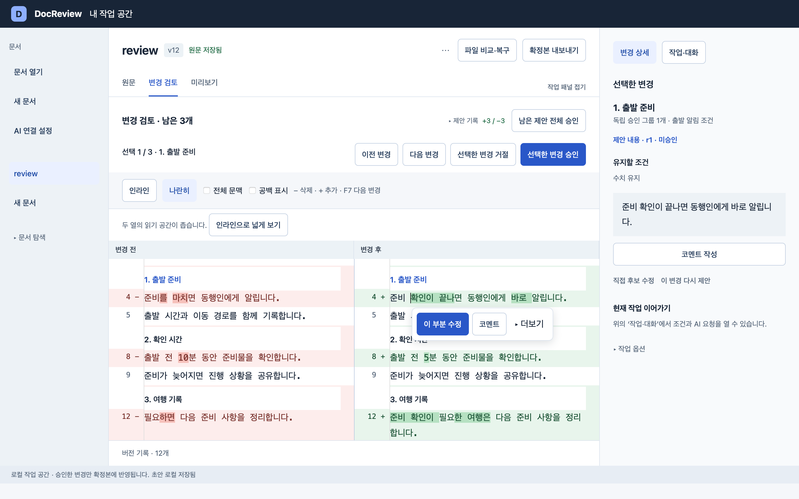

‘이 부분 수정’을 누르면 팝오버를 닫고 오른쪽에서 인용·대상 revision을 고정해 지시를 한 번 작성한다. 시안의 팝오버와 작성창은 실제로 순차 상태다.

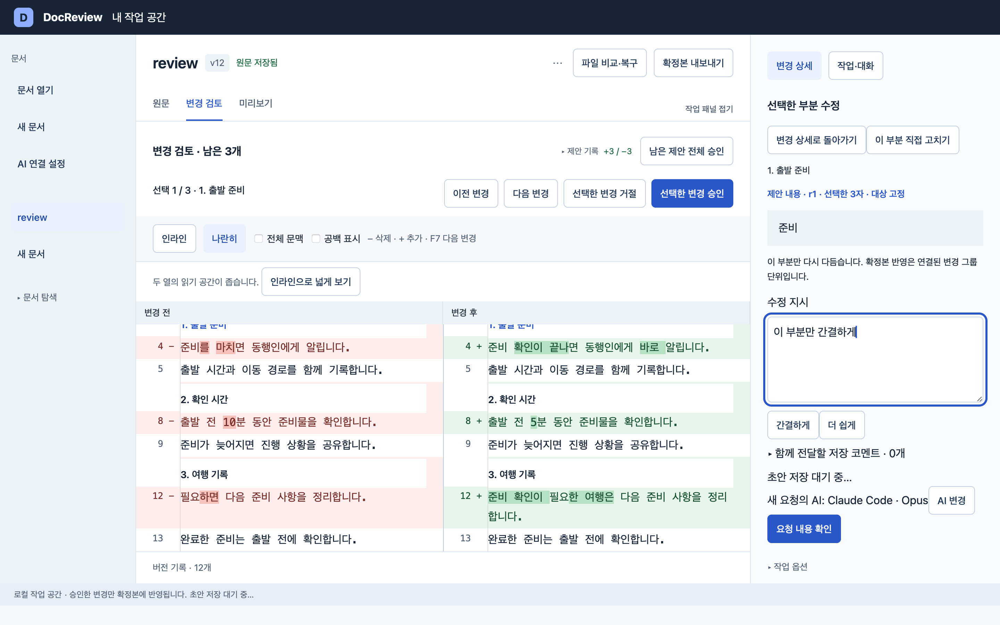

## 2. 범위·문맥·모델 확인

확인 단계는 작성 필드를 대신해 정확한 인용·지시·모델·전달 문맥·승인 전 확정본 유지 원칙을 보여준다. 문맥 전문은 펼쳐 읽으며 ‘확인 후 요청’으로만 실행한다. 수정 허용 범위와 외부 전송 문맥은 다르다.

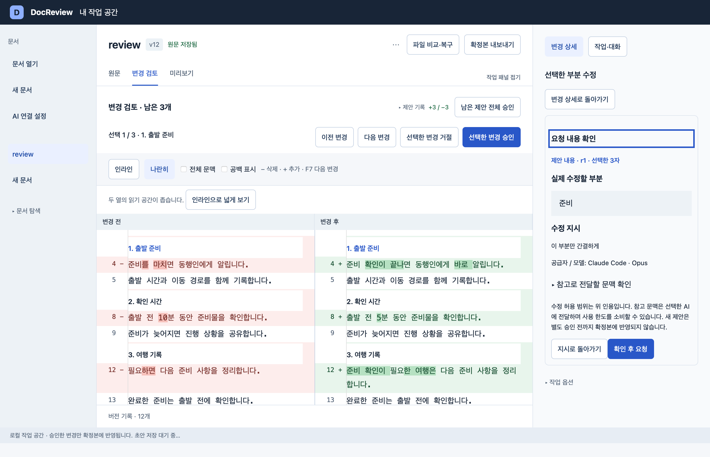

## 3. 새 미승인 후보

같은 변경의 새 revision을 표시하고 이전 후보 비교·재요청 경로를 제공한다. 승인은 기존 변경 그룹의 별도 행동이다. 선택 밖 문구·다른 제안·확정 파일 보존은 화면만으로 판정하지 않고 저장값 테스트로 확인한다.

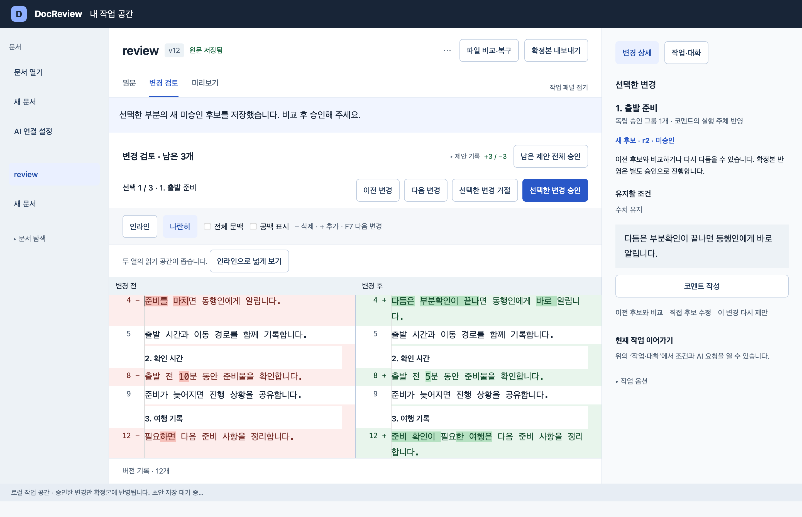

## 4. 수정할 수 없는 선택

이 사례는 변경 전 문장을 선택했으므로 참고 인용이라는 이유와 제안 쪽 재선택을 안내한다. 최초 시안의 혼합 선택과 다른 실패 사례이며 두 경우 모두 전체 대상으로 자동 확대하지 않는다. AI의 잘못된 응답도 지시를 보존하는 별도 E2E로 검사한다.

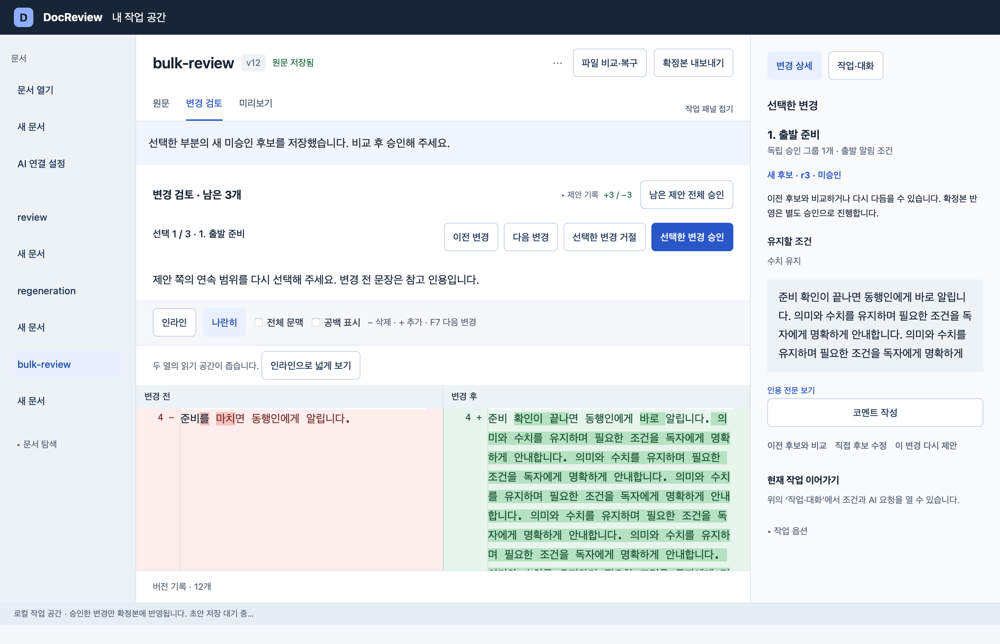

## 5. 원문 선택 팝오버와 새 부분 제안

원문도 드래그를 마치면 선택 옆에 ‘이 부분 수정’이 뜬다. 선택·복사만으로 일반 요청 범위나 작성 대상은 바뀌지 않는다. 아래는 기존 고정 버튼을 대체한 현재 흐름이다.

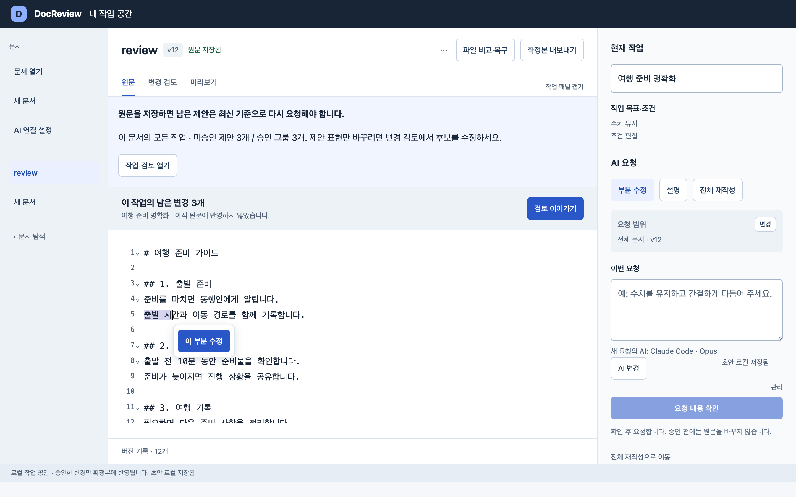

버튼을 누른 뒤 인용을 고정하고 지시를 작성한다. 저장된 원문·작업·head·인용을 검증한 다음 실제 문맥과 모델을 확인한다. 일반 생성과 달리 기존 미승인 묶음을 보존하는 확정본 선택 요청이다.

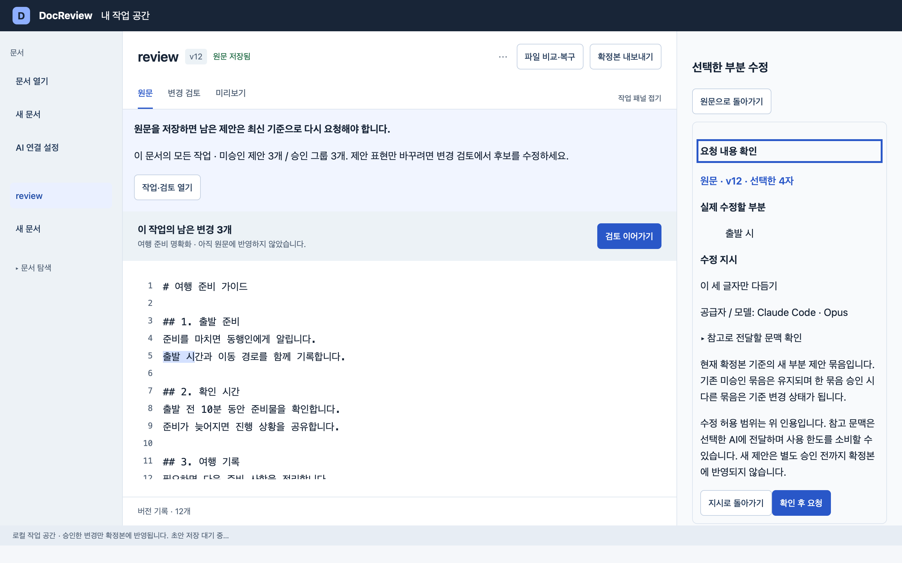

성공하면 정확한 새 미승인 묶음의 검토를 연다. 생성 시 기존 제안은 유지하지만 이후 한 묶음을 승인하면 다른 묶음의 기준이 바뀔 수 있다.

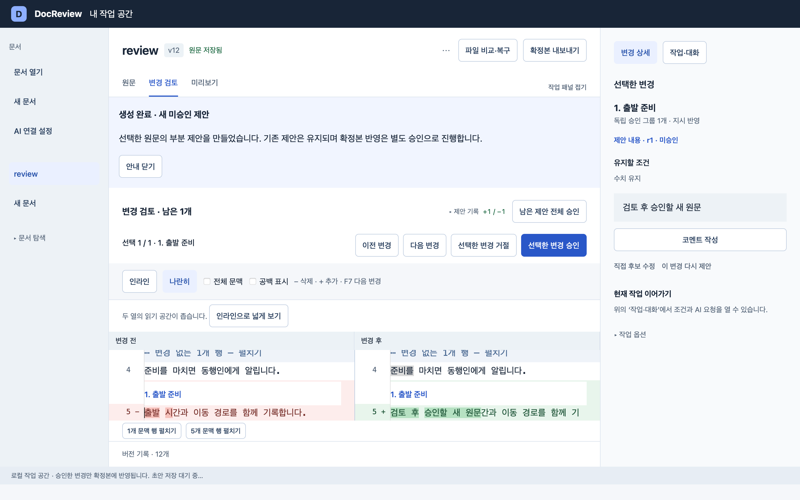

실패하면 원문·인용·지시를 유지해 수동 재시도한다. 미승인 제안과 겹치면 다른 작업까지 조회해 해당 검토를 여는 명시적 버튼을 제공하며 원문 위치를 후보 위치로 추정하지 않는다.

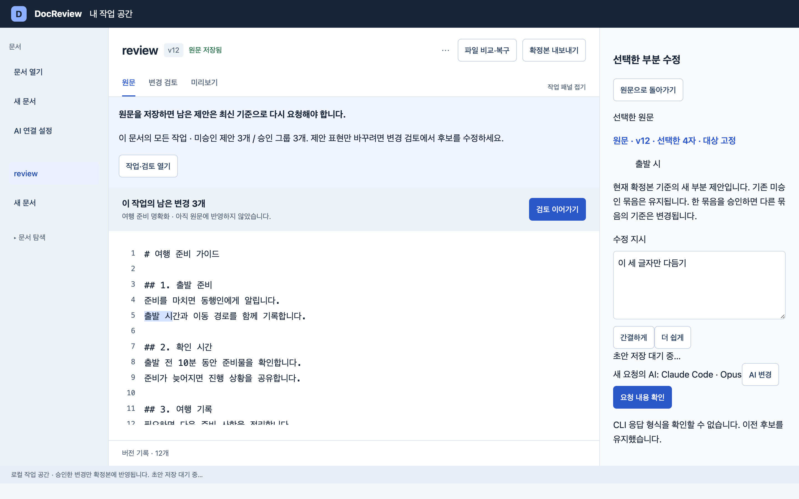

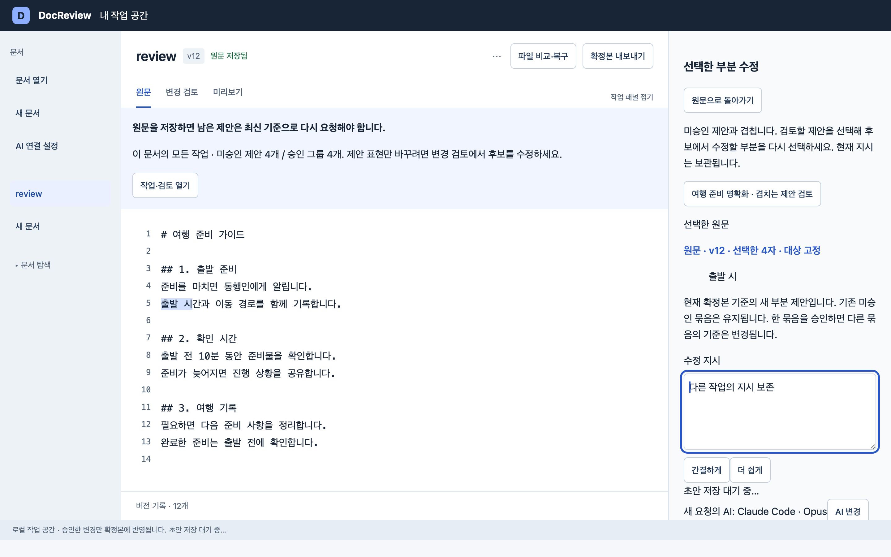

## 6. 원문 편집 영향

문서 전체의 미승인 제안·승인 그룹·재작성 후보 영향을 표시한다. 안내에서 작업·검토로 이동할 수 있으며 입력마다 모달을 띄우지 않는다. 건수는 실제 저장 상태다.

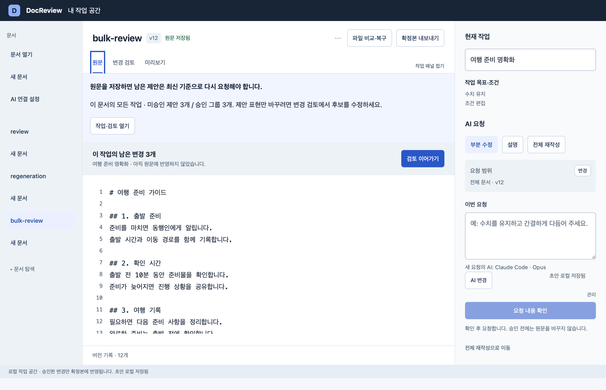

## 7. 과거 후보 비교

중앙에서 이전 후보와 새 후보의 읽기 전용 비교를 연다. 당시 기준과 현재 검토 복귀를 표시하고 이력에서 승인하지 않는다. 이 캡처는 revision 비교이며 새 요청으로 보관된 묶음의 비교는 별도 상태다.

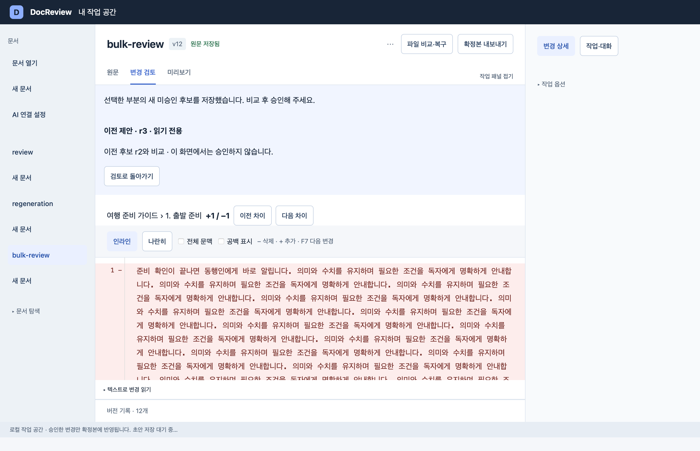

## 8. 검토 완료

실제 결정으로 완료와 승인·거절 수를 표시한다. 이 합성 사례는 3개 제안을 모두 거절했으므로 확정 파일은 그대로다. 이전 선택 오류 안내는 완료 후 표시하지 않는다. 내보내기는 문서 상단의 공통 행동을 사용한다.

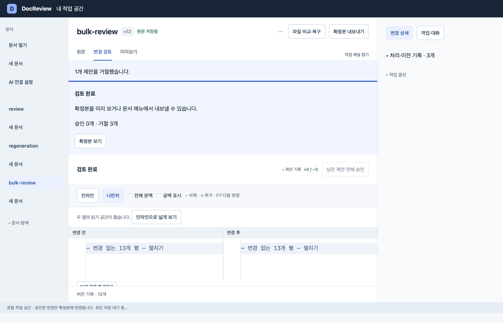

## 9. 요청 종류와 첫 지시 보존

‘부분 수정 / 설명 / 전체 재작성’을 한 진입점에서 선택한다. 첫 작업과 첫 지시를 함께 저장하며 확인을 취소해도 지시는 남고 작업을 중복 생성하지 않는다.

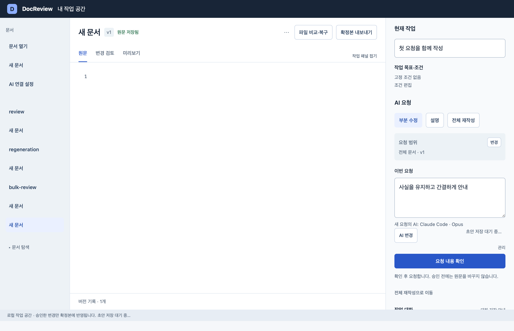

## 좁은 창·확대와 키보드

원문·diff 각각 1440×900·1280×800·800×600 × 100/150/200%를 검사했다. 아래는 800×600·200%의 원문이다. 선택 강조와 버튼의 실제 hit target을 확인했으며, 낮은 높이는 본문 공간을 확보하고 세로 스크롤로 읽는다.

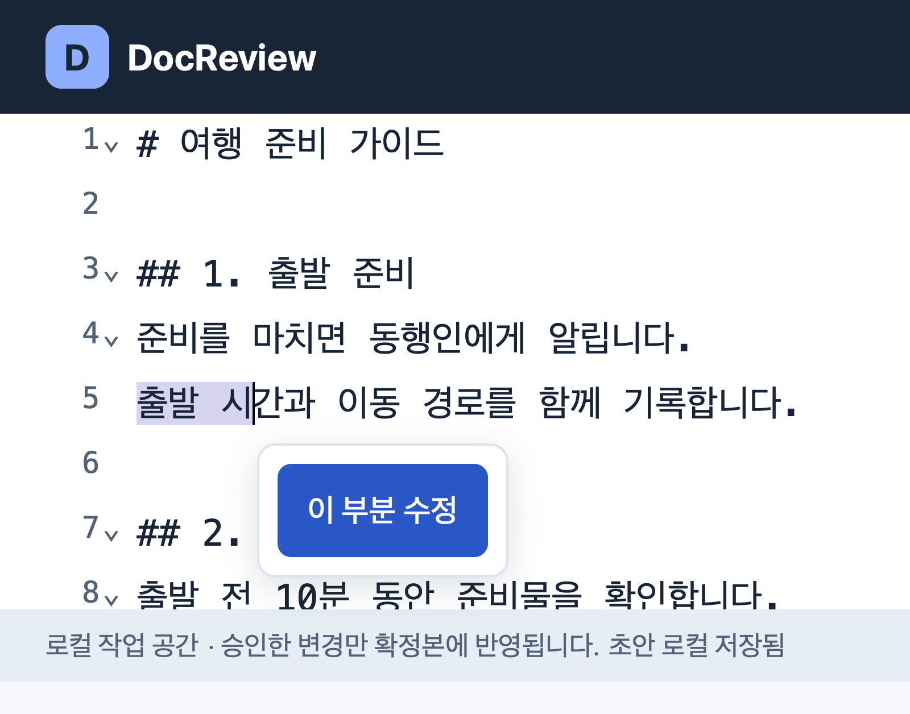

선택 뒤 `Shift+F10`으로 행동에 포커스를 옮기고 `Enter`로 연다. `Tab`으로 코멘트 등 보조 행동, `Escape`로 편집기에 돌아간다. 일반 release에서도 OS 키 입력으로 원문 작성창·diff 코멘트의 정확한 인용을 확인했다. 실제 한국어 IME 조합·VoiceOver·작성자 평가는 [남은 수동 인수](../../development/ux-native-validation.md)다.

## 전환 경계 보완

원문과 후보에서 서로 다른 지시를 작성한 뒤 원문으로 돌아온 화면이다. 원문의 고정 인용·지시와 활성화된 ‘요청 내용 확인’을 유지한다. 후보 탭의 마지막 대상과 지시는 별도로 복원한다.

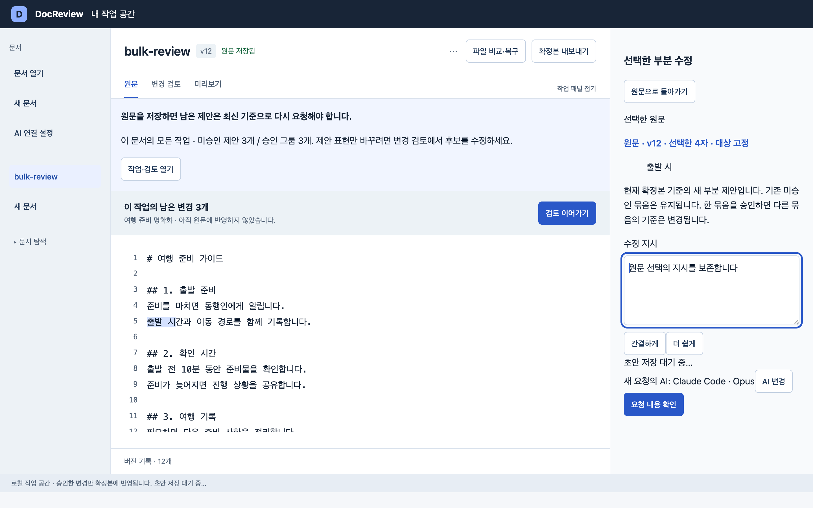

변경 A의 부분 수정을 작성하면서 B로 이동한 뒤 저장한 결과다. A의 새 r2와 ‘선택 1 / 3 · 1. 출발 준비’로 함께 복귀해 상세 후보와 승인 대상이 일치한다. 확정본은 승인 전까지 그대로다.

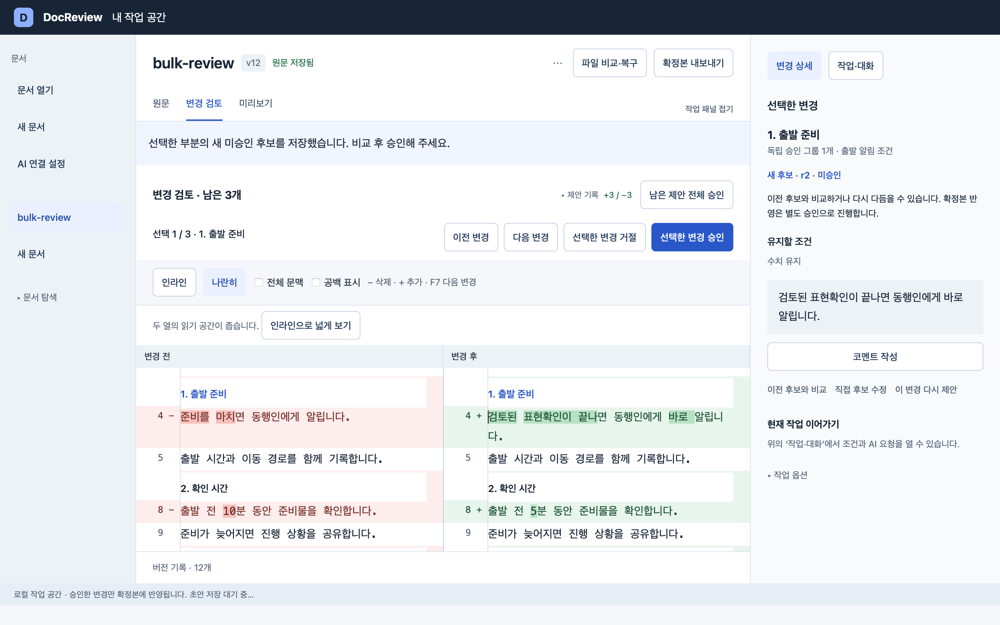

## 원문 요청 중 보기 왕복

원문 요청 실행 중 다른 보기를 읽고 돌아와도 실행 잠금과 완료·오류 처리를 유지한다. 성공하면 빈 작성창을 남기지 않고 새 제안으로 이동한다. 실패하면 같은 인용과 지시를 유지하고 오류와 재준비 행동을 제공한다. 작업을 바꾸면 임시 작성창은 닫고, 이전 작업의 늦은 완료가 현재 작업을 바꾸지 않는다.

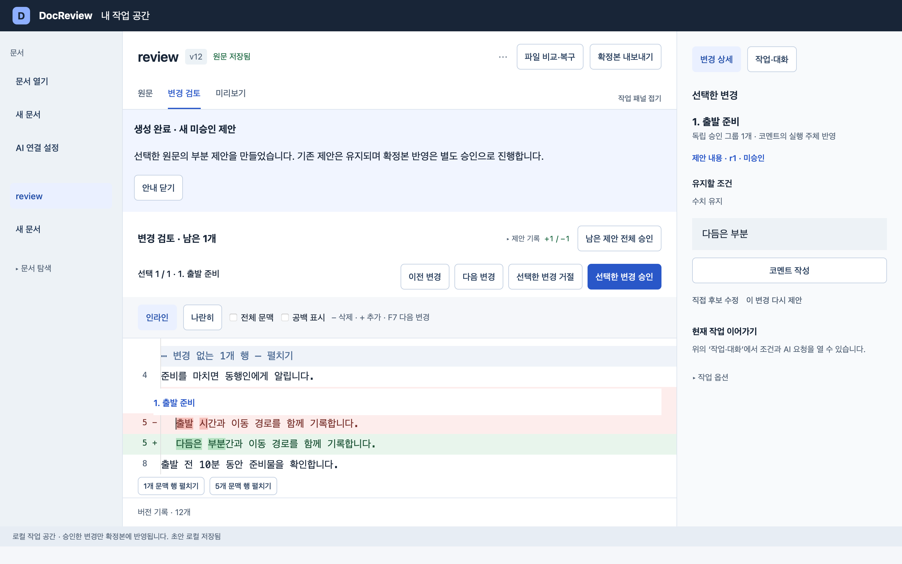

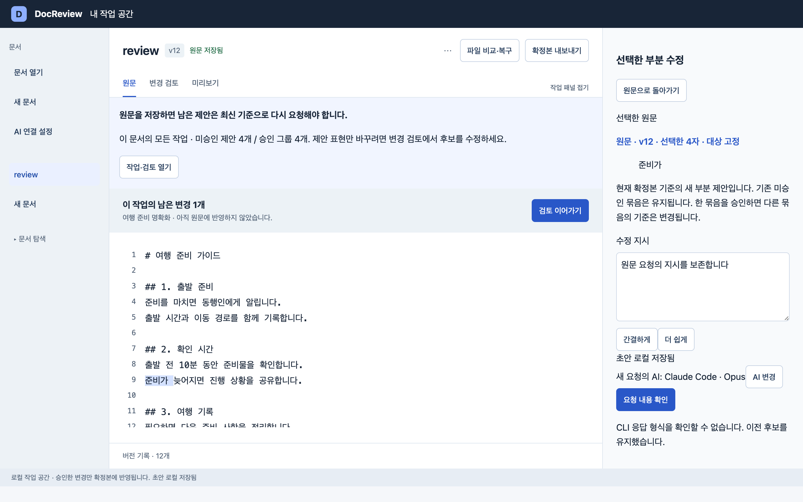

## 재현

`apps/desktop`에서 `npm run native:build:e2e` 완료 후 `npm run test:e2e -- ux`, `npm run test:e2e -- selection-popover`를 순차 실행한다. 종료 뒤 `npm run native:build`로 일반 빌드를 복원한다. 실제 사용자 DB와 계정으로 기능 테스트하지 않는다.

PNG는 각 과업의 특정 스크롤 위치다. 모든 컨트롤이 한 화면에 동시에 보인다는 뜻은 아니다. 검사 범위·합성 캡처 빌드와 설치 일반 release 빌드는 manifest에서 구분한다.
